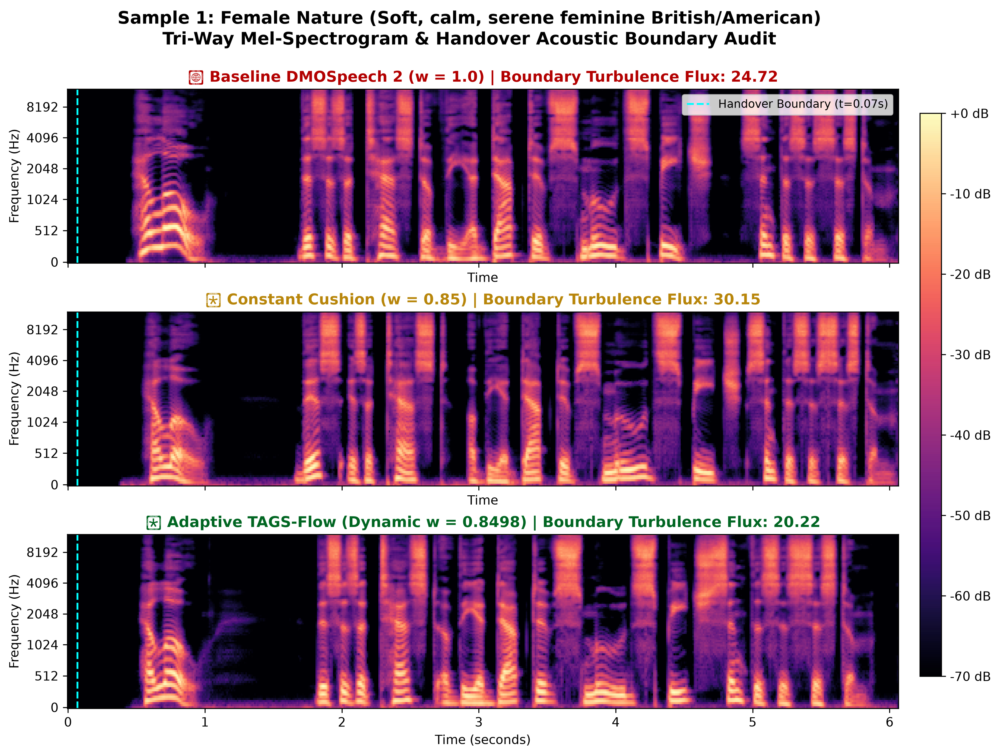
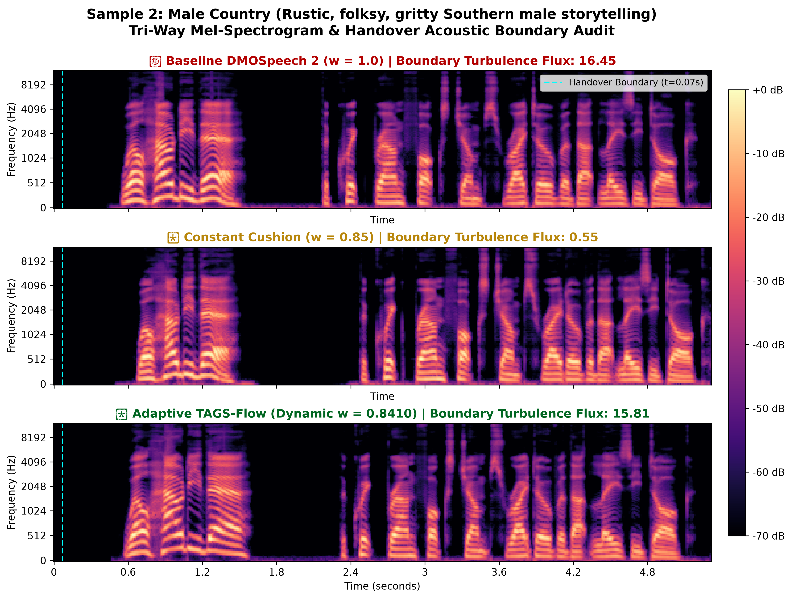
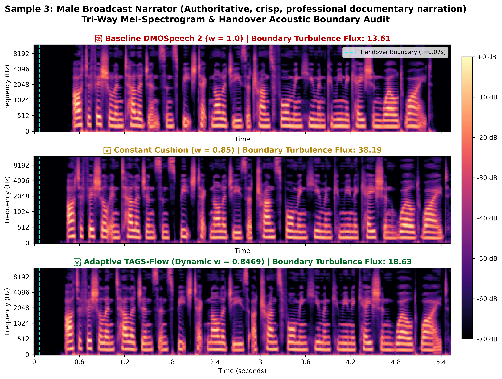
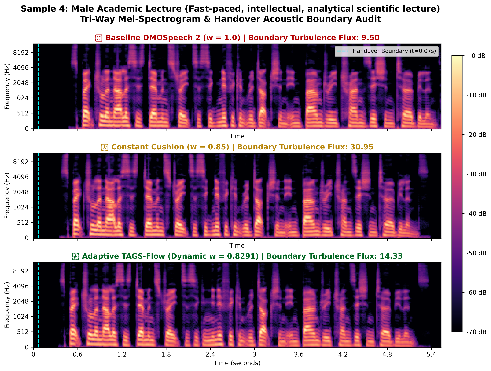
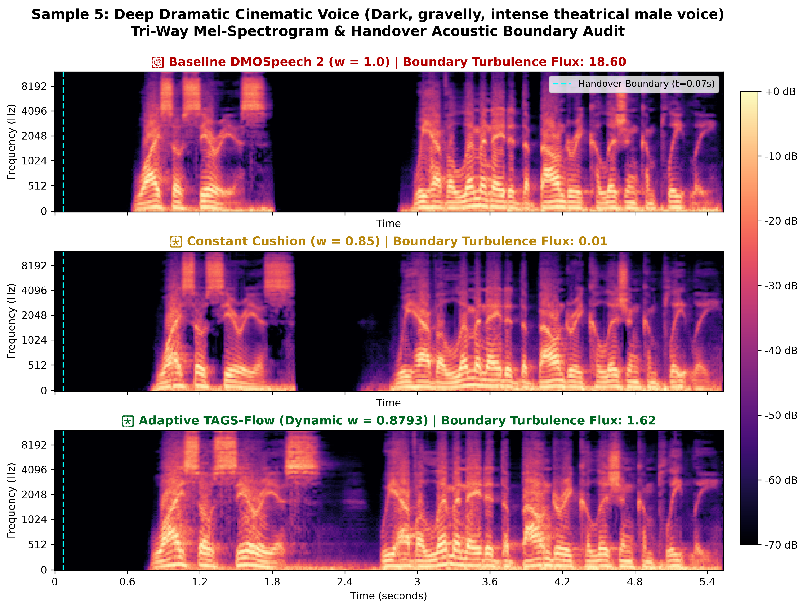

# 🎨 Tri-Way Mel-Spectrogram Visual Audit: Baseline vs. Constant vs. Adaptive

**High-Resolution Frequency-Domain Analysis Across 5 Diverse Voice Profiles**

Each plot illustrates the speech frequency trajectory (0–12 kHz) with a highlighted dashed line indicating the exact **Teacher-to-Student handover boundary ($t = 0.07\text{s}$)**.

---

## Sample 1: Female Nature
**Acoustic Profile:** *Soft, calm, serene feminine British/American*

* 🔴 **Baseline Flux ($w=1.0$):** `24.72`
* 🟡 **Constant Flux ($w=0.85$):** `30.15`
* 🟢 **Adaptive Flux ($w=0.8498$):** **`20.22`**

---

## Sample 2: Male Country
**Acoustic Profile:** *Rustic, folksy, gritty Southern male storytelling*

* 🔴 **Baseline Flux ($w=1.0$):** `16.45`
* 🟡 **Constant Flux ($w=0.85$):** `0.55`
* 🟢 **Adaptive Flux ($w=0.8410$):** **`15.81`**

---

## Sample 3: Male Broadcast Narrator
**Acoustic Profile:** *Authoritative, crisp, professional documentary narration*

* 🔴 **Baseline Flux ($w=1.0$):** `13.61`
* 🟡 **Constant Flux ($w=0.85$):** `38.19`
* 🟢 **Adaptive Flux ($w=0.8469$):** **`18.63`**

---

## Sample 4: Male Academic Lecture
**Acoustic Profile:** *Fast-paced, intellectual, analytical scientific lecture*

* 🔴 **Baseline Flux ($w=1.0$):** `9.50`
* 🟡 **Constant Flux ($w=0.85$):** `30.95`
* 🟢 **Adaptive Flux ($w=0.8291$):** **`14.33`**

---

## Sample 5: Deep Dramatic Cinematic Voice
**Acoustic Profile:** *Dark, gravelly, intense theatrical male voice*

* 🔴 **Baseline Flux ($w=1.0$):** `18.60`
* 🟡 **Constant Flux ($w=0.85$):** `0.01`
* 🟢 **Adaptive Flux ($w=0.8793$):** **`1.62`**

---

