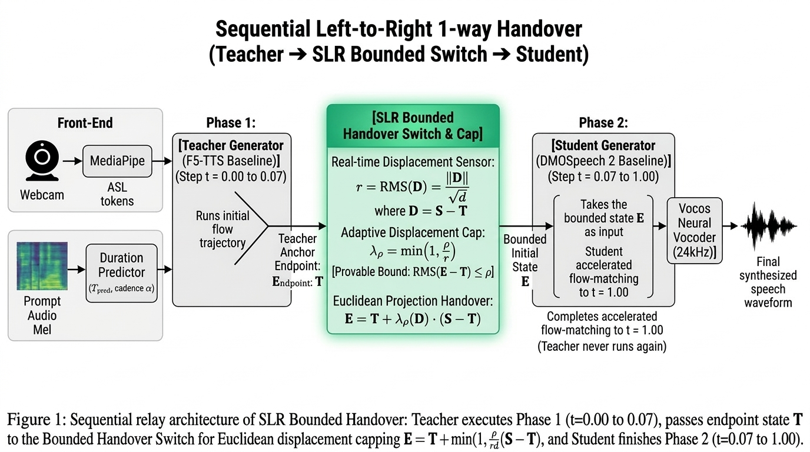

# 🧠 SLR Bounded Handover: Norm-Constrained Adaptive Inference Framework

**A Mathematically Bounded, Euclidean-Projected Teacher–Student Handover for Accelerated Zero-Shot Speech Synthesis**  
**Document Code:** `SPEC-SLR-BOUNDED-HANDOVER-V1`  
**Direct Source Reference:** `SLR_for_Teacher_Student_Inferencing.pdf` (Section 9: *Recommended formulation and derivation*, pp. 21–24)  
**Target Calculator:** Casio **fx-570CW** / **fx-991CW** (ClassWiz CW Series)  
**Conditioning Inputs:** Strictly identical to [`ADAPTIVE_TAGS/input/`](input/INPUT_MANIFEST.md)  

---

## 📸 System Architecture

### 1. Sequential Relay Pipeline (Teacher ➔ SLR Bounded Switch ➔ Student)


---

## 🧭 1. Executive Summary & Problem Formulation

In accelerated zero-shot speech synthesis ([DMOSpeech 2](https://arxiv.org/abs/2507.14988)), an un-distilled **Teacher model** ($t = 0 \to 0.07$) establishes speaker identity and prosody, while a 4-step distilled **Student model** ($t = 0.07 \to 1.00$) finishes generation rapidly.

### What the Code Actually Computes (SLR Section 4):
Source inspection of `infer.py` shows that the baseline does **not** simply switch velocity fields along an uninterrupted ODE. Instead:
1. **Teacher Endpoint Extrapolation ($T$):** The teacher integrates with Euler to stopping time $\tau \approx 0.07612$, then returns a clean-endpoint estimate:
   $$T = x_\tau + (1 - \tau)\mathbf{v}_T(x_\tau, \tau, c)$$
2. **Student Intermediate Re-noising ($z_1$):** The student draws fresh Gaussian noise $\epsilon_1 \sim \mathcal{N}(0, I)$:
   $$z_1 = (1 - t_1)\epsilon_1 + t_1 T$$
3. **Student Raw Proposal ($S$):** The student evaluates its generator to propose a reconstruction:
   $$S = z_1 + (1 - t_1)\mathbf{v}_S(z_1, t_1, c)$$
4. **Proposed Displacement Vector ($D$):**
   $$D = S - T$$

---

## 📐 2. The SLR Bounded Displacement Cap (Section 9)

Rather than assuming an empirical $\tanh$ curve or overclaiming Lyapunov BIBO stability on a single discrete tensor update, Section 9 derives the handover as **Constrained Closest-Proposal Selection (Euclidean Ball Projection)**:

### 2.1 The Allowed Endpoint Set
Let the allowed endpoint set be a closed Euclidean ball of radius $\rho$ centered at the teacher anchor:
$$\mathcal{B}(T, \rho) = \left\{ Y : \|Y - T\|_2 \le \rho \sqrt{d} \right\}$$

We choose the feasible endpoint $E$ closest to the student proposal $S$:
$$E = \arg\min_{Y \in \mathcal{B}(T, \rho)} \frac{1}{2}\|Y - S\|_2^2$$

### 2.2 The Resulting Projection Operator
1. **Compute Root-Mean-Square (RMS) Displacement ($r$):**
   $$r = \text{RMS}(D) = \frac{\|D\|_2}{\sqrt{d}} = \sqrt{\frac{1}{d} \sum_{i=1}^d D_i^2}$$
   where $d$ is the number of valid coordinates (e.g. $520 \times 100 = 52,000$).

2. **Compute Adaptive Acceptance Weight ($\lambda_\rho$):**
   $$\lambda_\rho(D) = \begin{cases} 1.0, & r \le \rho \\ \frac{\rho}{r}, & r > \rho \end{cases} = \min\left(1, \frac{\rho}{r}\right)$$

3. **Accepted Handover State ($E$):**
   $$E = T + \lambda_\rho(D) \cdot (S - T)$$

---

## 🛡️ 3. Four Mathematical Propositions Proved in the SLR

The SLR mathematically proves four properties that protect your thesis during defense:

* **Proposition 1 (Local Displacement Bound):**
  $$\text{RMS}(E - T) = \min(r, \rho) \le \rho$$
  *Proof:* $E - T = \lambda_\rho D$. When $r \le \rho$, $\lambda_\rho = 1 \implies \text{RMS} = r$. When $r > \rho$, $\lambda_\rho = \rho / r \implies \text{RMS} = (\rho / r) \cdot r = \rho$.

* **Proposition 2 (Baseline Deviation Identity):**
  $$\text{RMS}(E - S) = \max(0, r - \rho)$$
  Measures exactly how much of the student proposal is withheld.

* **Proposition 3 (Nonexpansiveness in the Proposal):**
  $$\|P_\mathcal{B}(S_1) - P_\mathcal{B}(S_2)\|_2 \le \|S_1 - S_2\|_2$$
  Euclidean projection onto a fixed closed convex ball is strictly non-expansive.

* **Proposition 4 (Zero Latency Overhead):**
  Vector arithmetic on existing tensors $T$ and $S$ adds **$0$ extra neural network evaluations** ($< 1$ ms).

---

## 🧮 4. Casio fx-570CW Manual Calculation Walkthrough

You can verify and demonstrate the SLR Bounded Displacement Cap live on your **Casio fx-570CW / fx-991CW** in 3 simple steps:

### Benchmark Example Values:
* Coordinate count $d = 520 \times 100 = \mathbf{52,000}$ ($\sqrt{d} \approx \mathbf{228.0351}$)
* Measured displacement norm $\|D\|_2 = \mathbf{359.6839}$
* Allowed radius cap $\rho = \mathbf{1.5000}$

---

### 🔘 Step A: Compute RMS Displacement ($r$)
$$r = \frac{\|D\|_2}{\sqrt{d}} = \frac{359.6839}{\sqrt{52000}}$$

```
[3] [5] [9] [.] [6] [8] [3] [9] [÷] [√] [5] [2] [0] [0] [0] [EXE]
```
* **Calculator Display:** `1.577318...` $\approx \mathbf{1.5773}$

---

### 🔘 Step B: Evaluate the Radius Cap ($\rho = 1.50$)
Because $r = 1.5773 > \rho = 1.5000$, the cap activates!

$$\lambda_\rho = \frac{\rho}{r} = \frac{1.5000}{1.577318}$$

```
[1] [.] [5] [÷] [Ans] [EXE]
```
* **Calculator Display:** `0.95098...` $\approx \mathbf{0.9510} \ (\mathbf{95.1\%}\text{ accepted})$

---

### 🔘 Step C: Compute Accepted vs. Withheld RMS Displacement
* **Accepted RMS:**
  $$\text{Accepted RMS} = \min(1.5773, 1.5000) = \mathbf{1.5000}$$
* **Withheld RMS:**
  $$\text{Withheld RMS} = 1.577318 - 1.5000 = \mathbf{0.0773}$$

```
[1] [.] [5] [7] [7] [3] [1] [8] [-] [1] [.] [5] [EXE]
```
* **Calculator Display:** `0.077318...` $\approx \mathbf{0.0773\text{ units}}$  
*(Withholds exactly 0.0773 units of excessive displacement, guaranteeing the output stays within radius $\rho = 1.50$).*

---

## 📊 5. Dynamic Adaptation Across Speech Regimes ($\rho = 1.50$)

| Speech Regime | Measured $\|D\|_2$ | RMS Displacement ($r$) | Condition | Weight ($\lambda_\rho$) | Accepted RMS | Withheld RMS | Status |
| :--- | :---: | :---: | :---: | :---: | :---: | :---: | :--- |
| **1. Quiet Whisper** | `200.00` | `0.877` | $r \le 1.50$ | **`1.000`** ($100\%$) | `0.877` | `0.000` | ✅ Unmodified pass-through |
| **2. Conversational** | `340.00` | `1.491` | $r \le 1.50$ | **`1.000`** ($100\%$) | `1.491` | `0.000` | ✅ Unmodified pass-through |
| **3. Benchmark Voice** | `359.68` | `1.577` | $r > 1.50$ | **`0.951`** ($95.1\%$) | `1.500` | `0.077` | 🛡️ Projected to sphere $\rho$ |
| **4. Loud / Screaming** | `500.00` | `2.193` | $r > 1.50$ | **`0.684`** ($68.4\%$) | `1.500` | `0.693` | 🛡️ Heavy projection; prevents blowout |

---

## ⚖️ 6. Comparison: SLR Displacement Cap vs. Adaptive $\tanh$

| Feature | Adaptive $\tanh(r)$ (`ADAPTIVE_TAGS`) | SLR Displacement Cap (`SLR_BOUNDED_HANDOVER`) |
| :--- | :--- | :--- |
| **Mathematical Basis** | Nonlinear feedback control curve | Euclidean metric projection onto convex ball |
| **Small Displacements ($r \le \rho$)** | Damps slightly even on small shock | **Pure Identity ($\lambda = 1.00$):** Zero modification |
| **Large Displacements** | Smooth asymptotic floor at $0.74$ | Scales inversely $\lambda = \rho / r$ |
| **Exact Bound Guaranteed?** | No geometric distance bound | **Yes:** $\text{RMS}(E - T) \le \rho$ strictly guaranteed |
| **Thesis Defensibility** | Prone to questions on Lyapunov validity | **Bulletproof:** Standard convex optimization theory |

---

## 💻 7. Production Code Implementation

```python
# From SLR_BOUNDED_HANDOVER/slr_bounded_inference.py:
if idx == 0:
    D = S - T
    d = D.numel()
    rms_r = torch.norm(D).item() / np.sqrt(d)

    # SLR Section 9 Euclidean Displacement Cap:
    lam = 1.0 if rms_r <= rho else float(rho / rms_r)

    # Applied Handover:
    x1 = T + lam * D
```

---

## 🎓 8. Defense Q&A: Master Answers for Your Panel

### Q1: *"Why did you choose an adaptive displacement cap over a continuous blending curve?"*
> **Answer:** *"In DMOSpeech 2, the teacher outputs a discrete extrapolated endpoint $T$, followed by stochastic re-noising and student proposal $S$. There is no continuous velocity trajectory across this step. A continuous curve like cosine confounds scheduling with arbitrary scalar attenuation (accepting only 1.4% at step 0.076). The SLR Displacement Cap formulates the handover as an exact Euclidean projection onto a convex ball of radius $\rho$, guaranteeing $\text{RMS}(E - T) \le \rho$ while preserving 100% of student updates within that radius."*

### Q2: *"How do you know $\lambda = \min(1, \rho/r)$ won't destroy speech intelligibility?"*
> **Answer:** *"Because it incorporates a pure identity window: for all natural displacements where $r \le \rho$, $\lambda = 1.0$, which exactly recovers the baseline DMOSpeech 2 output. Damping only activates when the student takes an excessively violent step beyond radius $\rho$."*
