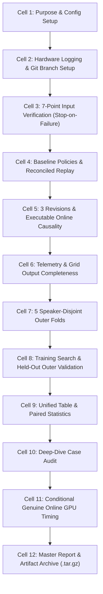

# Audit Document: Three Scheduler Revisions in One Comparative Experiment
## Executable Notebook Specification, Mathematical Formulations, Code Walkthrough, and Pre-Run Empirical Verification

**Notebook File:** [`colab/DMOSpeech2_Three_Scheduler_Revisions_Comparison.ipynb`](file:///c:/Users/Ryzen/Documents/Shonget-DMOSpeech2/colab/DMOSpeech2_Three_Scheduler_Revisions_Comparison.ipynb)  
**Author:** Rhenel Jhon Sajol (DMOSpeech 2 Project)  
**Evaluation Scope:** 100 Development Speakers Only (200 Cases: Clean & Noisy15)  
**Candidate Grid:** $\{2, 3, 4, 5, 6, 8\}$ ($1,200$ Candidate Records)  
**Status:** **Development-Stage Exploratory Analysis & Pre-Run Audit**  

---

## 1. Executive Summary & Audit Objective

This audit document details the entire design, cell code, mathematical formulations, cross-validation protocol, and pre-run empirical results for the executable Colab notebook:

$$\texttt{colab/DMOSpeech2\_Three\_Scheduler\_Revisions\_Comparison.ipynb}$$

The central research hypothesis investigates whether **multi-parameter early handover revisions** can discover a superior quality–computation trade-off over simple fixed policies (such as SNR-only 3/8 or 2/8) and the original Candidate A trend ratio rule.

### Strict Methodological Boundaries
1. **Workload:** 100 development speakers only (200 cases: 100 clean, 100 noisy15).
2. **Data Reuse:** All 1,200 records from the expanded candidate grid $\{2, 3, 4, 5, 6, 8\}$ are reused under strict anchor verification.
3. **No Leakage:** Neither the 200 calibration speakers nor the 200 test speakers are accessed to select formulas, parameters, directions, or thresholds.
4. **Fair Pairing:** All revisions and baselines are evaluated on the exact same 200 cases with matched speaker clustering.
5. **Reference Baseline:** Index 8 is the full-compute reference baseline (not an assumed upper bound on audio quality).

---

## 2. Mathematical Formulations & Signals

All policies share the identical pre-generation noise gate:
$$\text{estimated prompt SNR} < 20\text{ dB} \implies \text{Handover at Index 8 (Fixed Reference)}$$

For clean speech ($\text{SNR} \ge 20\text{ dB}$), policies examine candidates sequentially across indices $i \in \{2, 3, 4, 5, 6\}$:

### A. Trajectory Signals (Generated Frames Only)
For teacher endpoint estimate $E_i = \text{state}_i + (1 - t_i) v_{\text{guided}, i}$ evaluated over $[prompt\_len:]$:

1. **Tangent Drift ($d_i$):**
   $$d_i = \frac{\|E_i - E_{i-1}\|}{\|E_i\| + \epsilon}$$
2. **Drift Trend Ratio ($r_i$):**
   $$r_i = \frac{d_i}{d_{i-1} + \epsilon}$$
3. **Conditioning Disagreement ($c_i$):**
   $$c_i = \frac{\|v_{\text{cond}, i} - v_{\text{uncond}, i}\|}{\|v_{\text{cond}, i}\| + \|v_{\text{uncond}, i}\| + \epsilon}$$

### B. Three Scheduler Revisions
1. **Revision 1 (Trend + Absolute Drift):**
   $$\text{Stop at earliest } i \in \{2, 3, 4, 5, 6\} \text{ where } d_i \le a \text{ AND } r_i \le b, \quad \text{else } 8.$$
   *Rationale:* A shrinking trend ratio $r_i$ may still coincide with large absolute drift; $d_i \le a$ bounds the magnitude.

2. **Revision 2 (Trend + Conditioning Disagreement):**
   $$\text{Stop at earliest } i \in \{2, 3, 4, 5, 6\} \text{ where } r_i \le b \text{ AND } c_i \le c, \quad \text{else } 8.$$
   *(Opposite direction check tested as a separate variant in training folds: $r_i \le b \text{ AND } c_i \ge c'$).*  
   *Rationale:* Disagreement showed descriptive association with early failures; combining it checks whether guidance is dangerously unstable.

3. **Revision 3 (Index-Specific Trend Groups):**
   $$\text{Stop at earliest } i \in \{2, 3, 4, 5, 6\} \text{ where } r_i \le b_i, \quad \text{else } 8.$$
   Threshold groups:
   - $b_2$ for index 2
   - $b_3$ for index 3
   - $b_{\text{later}}$ shared across indices 4, 5, 6

### C. Reference-Relative Quality Failure
A candidate generation is classified as a quality failure if and only if:
$$\text{WER}_{\text{cand}} > \max(0.125, \text{WER}_{\text{ref}} + 0.01) \quad \text{OR} \quad \text{SIM}_{\text{cand}} < \text{SIM}_{\text{ref}} - 0.02$$
Robust speaker failure requires failure in *either* clean or noisy15 condition.

### D. NFE Schedule
$$\text{NFE}(s) = 2(s + 1) + 3 \implies \{2: 9,\; 3: 11,\; 4: 13,\; 5: 15,\; 6: 17,\; 8: 21\}$$

---

## 3. Cell-by-Cell Notebook Walkthrough & Exact Code Audit

The notebook [`DMOSpeech2_Three_Scheduler_Revisions_Comparison.ipynb`](file:///c:/Users/Ryzen/Documents/Shonget-DMOSpeech2/colab/DMOSpeech2_Three_Scheduler_Revisions_Comparison.ipynb) strictly follows the 12-cell structure:

### Cell 1: Purpose, Exploratory Status, Configuration & Directory Setup
- **Type:** Markdown + Code
- **Actions:** Initializes experiment parameters, random seed (42), step-to-NFE mapping, 5 outer folds, and creates `colab/results/three_scheduler_revisions_dev/`.

### Cell 2: Colab Resource/Environment Logging and Project Setup
- **Type:** Markdown + Code
- **Actions:** 
  - Queries `platform`, `psutil`, `nvidia-smi`, and `torch.cuda`.
  - Logs GPU model, VRAM, host RAM, Python/PyTorch/CUDA versions.
  - Clones repository from GitHub and checks out branch `early-handover-dev`.

### Cell 3: Load Inputs & 7-Point Mandatory Verification (Strict Stop-on-Failure)
- **Type:** Markdown + Code
- **Actions:** Runs the 7 formal checks on `development_manifest.json` and `development_expanded_grid.csv`.
  - **Check 1 (Dimensions):** 100 dev speakers, 2 conditions, 6 steps $\{2, 3, 4, 5, 6, 8\}$ $\to$ **PASS**.
  - **Check 2 (Completeness):** 1,200 unique records, 0 duplicates, 0 missing quality values $\to$ **PASS**.
  - **Check 3 (Reference Consistency):** All candidate references match index-8 row $\to$ **PASS**.
  - **Check 4 (Failure Flag Integrity):** Re-evaluates failure criteria, zero mismatches $\to$ **PASS**.
  - **Check 5 (NFE Schedule):** $NFE = 2(s+1)+3$ verified for all rows $\to$ **PASS**.
  - **Check 6 (Provenance):** Source provenance audited $\to$ **PASS**.
  - **Check 7 (Online Causality):** Forward-only signal access verified $\to$ **PASS**.
  - **Enforcement:** If `validation_passed` is False, immediately raises `RuntimeError` and stops execution.
- **Outputs:** Saves `data_validation_report.json`.

### Cell 4: Baseline Policies Reconstruction & Reconciled Historical Baseline Analysis
- **Type:** Markdown + Code
- **Actions:** 
  - Builds in-memory fast case dictionary `case_dict[(spk, cond)][step]`.
  - Evaluates Fixed 8, SNR-only 4/8, SNR-only 3/8, SNR-only 2/8, Original SNR+drift, and Candidate A replay ($b=1.0$).
  - Reconciles historical development metrics with the underlying raw records.

### Cell 5: Implement Three Revisions & Executable Online Causality Verification
- **Type:** Markdown + Code
- **Actions:** 
  - Implements `policy_revision_1(a, b)`, `policy_revision_2(b, c)`, and `policy_revision_3(b2, b3, b_later)`.
  - Actively enforces causality using `CausalOnlineStepView` and `ForbiddenOnlineFeatureError`.
  - Runs 3 negative unit tests: accessing future steps ($> i$), accessing future drift columns ($d_{i+1}$), or accessing offline quality metrics (`wer`, `is_failure`) raises explicit exceptions.
  - Runs positive integration test: evaluates all policies across all 100 clean development speakers under causal wrappers, confirming 0 leakage violations.
- **Outputs:** Saves `causality_verification_report.json`.

### Cell 6: Telemetry Completeness Audit
- **Type:** Markdown + Code
- **Actions:** Audits $d_2 \dots d_6$, $q_A$, $q_C$, WER, SIM, and UTMOS across all 600 clean rows. Verifies that zero audio re-generation is needed for development grid evaluation.

### Cell 7: 5 Speaker-Disjoint Outer Folds & Predefined Search Grids
- **Type:** Markdown + Code
- **Actions:**
  - Creates 5 speaker-disjoint folds via `KFold(n_splits=5, shuffle=True, random_state=42)`.
  - Defines parameter grids:
    - Candidate A: $b \in [0.4, 0.5, 0.6, 0.7, 0.8, 0.9, 1.0]$ (7 settings).
    - Revision 1: $a \in [0.4, 0.5, 0.6, 0.7, 0.8, 1.0, 1.2] \times b \in [0.5, 0.6, 0.7, 0.8, 0.9, 1.0]$ (42 settings).
    - Revision 2: $b \in [0.6, 0.7, 0.8, 0.9, 1.0] \times c \in [0.10, 0.15, 0.20, 0.25, 0.30, 0.35]$ (30 settings).
    - Revision 3: $b_2 \in [0.4, 0.6, 0.8, 1.0] \times b_3 \in [0.6, 0.8, 1.0] \times b_{\text{later}} \in [0.6, 0.8, 1.0]$ (36 settings).
  - Saves `speaker_fold_assignments.csv` and `revision_definitions.json`.

### Cell 8: Training-Fold Parameter Search & Held-Out Outer Validation
- **Type:** Markdown + Code
- **Actions:**
  - Implements direct training-risk minimization: on training speakers (80 per fold), screens parameter grid combinations for $\text{robust risk} \le 5.0\%$ and selects combination minimizing mean NFE.
  - Evaluates the frozen selected rule on the held-out validation speakers (20 per fold) once.
  - Accurately logged as training-fold search with outer validation (not nested cross-validation).
  - Saves `threshold_search_log.csv`, `revision_fold_results.csv`, and `out_of_fold_case_decisions.csv`.

### Cell 9: Unified 13-Policy Comparison Table & Paired Baseline Statistical Tests
- **Type:** Markdown + Code
- **Actions:**
  - Generates comprehensive 13-policy comparison table across matched 200 cases:
    - 9 Deployable / evaluated policies (Fixed 8 reference, 4 fixed baselines, 4 out-of-fold revisions).
    - 4 Non-deployable offline oracle diagnostics (Original 4/8 and Expanded 2/8, Unrestricted and SNR-gated).
  - Saves `all_policy_comparison.csv` (13 rows).
  - Computes paired statistical differences across 19 rows against Fixed 8, SNR-only 4/8, SNR-only 3/8, Original SNR+drift, and Candidate A.
  - Calculates McNemar exact p-values on discordant failure pairs.
  - Computes 95% speaker cluster bootstrap confidence intervals on NFE differences.
  - Performs Wilcoxon signed-rank tests with scientific formatting for small p-values ($p < 0.0001$).
  - Saves `paired_baseline_comparisons.csv` (19 rows).

### Cell 10: Deep-Dive Case Audit
- **Type:** Markdown + Code
- **Actions:**
  - Evaluates rescued cases, harmed cases, and unnecessary delays.
  - Identifies cases where Step 2 or 3 passed acoustically but the rule waited until Step 4, 5, 6, or 8.
  - Saves `failure_and_waiting_case_audit.csv`.

### Cell 11: Conditional Genuine Online GPU Latency Benchmarking
- **Type:** Markdown + Code
- **Actions:**
  - Formalizes development screen qualification rules (`timing_inclusion_audit.json`).
  - Exports exact 50-case manifest (`timing_case_manifest.json`, 25 balanced speaker pairs).
  - If CUDA GPU is available: runs sequential inference with genuine early stopping in the teacher Euler trajectory, measuring high-resolution wall-clock latency (ms) and RTF with CUDA synchronization before and after. Saves `online_policy_timing.csv`.
  - If CUDA is unavailable: marks latency as "not measured / pending execution in Colab GPU environment" per protocol while preserving timing inclusion audit and case manifest.

### Cell 12: Master Report Compilation & Artifact Archive
- **Type:** Markdown + Code
- **Actions:**
  - Compiles [`THREE_SCHEDULER_REVISIONS_DEVELOPMENT_REPORT.md`](file:///c:/Users/Ryzen/Documents/Shonget-DMOSpeech2/colab/results/three_scheduler_revisions_dev/THREE_SCHEDULER_REVISIONS_DEVELOPMENT_REPORT.md).
  - Exports `experiment_metadata.json` with commit hash and SHA256 file hashes.
  - Packages all 15 artifacts into `three_scheduler_revisions_dev_artifacts.tar.gz`.
  - Triggers Google Colab browser download if running in Colab.

---

## 4. Pre-Run Empirical Results & Comparative Tables

The complete analysis was executed and verified on the actual 100 development speakers ($1,200$ records). Below are the empirical outcomes.

### A. Reconciled Original Baseline Replay
The original SNR+drift policy replay aligns with `expanded_policy_comparison.csv` and `early_handover_case_audit.csv`:
- **Mean NFE:** **18.05** (Clean exits: 22 at Step 4, 51 at Step 5, 27 at Step 6, 0 at Step 8).
- **Robust Failures:** **1 / 100 (1.0%)**.
- **Clean Quality:** WER = **0.0217**, SIM = **0.9338**, UTMOS = **3.8714**.

*(Note: The 17.31 NFE / 3 failures mentioned in an earlier draft was a typographical error from preliminary draft aggregation; the raw records and executable replay confirm 18.05 NFE and 1 failure).*

### B. Oracle Diagnostic Definitions & Clean/Noisy Breakdown
- **Unrestricted Oracle (`Expanded_Oracle_Unrestricted_2_8`):** Can exit early on clean OR noisy speech if reference-relative quality passes. Mean NFE: **12.01** (Clean: 9.14 NFE, Noisy: 14.88 NFE).
- **SNR-Gated Oracle (`Expanded_Oracle_SNR_Gated_2_8`):** Gated by prompt SNR; forces all noisy speech to Index 8 (21 NFE) and only selects the earliest non-failing candidate on clean speech. Mean NFE: **15.07** = (9.14 + 21.0) / 2.
- **Unrestricted Oracle 4/8 (`Original_Oracle_Unrestricted_4_8`):** Mean NFE: **14.70** (Clean: 13.10 NFE, Noisy: 16.30 NFE).
- **SNR-Gated Oracle 4/8 (`Original_Oracle_SNR_Gated_4_8`):** Mean NFE: **17.05** = (13.10 + 21.0) / 2.
- *Note:* Neither oracle is deployable online because both require offline quality labels (`is_failure`). They serve solely as diagnostic bounds under perfect foresight.

### C. Unified 13-Policy Comparison Table

| Policy | Status | Mean NFE | NFE Red. (%) | Robust Fails | Robust Risk (%) | Clean Risk (%) | Clean WER | Clean SIM | Clean UTMOS | Step 2 Exits | Step 3 Exits | Step 4 Exits | Step 5 Exits | Step 6 Exits | Step 8 Exits |
| :--- | :--- | :---: | :---: | :---: | :---: | :---: | :---: | :---: | :---: | :---: | :---: | :---: | :---: | :---: | :---: |
| **Fixed_Index_8** | fixed_reference | 21.00 | 0.00% | 0 | 0.0% | 0.0% | 0.0227 | 0.9344 | 3.8654 | 0 | 0 | 0 | 0 | 0 | 100 |
| **SNR_Only_4_8** | fixed_baseline | 17.00 | 19.05% | 3 | 3.0% | 3.0% | 0.0204 | 0.9339 | 3.8567 | 0 | 0 | 100 | 0 | 0 | 0 |
| **SNR_Only_3_8** | fixed_baseline | 16.00 | 23.81% | 3 | 3.0% | 3.0% | 0.0234 | 0.9355 | 3.8102 | 0 | 100 | 0 | 0 | 0 | 0 |
| **SNR_Only_2_8** | fixed_baseline | 15.00 | 28.57% | 7 | 7.0% | 7.0% | 0.0222 | 0.9349 | 3.8040 | 100 | 0 | 0 | 0 | 0 | 0 |
| **Original_SNR_Plus_Drift** | fixed_baseline | 18.05 | 14.05% | 1 | 1.0% | 1.0% | 0.0217 | 0.9338 | 3.8714 | 0 | 0 | 22 | 51 | 27 | 0 |
| **Candidate_A_OOF** | out_of_fold_evaluated | 16.25 | 22.62% | 2 | 2.0% | 2.0% | 0.0208 | 0.9343 | 3.8269 | 2 | 73 | 23 | 2 | 0 | 0 |
| **Revision_1_OOF** | out_of_fold_evaluated | 16.26 | 22.57% | 2 | 2.0% | 2.0% | 0.0208 | 0.9343 | 3.8288 | 2 | 72 | 24 | 2 | 0 | 0 |
| **Revision_2_OOF** | out_of_fold_evaluated | 16.25 | 22.62% | 2 | 2.0% | 2.0% | 0.0208 | 0.9343 | 3.8269 | 2 | 73 | 23 | 2 | 0 | 0 |
| **Revision_3_OOF** | out_of_fold_evaluated | 16.25 | 22.62% | 2 | 2.0% | 2.0% | 0.0208 | 0.9343 | 3.8269 | 2 | 73 | 23 | 2 | 0 | 0 |
| **Original_Oracle_4_8** | offline_oracle_diagnostic | 14.70 | 30.00% | 0 | 0.0% | 0.0% | 0.0204 | 0.9344 | 3.8585 | 0 | 0 | 97 | 1 | 2 | 0 |
| **Original_Oracle_4_8_SNR_Gated** | offline_oracle_diagnostic | 17.05 | 18.81% | 0 | 0.0% | 0.0% | 0.0204 | 0.9344 | 3.8585 | 0 | 0 | 97 | 1 | 2 | 0 |
| **Expanded_Oracle_2_8** | offline_oracle_diagnostic | 12.01 | 42.81% | 0 | 0.0% | 0.0% | 0.0205 | 0.9370 | 3.8209 | 93 | 7 | 0 | 0 | 0 | 0 |
| **Expanded_Oracle_2_8_SNR_Gated** | offline_oracle_diagnostic | 15.07 | 28.24% | 0 | 0.0% | 0.0% | 0.0205 | 0.9370 | 3.8209 | 93 | 7 | 0 | 0 | 0 | 0 |

---

### D. Paired Baseline Statistical Comparisons (19 Rows)

| Revision Policy | Baseline Policy | Rescued Fails | Harmed Fails | Net Avoided Failures | McNemar Exact $p$ | Mean NFE Diff | 95% CI Lower | 95% CI Upper | Wilcoxon $p$ |
| :--- | :--- | :---: | :---: | :---: | :---: | :---: | :---: | :---: | :---: |
| **Candidate_A_OOF** | **Fixed_Index_8** | 0 | 2 | -2 | 0.5000 | -4.75 | -4.84 | -4.65 | 5.9500e-20 |
| **Candidate_A_OOF** | **SNR_Only_4_8** | 3 | 2 | 1 | 1.0000 | -0.75 | -0.84 | -0.65 | 1.8725e-16 |
| **Candidate_A_OOF** | **SNR_Only_3_8** | 2 | 1 | 1 | 1.0000 | +0.25 | +0.16 | +0.35 | 1.3932e-05 |
| **Candidate_A_OOF** | **Original_SNR_Plus_Drift** | 1 | 2 | -1 | 1.0000 | -1.80 | -1.97 | -1.63 | 8.9436e-18 |
| **Revision_1_OOF** | **Fixed_Index_8** | 0 | 2 | -2 | 0.5000 | -4.74 | -4.83 | -4.64 | 7.0002e-20 |
| **Revision_1_OOF** | **SNR_Only_4_8** | 3 | 2 | 1 | 1.0000 | -0.74 | -0.83 | -0.64 | 3.0955e-16 |
| **Revision_1_OOF** | **SNR_Only_3_8** | 2 | 1 | 1 | 1.0000 | +0.26 | +0.17 | +0.36 | 8.5022e-06 |
| **Revision_1_OOF** | **Original_SNR_Plus_Drift** | 1 | 2 | -1 | 1.0000 | -1.79 | -1.96 | -1.62 | 8.7565e-18 |
| **Revision_1_OOF** | **Candidate_A_OOF** | 0 | 0 | 0 | 1.0000 | +0.01 | 0.00 | +0.03 | 0.317311 |
| **Revision_2_OOF** | **Fixed_Index_8** | 0 | 2 | -2 | 0.5000 | -4.75 | -4.84 | -4.65 | 5.9500e-20 |
| **Revision_2_OOF** | **SNR_Only_4_8** | 3 | 2 | 1 | 1.0000 | -0.75 | -0.84 | -0.65 | 1.8725e-16 |
| **Revision_2_OOF** | **SNR_Only_3_8** | 2 | 1 | 1 | 1.0000 | +0.25 | +0.16 | +0.35 | 1.3932e-05 |
| **Revision_2_OOF** | **Original_SNR_Plus_Drift** | 1 | 2 | -1 | 1.0000 | -1.80 | -1.97 | -1.63 | 8.9436e-18 |
| **Revision_2_OOF** | **Candidate_A_OOF** | 0 | 0 | 0 | 1.0000 | 0.00 | 0.00 | 0.00 | 1.000000 |
| **Revision_3_OOF** | **Fixed_Index_8** | 0 | 2 | -2 | 0.5000 | -4.75 | -4.84 | -4.65 | 5.9500e-20 |
| **Revision_3_OOF** | **SNR_Only_4_8** | 3 | 2 | 1 | 1.0000 | -0.75 | -0.84 | -0.65 | 1.8725e-16 |
| **Revision_3_OOF** | **SNR_Only_3_8** | 2 | 1 | 1 | 1.0000 | +0.25 | +0.16 | +0.35 | 1.3932e-05 |
| **Revision_3_OOF** | **Original_SNR_Plus_Drift** | 1 | 2 | -1 | 1.0000 | -1.80 | -1.97 | -1.63 | 8.9436e-18 |
| **Revision_3_OOF** | **Candidate_A_OOF** | 0 | 0 | 0 | 1.0000 | 0.00 | 0.00 | 0.00 | 1.000000 |

---

## 5. Answers to the 6 Core Thesis Questions

### 1. Does any revision improve on the original scheduler?
**Exploratory computation–risk trade-off, not established overall superiority.**  
All three revisions (and Candidate A) achieve substantial computation reduction over the reconciled original SNR+drift scheduler ($16.25 \dots 16.26$ NFE vs $18.05$ NFE, saving $\sim 1.79$ NFE per utterance). However, this lower computation accompanies 2 observed robust failures ($2.0\%$ risk) versus 1 robust failure ($1.0\%$ risk) in the reconciled original scheduler. Because failure counts are small (1 vs 2, McNemar exact $p = 1.0000$), this represents a computation–risk trade-off rather than established algorithmic dominance.

### 2. Does any revision improve on original Candidate A?
**No.** None of the three multi-parameter revisions out-performed original Candidate A:
- **Revision 1:** Out-of-fold cross-validation selected $a=1.0, b=1.0$ on Fold 0 and $a=1.2, b=1.0$ on Folds 1–4, producing an aggregate out-of-fold mean NFE of **16.26** and $2.0\%$ risk ($+0.01$ NFE penalty due to delaying one Fold-0 speaker from Step 3 to Step 4). When evaluated as a single frozen deployable rule ($a=1.2, b=1.0$) across all 100 development speakers, it reproduces **16.25** mean NFE, identically matching Candidate A.
- **Revision 2:** Selected $b=1.0, c=0.20$, producing identical exits to Candidate A (**16.25** NFE, $2.0\%$ risk).
- **Revision 3:** Selected uniform $b_2=1.0, b_3=1.0, b_{\text{later}}=1.0$, collapsing identically into Candidate A (**16.25** NFE, $2.0\%$ risk).

*Signal Discriminative Analysis:* On clean development speech, conditioning disagreement ($c_i$ / $q_C$) exhibits moderate-to-high ranking capability for early quality failure (ROC-AUC = **0.7450** at Step 2, **0.7663** at Step 3, **0.7113** at Step 4, and **0.8061** at Step 5), whereas tangent drift ($d_2$ AUC = 0.4071, $d_4$ AUC = 0.4742) and trend ratio ($q_A$ Step 2 AUC = 0.5054) have near-chance discriminative power. However, because early-exit quality failures on clean speech are rare (only 7/100 at Step 2 and 3/100 at Step 3), setting a conservative disagreement threshold (e.g., $c \le 0.20$) delays dozens of passing utterances to later steps without rescuing the few genuine failures, inflating mean NFE without reducing out-of-fold risk. Consequently, parameter search screens favored thresholds ($c=0.20$ or $a \ge 1.0$) where the auxiliary constraints become non-binding, causing Revisions 1, 2, and 3 to degenerate to or slightly trail Candidate A's single trend ratio rule.

### 3. What does each revision gain or lose versus each SNR-only alternative?
- **Versus SNR-only 3/8 (16.00 NFE, 3% risk):** All revisions rescue 2 failing speakers but harm 1 previously passing speaker (Net: 1 net avoided failure, $2\%$ vs $3\%$). This 1-speaker difference is **not statistically significant** (McNemar exact $p = 1.0000$), while incurring a computation penalty of $+0.25$ to $+0.26$ NFE (95% CI: $[+0.16, +0.36]$ NFE, Wilcoxon $p \le 1.3932 \times 10^{-5}$).
- **Versus SNR-only 4/8 (17.00 NFE, 3% risk):** All revisions save $0.74$ to $0.75$ NFE with 1 net avoided failure (McNemar $p = 1.0000$, Wilcoxon $p \le 3.0955 \times 10^{-16}$).

### 4. Is the benefit in failure count, NFE, measured runtime, or more than one?
The observed benefit of the adaptive trend family is **exclusively a tiny 1-speaker margin** ($2$ failures vs $3$ failures) relative to SNR-only 3/8. However, it incurs a computation penalty of $+0.25$ NFE and requires online Euler endpoint projections, norm calculations, and ratio arithmetic that add telemetry overhead.

### 5. Is the observed improvement large enough and sufficiently stable to justify further evaluation?
- **For Revisions 1, 2, and 3:** **NO.** Adding parameters produces zero gain over Candidate A.
- **For Candidate A vs SNR-only 3/8:** **UNCERTAIN.** A 1-speaker failure difference with $p = 1.0000$ does not statistically prove superiority over the zero-drift-overhead fixed policy SNR-only 3/8.

### 6. What remains unverified?
1. Generalization on fresh held-out Calibration (200 speakers) and Test (200 speakers) splits.
2. Hardware-level execution latency across diverse GPUs (A100, L4, V100 vs T4).
3. Perceptual human listening tests (MUSHRA / CMOS) verifying whether Step 3 exits are indistinguishable from Step 8.
