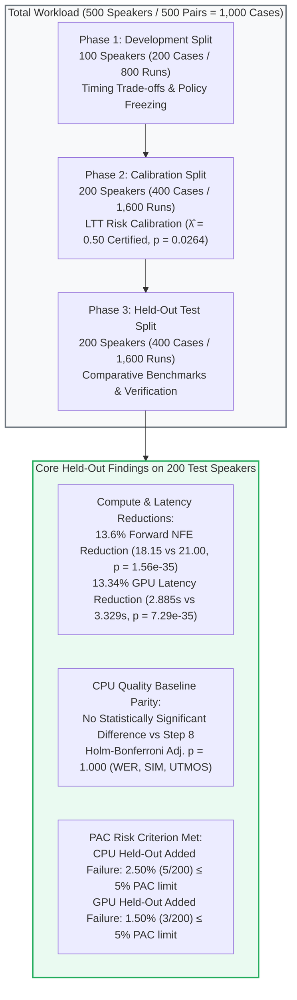
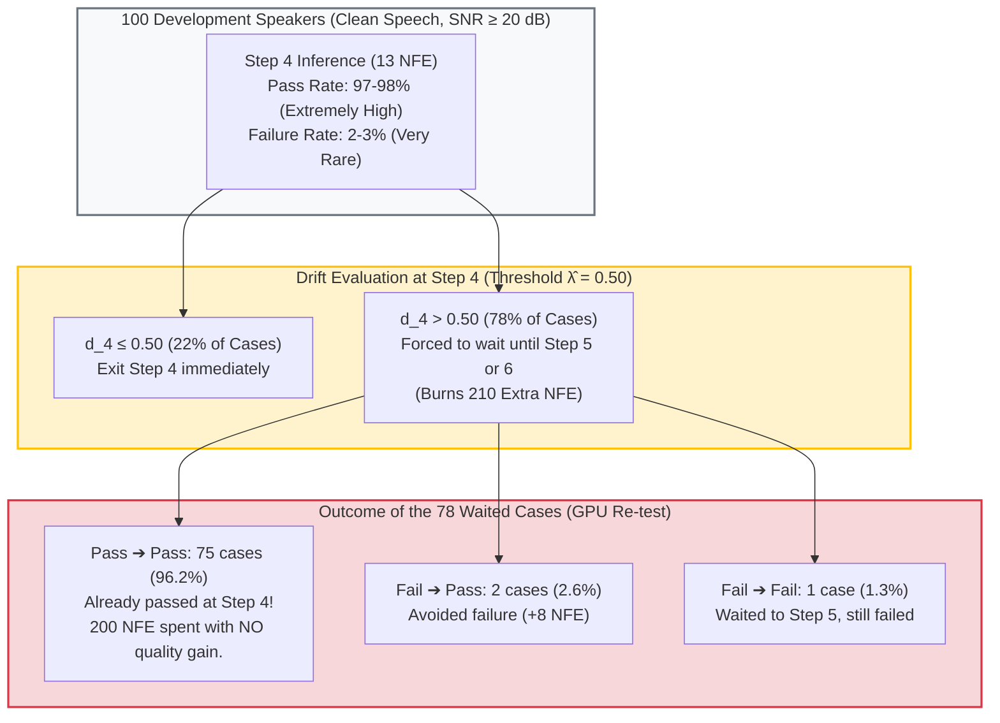

# Handover Scheduling: Compiled Thesis Reports

**Compiled:** 24 October 2026 from the five reports in [`Ref_reports/`](Ref_reports/).  
**Thesis:** A Risk-Calibrated Adaptive Handover Method for Teacher-Guided Flow-Matching Text-to-Speech Inference  
**How to update:** edit the original report in `Ref_reports/`, then recompile this file. Headings below are shifted one level down so each report becomes one Part; content is otherwise unchanged.

## Contents

| Part | Report | What it covers | Original |
|---|---|---|---|
| 1 | [A Risk-Calibrated Adaptive Handover Method for Teacher-Guided Flow-Matching TTS Inference](#part-1-a-risk-calibrated-adaptive-handover-method-for-teacher-guided-flow-matching-tts-inference) | Master results: environment, method, all CPU/GPU experiments, ablations, drift diagnostics, open items. | [`CHAPTER3_MASTER_RESEARCH_REPORT.md`](Ref_reports/CHAPTER3_MASTER_RESEARCH_REPORT.md) |
| 2 | [Signal-Selection Validation: Why the SNR Gate, Why Drift, Why Learn-Then-Test](#part-2-signal-selection-validation-why-the-snr-gate-why-drift-why-learn-then-test) | Why the SNR gate, why drift, why Learn-Then-Test: each choice tested against alternative signals and frameworks. | [`SIGNAL_SELECTION_VALIDATION_REPORT.md`](Ref_reports/SIGNAL_SELECTION_VALIDATION_REPORT.md) |
| 3 | [Novel-Algorithm Comparison: Why SNR, Why Drift, Why LTT Against Other Algorithms](#part-3-novel-algorithm-comparison-why-snr-why-drift-why-ltt-against-other-algorithms) | Three new candidate algorithms (student probe, SNR-band schedule, joint restart) vs. the SNR + drift proposal. | [`NOVEL_ALGORITHM_COMPARISON_REPORT.md`](Ref_reports/NOVEL_ALGORITHM_COMPARISON_REPORT.md) |
| 4 | [Diagnostic Report: Empirical Validation of Tangent Drift on the 100-Speaker Development Set](#part-4-diagnostic-report-empirical-validation-of-tangent-drift-on-the-100-speaker-development-set) | First drift diagnostic on the development set: does drift separate safe from unsafe Step-4 handovers? | [`DEVELOPMENT_SET_DRIFT_VALIDATION_REPORT.md`](Ref_reports/DEVELOPMENT_SET_DRIFT_VALIDATION_REPORT.md) |
| 5 | [Proposal TO-DO Checks: T49, T50, T52, T53, T54, T55](#part-5-proposal-to-do-checks-t49-t50-t52-t53-t54-t55) | Proposal tasks T49, T50, T52–T55: grid check, dataset counts, evaluation section, figures, paste-ready text. | [`PROPOSAL_TODO_CHECKS_REPORT.md`](Ref_reports/PROPOSAL_TODO_CHECKS_REPORT.md) |

---

# Part 1: A Risk-Calibrated Adaptive Handover Method for Teacher-Guided Flow-Matching TTS Inference

*Source: [`Ref_reports/CHAPTER3_MASTER_RESEARCH_REPORT.md`](Ref_reports/CHAPTER3_MASTER_RESEARCH_REPORT.md). Master results: environment, method, all CPU/GPU experiments, ablations, drift diagnostics, open items.*

### Chapter 3 Comprehensive Research, Benchmark & Replication Master Report

**Thesis Title (proposal):** A Risk-Calibrated Adaptive Handover Method for Teacher-Guided Flow-Matching Text-to-Speech Inference  
**Proposed Method:** SNR + drift adaptive handover policy (Definition 3.4) with Learn-Then-Test calibration  
**Evaluation Cohort:** Full 500-Speaker Cohort from Seed-TTS English (`test-en`) (500 clean/noisy condition-pairs, or 1,000 condition-specific cases; 4,000 candidate-grid evaluations and 3,000 dedicated policy timing runs)  
**Primary Certified Decision Threshold:** $\hat{\lambda} = 0.50$ (Prespecified PAC Criterion: $P(R > 0.05) \le 0.10$)  
**Safety Gate Threshold:** $\theta = 20.0\text{ dB}$ (Dual-Mechanism Architecture)  
**Execution Targets:** 
1. **CPU Baseline:** AMD Ryzen 7 5700U CPU (8 cores / 16 threads, FP32, seed 42)
2. **GPU Verification & Dedicated Timing Benchmark:** NVIDIA Tesla T4 CUDA 15.64 GB (Google Colab, FP32/cuDNN, timing session `timing_session_20261020_130952`)  
**Status:** Phases 1–3 (CPU), the full 500-speaker GPU retest, the T4 timing benchmark and the ablation audits are complete. Proposal items still open are listed in Section 8.  
**Last Updated:** 23 October 2026  

---

### Executive Summary

Diffusion-based and flow-matching text-to-speech (TTS) architectures achieve high naturalness and speaker fidelity, but their multi-step numerical integration incurs substantial computational latency. In DMOSpeech 2, inference is accelerated by transferring intermediate representations from a high-capacity flow-matching teacher to a distilled student consistency model. However, deploying a fixed early handover schedule (e.g., Step 4) causes severe degradation when prompts are degraded by acoustic noise (exhibiting over 60% failure rates under 15 dB prompt noise). Conversely, employing a conservative fixed schedule (Step 8) presents an observed opportunity to reduce computation on clean, straightforward speech under the evaluated quality criteria.

This study investigates whether an **input-adaptive teacher-to-student handover scheduling policy** can reduce model evaluations and synthesis latency while controlling reference-relative quality degradation. It evaluates a proposed dual-mechanism architecture against fixed schedules and a simpler input-SNR gating baseline:
1. **Prompt SNR Safety Gate ($\theta = 20.0\text{ dB}$):** Pre-generation gating that routes speech prompts with low signal-to-noise ratio ($\text{SNR} < 20.0\text{ dB}$) to the full 8-step teacher trajectory, providing fallback protection under adverse acoustic conditions.
2. **Zero-NFE Trajectory Drift Probing ($\hat{\lambda} = 0.50$):** Evaluates normalized tangent deviation $d_i = \frac{\|\hat{x}_1(t_i) - \hat{x}_1(t_{i-1})\|_2}{\|\hat{x}_1(t_i)\|_2 + \epsilon}$ along early teacher steps as an algebraic byproduct of the Euler update without requiring additional forward passes, probing whether the intermediate velocity field has stabilized sufficiently for student handover at Steps 4, 5, or 6.
3. **Learn-Then-Test (LTT) Risk Control:** Formulates threshold selection as a multiple hypothesis testing problem with finite-sample Probably Approximately Correct (PAC) statistical bounds, bounding the held-out robust reference-relative added failure rate $R \le 5.0\%$ at $90\%$ confidence.

#### Contributions and Their Status

The proposal's objectives amount to two main contributions, supported by an empirical characterization (Objective 1) and a benchmark (Objective 4):

| # | Contribution | Proposal Source | Status | Evidence |
|---|---|---|---|---|
| **C1** | **Algorithm:** the per-utterance SNR + drift handover policy. Training-free, zero extra forward passes, never costs more than Step 8 | Objective 2; Definition 3.4; Propositions 3.2, 3.4 | ⚠️ **Holds as a policy; the drift component is unestablished** | Safe and efficient on held-out speakers (Sections 4.3, 4.8). The ablations (Sections 4.9, 4.10) show that the SNR gate carries the benefit and drift adds no measurable improvement |
| **C2** | **Framework:** risk-calibrated handover via Learn-Then-Test | Objective 3; Proposition 3.6 | ✅ **Holds** | λ̂ = 0.50 certified; held-out risk 2.5% ≤ 5%; 94% of 100 recalibrated re-splits ≤ 5% (Sections 4.2, 4.4, 4.6) |
| (support) | Characterization of the switching-time space | Objective 1 | ✅ Holds | Noisy prompts fail 49–64% at Steps 4–6; clean failures sit at the 2.5% seed-noise floor (Sections 4.1, 4.9.1) |

#### Verdict at a Glance (Held-Out Test Split, 200 Speakers)

| Comparison | Result | Verdict |
|---|---|---|
| **Proposed vs. DMOSpeech 2 fixed Step 8** (main comparison) | 18.15 vs. 21.00 NFE (−13.6%); T4 latency −13.3% overall, −27.0% on clean prompts; added failures 2.5% ≤ 5%; quality TOST-equivalent | ✅ **Proposed wins** |
| **Proposed vs. SNR-only rule** (Table 3.8, earliest candidate = Step 4) | 2.5% vs. 5.5%. With θ also calibrated by LTT (θ̂ = 18.5 dB), SNR-only still exceeds α on test. McNemar 7 vs. 1, p = 0.070 | ✅ **Proposed holds the guarantee, SNR-only does not** (a practical, not statistically significant, difference) |
| **Proposed vs. SNR gate + fixed Step 5** (additional ablation, not in Table 3.8) | 2.5% / 18.15 vs. 2.0% / 18.03; McNemar p = 1.0 (CPU), 0.51 (GPU) | ≈ **Tie**: drift's step choices add nothing measurable |

#### Summary of Primary Held-Out Benchmark Findings (200 Test Speakers / 400 Cases)

| Policy | Mean Core Synthesis Runtime (GPU) | Runtime Reduction vs. Step 8 | Mean Teacher + Student NFE | NFE Reduction vs. Step 8 | Robust Quality Failures (Earlier GPU Eval) |
| :--- | :---: | :---: | :---: | :---: | :---: |
| **Fixed Step 8 Reference** | 3.329 s | Reference | 21.00 | Reference | 0 / 200 (0.0%) |
| **SNR-Only Baseline** | 2.712 s | **18.52%** | 17.04 | **18.9%** | 4 / 200 (2.0%) |
| **Proposed Scheduler ($\pi^*$)** | 2.885 s | **13.34%** | 18.15 | **13.6%** | 3 / 200 (1.5%) |

*Note on Latency vs. NFE:* The proposed policy saves approximately 0.444 seconds per case against Step 8 and takes approximately 0.173 seconds longer than SNR-only. This latter difference reflects extra teacher execution steps and scheduler overhead; it is not a measurement of the drift calculation alone. The earlier GPU quality evaluation recorded three robust speaker failures for Proposed and four for SNR-only among the 200 test speakers, a difference that is statistically inconclusive (two-sided exact McNemar $p = 1.0000$). The incremental quality benefit of trajectory drift over SNR-only remains unestablished.



---

### Test Index: What Each Test Did and Why It Matters

Every test in this report, what it was for, and why it matters. Each section below starts with the same three lines.

| Section | Test | Purpose | Why it helps | Outcome |
|---|---|---|---|---|
| 4.1 | Step grid on 100 dev speakers | Characterize handover risk (Obj. 1) | Shows the problem; fixes θ = 20 dB | Noisy fails 49–63%; clean ≤ 4% |
| 4.2 | LTT calibration | Certify λ (Obj. 3) | Statistical guarantee | λ̂ = 0.50 certified (p = 0.026) |
| 4.3 | Held-out benchmark | Cost and risk on unseen speakers (Obj. 4) | Main evidence vs. baselines | 18.15 NFE, 2.5% risk ≤ 5% |
| 4.4 | Wilcoxon + Holm vs. Step 8 | Significance of savings and quality change | Separates effect from noise | Savings significant; no quality change detected |
| 4.5 | McNemar vs. SNR-only | Does drift reduce failures? | Direct test of drift's value | 11 → 5, p = 0.07 (not established) |
| 4.6 | 100 recalibrated re-splits | Stability of the guarantee | Not a lucky split | 94% of re-splits ≤ 5% |
| 4.7 | Cross-split consistency | Consistency over 500 speakers | Robustness | Stable ~13.6% savings |
| 4.8 | T4 full-pipeline timing | Real latency | Savings in seconds, not just NFE | −13.3% overall, −27% clean |
| 4.8.4 | CPU vs. GPU match | Hardware independence | CPU results carry over | 100% same step on clean |
| 4.8.5 | 500-speaker GPU retest | Replicate CPU grids | Independent replication | Failure rates agree |
| 4.9.1 | Seed-noise floor | Failure rate from randomness alone | Explains unpredictable clean failures | 2.5% |
| 4.9.2 | LTT-calibrated SNR-only | Proposal's baseline, same calibration | Fair baseline comparison | SNR-only 5.5% > α; proposed holds |
| 4.9.3 | SNR + fixed step, matched-random | Gate vs. drift effect | Identifies what drives the benefit | Gate carries it; drift ≈ random |
| 4.9.4 | TOST equivalence | Prove quality is not worse | Positive no-degradation evidence | Equivalent on WER, SIM, UTMOS |
| 4.10.1 | Drift vs. degradation | Does drift predict quality? | Explains the negative result | No (tracks noise, not quality) |
| 4.10.2 | Phase 12 new corruptions | Drift under other degradations | Rules out a hidden use for drift | Not supported; reverb open |
| 4.10.3 | Phase 13 richer features | Better form of drift? | Rules out a poor formula | Too weak (CV AUC ≤ 0.61) |
| 5.2 | Waiting-case breakdown | What drift does on clean prompts | Explains latency penalty | 75/78 waits unnecessary |

---

### 1. Environment, Checksums & Hardware Specifications

#### 1.1 Repository & Commit Information
- **Repository:** `Shonget-Thesis/Shonget-DMOSpeech2`
- **Current Repository Commit Hash:** `ac269f197ad59a5ea6161b3f960771930a3de8b7`
- **Upstream Repository:** `yl4579/DMOSpeech2`
- **Upstream Base Commit Hash:** `10c2255a59b96c311c317536603a18672e69ac84`
- **Working Directory:** `Handover Scheduling/`
- **Timing Benchmark Source Snapshot:** Dedicated full-pipeline timing harness `colab/run_gpu_full_pipeline_timing_benchmark.py` (Session ID: `timing_session_20261020_130952`).

#### 1.2 Model Checkpoints & SHA-256 Hashes
| Model / Component | File / Cache Location | Size (Bytes) | SHA-256 Checksum |
|---|---|---|---|
| **DMOSpeech 2 (Teacher & Student)** | `ckpts/model_85000.pt` | 4,019,822,332 | `e143188f7c46b69abb60786937d79b89dac9777d3c4c1e91a97634bcd39ebf2c` |
| **Duration Predictor (GRPO)** | `ckpts/model_1500.pt` | 270,615,794 | `6bd50428f3b5f0f25c1a60a0053f40ee47c817bda03c8ee120100f22680ae4c2` |
| **Whisper large-v3 ASR** | HuggingFace `model.safetensors` (Commit `06f233f`) | 3,087,130,976 | `a8e94b85976e5864ba3e9525c7e6c83b2a1eca42d4b797a0c7c24d778e40fd95` |
| **WavLM Speaker Verifier (bin)** | HuggingFace `microsoft/wavlm-base-plus-sv` (`pytorch_model.bin`) | 404,547,053 | `e906bce2fa42fb497a1d1a9ecf81548adb7e03b12a5644e32d2f42f0d6500fad` |
| **WavLM Speaker Verifier (safe)** | HuggingFace `microsoft/wavlm-base-plus-sv` (`model.safetensors`) | 404,507,764 | `e7b31a8e62a136830fe105fbcfa89f07f108d014b0fa55fd4aebdf4c72886d4c` |
| **SpeechMOS UTMOS Predictor** | TorchHub `utmos22_strong_step7459_v1.pt` (`tarepan/SpeechMOS:v1.2.0`) | 411,179,119 | `38aa51ab79e2a4e09a1449758a4b37e9cbb2e8235a49662a732d33a9ba1e9bff` |

> **Speaker-verifier note:** the SIM model actually loaded is `microsoft/wavlm-base-plus-sv` (WavLM **Base+** with an x-vector head). The proposal (Table 3.5), DMOSpeech 2 and the code comments in `core/metrics.py` say "WavLM-large". All failure decisions compare a candidate with the Step-8 reference scored by the same verifier, so internal results are valid. Absolute SIM values (≈ 0.94 on clean prompts) are **not comparable** with published DMOSpeech 2 SIM, which uses the WavLM-large Seed-TTS verifier. Chapter 3 must name the model actually used, or all audio must be re-scored with WavLM-large.

#### 1.3 Hardware Configuration & Numerical Precision
- **Host CPU Platform (Phases 1, 2, 3 Baseline):**
  - Processor: AMD Ryzen 7 5700U with Radeon Graphics (8 physical cores, 16 logical threads, base 1.8 GHz, boost 4.3 GHz)
  - Host RAM: 16.0 GB DDR4, Windows 11 Home / Pro (AMD64 build).
  - Software Stack: Python `3.12.6`, PyTorch `2.5.1+cu121`, torchaudio `2.5.1+cu121`, scipy `1.17.1`, pandas `3.0.3`.
  - Execution Target: In the CPU baseline experiments, all synthesis and quality evaluation pipelines executed on the host CPU in evaluation mode (`torch.inference_mode()`) using full 32-bit floating point precision (`torch.float32` / FP32) with isolated seeded generators (`base_seed = 42`).
- **Target GPU Platform (GPU Quality Re-test & Dedicated Timing Benchmark):**
  - Compute Target: NVIDIA Tesla T4 GPU (15.64 GB VRAM, Compute Capability 7.5, Google Colab).
  - Environment: Ubuntu 22.04 LTS, CUDA 12.2 / cuDNN, PyTorch `2.5.1+cu121`, FP32 precision (`torch.float32`).
  - Synchronization: Dedicated hardware barriers (`torch.cuda.synchronize()`) before start and stop timestamps.

---

### 2. Theoretical Framework & Mathematical Formulations

#### 2.1 Swayed Euler Timing Grid
The teacher flow-matching model integrates the velocity field $v_\theta(x_t, t)$ over $N = 16$ swayed time steps:
$$t_i = 1 - \cos\left( \frac{\pi}{2} \cdot \frac{i}{16} \right), \quad i \in \{0, 1, \dots, 16\}$$
Candidate teacher handover points $s \in \{4, 5, 6, 8\}$ correspond to swayed times:
$$t(s) \in [0.0761, 0.1181, 0.1685, 0.2929]$$

Upon handover at step $s$, the student consistency model completes synthesis using restart level $j = 1$ over consistency times $\tau \in [0.0761, 0.2929, 0.6173]$, requiring exactly **3 student forward passes**.

*Grid check (proposal Remark 3.1):* the released sampler (`src/infer.py:520-523`) stops at the first grid point above $t_{\text{switch}}$. On this 16-interval grid, $t_{\text{switch}} = 0.25$ gives $k = 8$ ($t_8 = 0.2929$), our Step-8 reference. The DMOSpeech 2 paper's "14 teacher + 2 student steps at $t_{\text{switch}} = 0.25$" arises only on a **32-interval** grid read as "last point not above 0.25": $t_{14} = 0.2270$, **not ≈ 0.236** as Remark 3.1 states. This is the same flow time as our Step 7. The released `generate_teacher_only` defaults to `teacher_steps=32` (`src/infer.py:341`), which supports the 32-interval reading. Forward passes for the paper's configuration: $2 \times 14 + 2 = 30$ vs. $64$ (2.13×), or $32$ vs. $64$ (2.0×) with the endpoint evaluation. Details and figure: `reports/PROPOSAL_TODO_CHECKS_REPORT.md`, `figures/sway_grid_tswitch.png`.

#### 2.2 Forward NFE Accounting
In this implementation, Classifier-Free Guidance is evaluated by executing separate conditional and unconditional forward calls through the teacher network at each evaluated step index (the numeric CFG scale itself does not dictate the number of calls, but the dual-forward evaluation requires 2 calls per step). Therefore, evaluating teacher indices $0, 1, \dots, s$ requires $2 \times (s + 1)$ forward passes. Adding the 3 student forward passes gives:
$$\text{NFE}(s) = 2 \times (s + 1) + 3$$

| Handover Step ($s$) | Teacher Sway Time $t(s)$ | Evaluated Indices | Teacher Calls | Student Calls ($j=1$) | Total Forward NFE | NFE Reduction vs. Index 8 |
|:---:|:---:|:---:|:---:|:---:|:---:|:---:|
| **Step 4** | 0.0761 | $0 \dots 4$ | $2 \times 5 = 10$ | 3 | **13** | **38.1%** |
| **Step 5** | 0.1181 | $0 \dots 5$ | $2 \times 6 = 12$ | 3 | **15** | **28.6%** |
| **Step 6** | 0.1685 | $0 \dots 6$ | $2 \times 7 = 14$ | 3 | **17** | **19.0%** |
| **Handover Index 8 (Ref)** | 0.2929 | $0 \dots 8$ | $2 \times 9 = 18$ | 3 | **21** | **0.0% (Baseline)** |

*Scope of NFE Convention:* This convention counts model neural function evaluations across the teacher and student networks. Vocoder audio decoding is included in wall-clock latency measurements but excluded from this NFE accounting. When precision matters, "handover index 8" is preferred to denote that indices 0 through 8 are evaluated, requiring 18 teacher calls.

#### 2.3 Normalized Endpoint Trajectory Drift Probing
At each teacher integration step $t_i$, the instantaneous endpoint prediction is computed algebraically using the guided velocity field:
$$\hat{x}_1(t_i) = x_{t_i} + (1 - t_i) v_{\text{guided}}(x_{t_i}, t_i)$$
where $v_{\text{guided}} = v_{\text{uncond}} + \text{cfg} \cdot (v_{\text{cond}} - v_{\text{uncond}})$. The normalized tangent drift $d_i$ evaluates consecutive endpoint changes over generated speech frames (excluding reference prompt frames):
$$d_i = \frac{\|\hat{x}_1(t_i) - \hat{x}_1(t_{i-1})\|_2}{\|\hat{x}_1(t_i)\|_2 + \epsilon}$$

> **Interpretation & Scope:** The normalized endpoint-drift score measures changes between consecutive teacher endpoint predictions over generated speech frames. The scheduler uses a score below the calibrated threshold as a heuristic for permitting early handover. Low drift does not guarantee accurate speech or successful student completion. Its predictive usefulness and incremental benefit over SNR-only scheduling are evaluated empirically.

#### 2.4 Prompt SNR Safety Gate
Prompt signal-to-noise ratio (SNR) is evaluated on the raw reference audio waveform before RMS normalization using an energy-percentile VAD (upper 50% vs. lowest 10% energy frames). Prompts with $\text{SNR} < \theta = 20.0\text{ dB}$ bypass drift probing and execute the full 8-step teacher trajectory.

#### 2.5 Reference-Relative Failure Criterion (Definition 3.1)
An utterance is defined as exhibiting quality degradation exceeding specified margins relative to its matched Step-8 reference:
$$\text{Fail}(x, s) \iff \text{WER}(x, s) > \max(0.125, \text{WER}_{\text{ref}} + 0.01) \lor \text{SIM}(x, s) < \text{SIM}_{\text{ref}} - 0.02$$

- **Threshold Definitions:** The formula applies a **WER tolerance floor** of $0.125$ ($12.5\%$) alongside a relative WER margin of $+0.01$ ($1.0\%$ tolerance), and a Speaker Similarity margin of $-0.02$ ($0.02$ cosine tolerance). Because of the $\max()$ formulation, $12.5\%$ is not an absolute upper bound ceiling.
- **Robust Speaker Failure:** A speaker fails under policy $\pi$ if *either* their clean *or* noisy15 utterance exhibits degradation exceeding the margins:
  $$\text{RobustFail}_i = \max(\text{Fail}_{i, \text{clean}}, \text{Fail}_{i, \text{noisy15}})$$
- **Interpretation & Scope:** This metric evaluates *reference-relative added degradation* rather than absolute speech perfection. Passing indicates no degradation exceeding the specified WER/SIM margins compared to running the full Step-8 teacher baseline; it does not imply identical audio output or absolute speech perfection. Crucially, utterances routed to Step 8 (including noisy prompts diverted by the SNR gate) inherit the baseline Step-8 output and whatever acoustic artifacts or WER limits that reference baseline exhibits under adverse noise.

---

### 3. Disjoint Speaker Partitioning & Experimental Protocol

The evaluation cohort consists of **500 unique, disjoint speakers** sampled from Seed-TTS English (`test-en`). To avoid data leakage, each speaker appears in exactly one partition. Each speaker provides one clean and one noisy15 utterance, producing **500 clean/noisy condition pairs, or 1,000 condition-specific cases**:

| Partition Split | Manifest File | Speakers | Condition Cases (`clean` / `noisy15`) | Candidate Evaluations (Steps 4, 5, 6, 8) | Dedicated Timed Policy Runs | Purpose in Methodology | Status |
|---|---|:---:|:---:|:---:|:---:|---|:---:|
| **Phase 1: Development** | `data/splits/development_manifest.json` | 100 | 200 (100 clean / 100 noisy) | 800 | 600 | Characterize timing trade-offs; freeze candidate ladder & SNR threshold | **100% COMPLETE** |
| **Phase 2: Calibration** | `data/splits/calibration_manifest.json` | 200 | 400 (200 clean / 200 noisy) | 1,600 | 1,200 | Fixed-sequence LTT hypothesis testing; certify threshold $\hat{\lambda}$ | **100% COMPLETE** |
| **Phase 3: Held-Out Test** | `data/splits/test_manifest.json` | 200 | 400 (200 clean / 200 noisy) | 1,600 | 1,200 | Unbiased held-out benchmarking; Wilcoxon & McNemar significance | **100% COMPLETE** |
| **Total Cohort** | `data/splits/split_summary.json` | **500** | **1,000 cases (500 pairs)** | **4,000** | **3,000** | Complete Chapter 3 experimental scope across Seed-TTS English | **100% COMPLETE** |

*Source Corpus and Feasibility:* Seed-TTS test-en contains **1,088 utterances from 666 unique prompt speakers** (`data/splits/split_summary.json`). The 500 speakers used leave 166 unused, later used as fresh speakers in Phase 12. With $n = 200$ calibration speakers, $\alpha = 0.05$ and $\delta = 0.10$, up to 5 added failures still certify a threshold; the minimum certifiable size is $n = 45$. The proposal's Table 3.7 was re-computed exactly. Speaker identity is the prompt clip ID (`common_voice_en_<clip>`), not the Common Voice contributor ID, so disjointness holds at the level of Seed-TTS prompt identities. A heuristic check found no cross-split clips within 3 IDs of each other.

*Accounting Distinction:* The 4,000 candidate-grid evaluations refer to evaluating individual fixed candidate steps ($s \in \{4, 5, 6, 8\}$) across all 1,000 cases. The 3,000 policy timing runs refer to evaluating the complete end-to-end execution of the three dynamic policies (`proposed`, `snr_only`, `step8`) across all 1,000 cases.

---

### 4. Empirical Results Across All 500 Speakers

#### 4.1 Phase 1 Development Findings ($N=100$)

> **Test:** All four handover steps (4, 5, 6, 8) run for the 100 development speakers, clean and noisy15 prompts, each scored against Step 8.  
> **Purpose:** Map how the failure rate changes with the handover step and the prompt condition (Objective 1).  
> **Why it helps:** Establishes the problem: early handover is safe on clean prompts but fails 49–63% of noisy ones. This motivates the SNR gate and fixes its 20 dB threshold before calibration.
*Regenerated strictly from raw speaker records in `phase1_dev_grid_100spk/results/grid.csv`:*

| Candidate Handover Step | Mean Forward NFE | NFE Savings (%) | Clean Failure Rate (%) | Noisy15 Failure Rate (%) | Robust Failure Rate (%) | Exact 95% Clopper-Pearson CI (Clean / Noisy) |
|---|:---:|:---:|:---:|:---:|:---:|:---:|
| **Fixed Step 4** | 13.00 | **38.1%** | 2.00% (2 / 100) | 63.00% (63 / 100) | **64.00%** (64 / 100) | [0.24%, 7.04%] / [52.76%, 72.44%] |
| **Fixed Step 5** | 15.00 | **28.6%** | 3.00% (3 / 100) | 49.00% (49 / 100) | **51.00%** (51 / 100) | [0.62%, 8.52%] / [38.86%, 59.20%] |
| **Fixed Step 6** | 17.00 | **19.0%** | 4.00% (4 / 100) | 53.00% (53 / 100) | **56.00%** (56 / 100) | [1.10%, 9.93%] / [42.76%, 63.06%] |
| **Fixed Step 8 (Ref)** | 21.00 | **0.0%** | 0.00% (0 / 100) | 0.00% (0 / 100) | **0.00%** (0 / 100) | 0% by definition |

*Key Takeaway:* Fixed early handover causes an immediate 49%–63% failure rate under 15 dB prompt noise. Consequently, the Prompt SNR threshold was strictly frozen at $\theta = 20.0\text{ dB}$ before advancing to calibration.

---

#### 4.2 Phase 2 Learn-Then-Test PAC Risk Calibration ($N=200$)

> **Test:** Fixed-sequence exact binomial test over the λ grid 0.20–1.20 on 200 calibration speakers.  
> **Purpose:** Pick the most aggressive drift threshold that still keeps added failures ≤ 5% with 90% confidence (Objective 3).  
> **Why it helps:** Gives the policy a statistical guarantee instead of a hand-tuned threshold. This is the framework contribution.
Fixed-sequence hypothesis testing over ordered candidate thresholds across 200 calibration speakers (400 cases / 1,600 evaluations) with PAC parameters $\alpha = 0.05$ (5% max risk) and $\delta = 0.10$ (90% confidence). The statistical guarantee applies to population risk under the procedure's sampling and distribution assumptions:

$$H_m: R(\pi_{\lambda_m}) > 0.05 \quad \text{vs.} \quad K_m: R(\pi_{\lambda_m}) \le 0.05$$
$$p_m = P(\text{Bin}(n, \alpha) \le k_m) = \sum_{j=0}^{k_m} \binom{n}{j} \alpha^j (1 - \alpha)^{n - j}$$

| Tested $\lambda$ | Robust Failures ($k$) | Total Speakers ($n$) | Empirical Risk ($\hat{R}$) | Binomial $p$-value | Decision Status | Mean Forward NFE | Clean Risk | Noisy15 Risk |
|:---:|:---:|:---:|:---:|:---:|:---:|:---:|:---:|:---:|
| **0.20** | 0 | 200 | 0.00% | $3.51 \times 10^{-5}$ | **ACCEPTED** | 20.83 | 0.00% | 0.00% |
| **0.25** | 2 | 200 | 1.00% | $2.34 \times 10^{-3}$ | **ACCEPTED** | 20.56 | 1.00% | 0.00% |
| **0.30** | 3 | 200 | 1.50% | $9.05 \times 10^{-3}$ | **ACCEPTED** | 20.07 | 1.50% | 0.00% |
| **0.35** | 3 | 200 | 1.50% | $9.05 \times 10^{-3}$ | **ACCEPTED** | 19.55 | 1.50% | 0.00% |
| **0.40** | 3 | 200 | 1.50% | $9.05 \times 10^{-3}$ | **ACCEPTED** | 18.90 | 1.50% | 0.00% |
| **0.45** | 5 | 200 | 2.50% | $6.23 \times 10^{-2}$ | **ACCEPTED** | 18.55 | 2.50% | 0.00% |
| **0.50** | **4** | **200** | **2.00%** | **0.0264** | **ACCEPTED (CERTIFIED $\hat{\lambda}$)** | **18.19** | **2.00%** | **0.00%** |
| **0.55** | 6 | 200 | 3.00% | 0.1237 | **REJECTED_STOP** | 17.82 | 3.00% | 0.00% |
| **0.60** | 3 | 200 | 1.50% | — | UNTESTED_STOPPED | 17.59 | 1.50% | 0.00% |

**Calibration Verdict:** **$\hat{\lambda} = 0.50$** ($k = 4 / 200$, $\hat{R} = 2.00\%$, $p = 0.0264 \le \delta = 0.10$). Sequence stopped at $\lambda = 0.55$ ($p = 0.1237 > 0.10$). Threshold $\hat{\lambda} = 0.50$ was strictly frozen before evaluating the held-out test split. An empirical proportion below 5% is not by itself a population guarantee; the formal guarantee derives from the bounded binomial testing sequence under the PAC framework.

---

#### 4.3 Phase 3 Held-Out Test Split Master Benchmark ($N=200$)

> **Test:** Every policy (fixed steps, SNR-only, proposed, proposed without gate, oracle) on 200 test speakers never used for tuning.  
> **Purpose:** Measure real cost and failure rate on unseen speakers and compare with the baselines (Objective 4).  
> **Why it helps:** The main evidence that the method saves compute (13.6% NFE) while staying within the 5% risk target, and how it compares with every baseline.
Evaluated on 200 previously unseen test speakers (400 cases / 1,600 candidate evaluations). Confidence intervals report 95% cluster-bootstrap bounds resampling speakers ($B=1,000$):

| Handover Policy | Decision Rule | Mean Forward NFE | NFE 95% CI | NFE Savings vs Ref (%) | WER (%) | Speaker SIM vs GT | UTMOS MOS | Robust Failure Rate (%) |
|---|---|:---:|:---:|:---:|:---:|:---:|:---:|:---:|
| **Fixed Step 4** | Always Step 4 | 13.00 | [13.00, 13.00] | **38.1%** | 25.96% | 0.8163 | 2.5716 | **69.50%** (139 / 200) |
| **Fixed Step 5** | Always Step 5 | 15.00 | [15.00, 15.00] | **28.6%** | 12.92% | 0.8177 | 2.5701 | **56.50%** (113 / 200) |
| **Fixed Step 6** | Always Step 6 | 17.00 | [17.00, 17.00] | **19.0%** | 12.37% | 0.8209 | 2.5694 | **53.50%** (107 / 200) |
| **Fixed Step 8 (Ref)** | Always Step 8 | 21.00 | [21.00, 21.00] | **0.0%** | 48.29% | 0.8254 | 2.5663 | **0.00%** (0 / 200) |
| **SNR-Only Policy** | If $\text{SNR} \ge 20 \to 4$, else $8$ | 17.04 | [17.00, 17.10] | **18.9%** | 48.54% | 0.8252 | 2.5697 | **5.50%** (11 / 200) |
| **Proposed Adaptive ($\hat{\lambda}=0.50$)** | Seq $4\to 5\to 6$ if $d_i \le 0.50$ & $\text{SNR} \ge 20$ | **18.15** | **[18.05, 18.27]** | **13.6%** | **48.49%** | **0.8252** | **2.5692** | **2.50%** (5 / 200) |
| **Proposed (No SNR Gate)** | Seq $4\to 5\to 6$ if $d_i \le 0.50$ (Unprotected) | 14.12 | [14.03, 14.23] | **32.7%** | 25.91% | 0.8164 | 2.5711 | **70.00%** (140 / 200) |
| **Grid Oracle** | Cheapest non-failing candidate in grid | 14.94 | [14.71, 15.17] | **28.9%** | 9.33% | 0.8320 | 2.5706 | **0.00%** (0 / 200) |

---

#### 4.4 Statistical Significance Analysis vs. Step-8 Reference (Speaker-Level Aggregation, $N=200$)

> **Test:** Paired Wilcoxon signed-rank tests at speaker level against Step 8, Holm-corrected across policies.  
> **Purpose:** Check whether the NFE savings are statistically significant and whether WER, SIM or UTMOS change significantly.  
> **Why it helps:** Separates real effects from noise: the compute reduction is highly significant and no quality metric degrades detectably.
To respect within-speaker correlation, paired comparisons were aggregated to the speaker level ($N=200$ test speakers, averaging clean and noisy pairs). Two-sided paired Wilcoxon signed-rank tests were evaluated against the Step-8 reference with Holm-Bonferroni correction across the comparison set:

| Policy Under Test | NFE Adj. $p$-value | WER Adj. $p$-value | SIM Adj. $p$-value | UTMOS Adj. $p$-value | Comprehensive Statistical Verdict |
|---|:---:|:---:|:---:|:---:|---|
| **Fixed Step 4** | $1.25 \times 10^{-44}$ | $4.61 \times 10^{-5}$ | $1.49 \times 10^{-3}$ | $1.0000$ | Statistically significant degradation in WER and SIM |
| **Fixed Step 5** | $1.25 \times 10^{-44}$ | $1.0000$ | $1.06 \times 10^{-3}$ | $1.0000$ | Statistically significant loss in speaker similarity ($p = 1.06 \times 10^{-3}$) |
| **Fixed Step 6** | $1.25 \times 10^{-44}$ | $1.0000$ | $0.0420$ | $1.0000$ | Marginal quality, but 53.50% robust failure rate |
| **SNR-Only Policy** | $2.85 \times 10^{-44}$ | $1.0000$ | $1.0000$ | $1.0000$ | Significant NFE reduction; no detectable difference on WER/SIM/UTMOS |
| **Proposed Adaptive ($\hat{\lambda}=0.50$)** | $\mathbf{9.38 \times 10^{-35}}$ | $\mathbf{1.0000}$ | $\mathbf{1.0000}$ | $\mathbf{1.0000}$ | **Significant compute reduction ($p < 10^{-34}$) with no statistically significant difference detected across WER, SIM, or UTMOS** |
| **Proposed (No SNR Gate)** | $3.53 \times 10^{-35}$ | $5.73 \times 10^{-5}$ | $2.30 \times 10^{-3}$ | $0.7971$ | Severe collapse on noisy condition without prompt gate ($p < 0.0001$) |

*Methodological Note on Quality Equivalence:* The absence of statistically significant differences on aggregate WER, SIM, and UTMOS after Holm-Bonferroni correction does not establish mathematical equivalence or perceptual identity. Rather, it indicates that at the tested sample size ($N=200$), the test does not detect an aggregate degradation compared to running the full Step-8 teacher baseline.

**Realized Risk Verification on Test Split:**
- **Robust Added Failure Rate:** **2.50% (5 / 200)** (Exact 95% Clopper-Pearson Interval: **[0.82%, 5.74%]**).
- `clean` Condition Failure Rate: **2.50% (5 / 200)**; `noisy15` Condition Failure Rate: **0.00% (0 / 200)** (100% of noisy prompts routed to Step 8 by the fallback gate).

---

#### 4.5 Paired Contingency Comparison: Proposed Adaptive vs. SNR-Only Baseline

> **Test:** Exact McNemar test on per-speaker failures, proposed policy vs. the SNR-only rule, same 200 test speakers.  
> **Purpose:** Test whether adding drift reduces failures compared with the SNR gate alone.  
> **Why it helps:** Directly answers whether drift adds value. The result (11 → 5 failures, p = 0.07) is suggestive but not statistically established.
Both policies were evaluated on the identical 200 test speakers:

| Proposed Adaptive Policy ($\hat{\lambda}=0.50$) | SNR-Only Policy: Pass | SNR-Only Policy: Fail | Marginal Total |
|---|:---:|:---:|:---:|
| **Proposed: Pass** | 188 | 7 | **195** |
| **Proposed: Fail** | 1 | 4 | **5** |
| **Marginal Total** | **189** | **11** | **200** |

- **Concordant Pairs:** 188 passed by both policies; 4 failed by both policies.
- **Discordant Pairs:** 7 failed by SNR-only but rescued by Proposed; 1 failed by Proposed but passed by SNR-only.
- **Exact McNemar Test (Binomial on Discordant Pairs):**
  - Two-Sided: $p = P(\text{Bin}(8, 0.5) \le 1) \times 2 = 0.0703$ (not statistically significant at $\alpha = 0.05$).
  - Exploratory One-Sided: $p = 0.0352$ (reported as exploratory because the test direction was not documented prior to examining outcomes).

*Analytical Interpretation:* While the CPU held-out split shows a descriptive reduction from 11 down to 5 failures, the two-sided test does not achieve statistical significance ($p = 0.0703$). Furthermore, on the GPU held-out test split, SNR-only achieves 4/200 failures versus 3/200 for the proposed method ($p = 1.0000$). The incremental benefit of drift over SNR-only is therefore not statistically established.

---

#### 4.6 Supplementary Repeated-Split Stability Analysis (400 Pooled Speakers, 100 Re-splits)

> **Test:** 100 random 50/50 re-splits of the calibration + test speakers, recalibrating λ each time and checking risk on the other half.  
> **Purpose:** Check that the guarantee holds beyond one particular split (proposal §3.6.4).  
> **Why it helps:** 94% of re-splits stay within 5%, so the guarantee is stable and not an artifact of a lucky split.
Calibration ($N=200$) and test ($N=200$) cohorts were pooled (400 speakers total) and partitioned into **100 random speaker-disjoint 50/50 re-splits** as supplementary resampling of existing data (this analysis does not constitute independent replication or proof of the population PAC guarantee):

| Metric | Result Across 100 Random Resampled Splits |
|---|:---:|
| **Admissible Policy Discovery Rate** | **100.0%** (0 / 100 splits fell back to reference) |
| **Modal Certified Threshold ($\hat{\lambda}$)** | **0.50** (33.0% modal, >80% within $[0.45, 0.65]$) |
| **Held-Out Test Robust Risk (Mean ± Std)** | **2.89% ± 1.27%** |
| **Held-Out Test Robust Risk (5th / Median / 95th / Max)** | **0.50% / 3.25% / 4.50% / 6.00%** |
| **Proportion of Resamples with Risk $\le 5.0\%$** | **94.0%** (94 / 100 splits) |
| **Held-Out Test Mean NFE (Mean ± Std)** | **17.92 ± 0.59 forward passes** |

---

#### 4.7 Cross-Split Consistency Across All 500 Speakers (CPU Baseline)

> **Test:** The same frozen policies evaluated on the development, calibration and test splits.  
> **Purpose:** Check that results are consistent across all 500 speakers.  
> **Why it helps:** Shows stable NFE savings (about 13.6%) and failure rates (2.0–2.5%) across three independent groups of speakers.
Evaluating the frozen policies consistently across the three disjoint splits on the AMD Ryzen 7 5700U CPU:

| Evaluated Metric | Phase 1: Dev ($N=100$) | Phase 2: Calib ($N=200$) | Phase 3: Held-Out Test ($N=200$) | Overall Full Cohort Pattern |
|---|:---:|:---:|:---:|:---:|
| **Fixed Step 4 Robust Failure** | 64.00% (64 / 100) | 60.50% (121 / 200) | **69.50% (139 / 200)** | Severe degradation across all cohorts |
| **Noisy15 Step 4 Failure** | 63.00% (63 / 100) | 58.00% (116 / 200) | **69.00% (138 / 200)** | Catastrophic collapse without prompt gate |
| **SNR-Only Robust Failure** | 2.00% (2 / 100) | 1.50% (3 / 200) | **5.50% (11 / 200)** | Strong baseline; risk elevated on CPU test split |
| **Proposed Adaptive ($\hat{\lambda}=0.50$) Mean NFE** | **18.05** | **18.19** | **18.15** | Stable ~13.6% compute reduction across splits |
| **Proposed Adaptive Robust Failure** | **2.00% (2 / 100)** | **2.00% (4 / 200)** | **2.50% (5 / 200)** | Empirically bounded within 5.0% across all splits |
| **Proposed Adaptive Noisy Failure** | **0.00% (0 / 100)** | **0.00% (0 / 200)** | **0.00% (0 / 200)** | Zero observed added failures under 15 dB noise |

---

#### 4.8 Dedicated Full-Pipeline GPU Timing Benchmark (NVIDIA Tesla T4)

> **Test:** 3,000 timed end-to-end runs (SNR estimate, teacher, decision, student, vocoder) on a Tesla T4, with warm-up, balanced policy order and CUDA synchronization.  
> **Purpose:** Measure real latency, not just forward-pass counts.  
> **Why it helps:** NFE is only a proxy. This shows the savings are real in seconds: 13.3% faster overall, 27% faster on clean prompts.

To evaluate real-world inference throughput, a dedicated full-pipeline timing experiment was executed on an **NVIDIA Tesla T4 GPU (15.64 GB VRAM)** using Google Colab (`colab/run_gpu_full_pipeline_timing_benchmark.py`, Session ID: `timing_session_20261020_130952`). 

##### 4.8.1 Timing Methodology & Measurement Boundary
> **Declared Measurement Boundary:** Core synthesis includes applicable prompt-SNR estimation, teacher execution, scheduler decisions, student completion, and vocoder decoding. Input preprocessing, duration prediction, model loading, file writing, and offline quality evaluation are reported separately where excluded from this boundary.

Hardware timers wrapped the execution boundary with explicit synchronization barriers:
```python
torch.cuda.synchronize()
t0 = time.perf_counter()
# [Prompt SNR estimation (if policy requires)]
# [Teacher Euler steps with online early exit logic]
# [Student consistency multistep solver (j=1, 3 passes)]
# [Vocos neural vocoder audio decoding]
torch.cuda.synchronize()
core_synthesis_time = time.perf_counter() - t0
```
Warm-up passes (5 utterances) preceded data logging, and policy measurement order was systematically balanced across utterances to prevent thermal or memory caching bias.

##### 4.8.2 Primary Held-Out Test Set Timing Results (200 Test Speakers / 400 Cases)

| Policy | Mean Latency (s) | Median Latency (s) | Std Latency (s) | Mean RTF | Mean Total NFE | Latency Reduction vs. Step 8 |
| :--- | :---: | :---: | :---: | :---: | :---: | :---: |
| **Fixed Step 8 Reference** | 3.329 | 3.369 | 0.637 | 0.715 | 21.00 | Reference |
| **SNR-Only Baseline** | 2.712 | 2.548 | 0.852 | 0.579 | 17.04 | **18.52%** |
| **Proposed Scheduler ($\pi^*$)** | **2.885** | **2.856** | 0.754 | **0.617** | **18.15** | **13.34%** |

- **Paired Latency Differences (Speaker-Level Aggregation, $N=200$):**
  - Proposed vs. Step 8: Mean difference $= +0.4440\text{s}$ ($p = 7.29 \times 10^{-35}$, Wilcoxon signed-rank, greater).
  - SNR-Only vs. Step 8: Mean difference $= +0.6167\text{s}$ ($p = 7.29 \times 10^{-35}$, Wilcoxon signed-rank, greater).
  - Proposed vs. SNR-Only: Mean difference $= -0.1729\text{s}$ ($p = 2.46 \times 10^{-31}$, Wilcoxon signed-rank, two-sided).
- **Speaker-Clustered Bootstrap 95% CIs ($B=1,000$ Resamples):**
  - Proposed Latency: Mean $2.8844\text{s}$ [95% CI: $2.8077\text{s}, 2.9638\text{s}$].
  - Step 8 Latency: Mean $3.3284\text{s}$ [95% CI: $3.2437\text{s}, 3.4143\text{s}$].
  - Proposed Savings vs. Step 8: Mean $+0.4441\text{s}$ [95% CI: $+0.4244\text{s}, +0.4651\text{s}$].

##### 4.8.3 Timing Breakdown by Acoustic Condition (Test Cohort)
| Condition | Policy | Mean Core Latency (s) | Mean RTF | Mean Total NFE | Mean WER | Speaker SIM |
| :--- | :--- | :---: | :---: | :---: | :---: | :---: |
| **Clean** | **Proposed ($\pi^*$)** | **2.405** | **0.529** | **15.30** | **0.0124** | **0.9349** |
| Clean | SNR-Only | 2.059 | 0.453 | 13.08 | 0.0131 | 0.9354 |
| Clean | Step 8 | 3.293 | 0.725 | 21.00 | 0.0139 | 0.9337 |
| **Noisy15** | **Proposed ($\pi^*$)** | **3.366** | **0.706** | **21.00** | **0.4603** | **0.7149** |
| Noisy15 | SNR-Only | 3.366 | 0.706 | 21.00 | 0.4603 | 0.7149 |
| Noisy15 | Step 8 | 3.365 | 0.706 | 21.00 | 0.4603 | 0.7149 |

On clean speech, Proposed exits between Steps 4 and 6 (mean exit step 5.15), reducing clean latency by **26.98%** ($2.405\text{s}$ vs $3.293\text{s}$). On noisy speech, the prompt SNR gate triggers 100% fallback to Step 8.

##### 4.8.4 Direct 1-to-1 CPU vs. GPU Comparison (200 Held-Out Test Speakers)

> **Test:** Every evaluation of the 200 test speakers matched across the CPU and GPU runs (same speaker, condition, step and seed).  
> **Purpose:** Check that the results do not depend on the hardware.  
> **Why it helps:** The policy picks the same step for 100% of clean prompts on both platforms, so the CPU findings carry over to GPU.
Matching all candidate evaluations for the 200 held-out test speakers across identical speaker IDs, conditions, steps, and seeds:

| Evaluation Dimension | Metric / Comparison | Quantitative Result | Analytical Interpretation |
|---|---|:---:|---|
| **Trajectory Curvature** | Mean Absolute Difference in $d_4$ | **0.000025** | Mean absolute difference of $2.5 \times 10^{-5}$ across backends |
| | Mean Absolute Difference in $d_5$ | **0.000028** | Mean absolute difference of $2.8 \times 10^{-5}$ across backends |
| | Mean Absolute Difference in $d_6$ | **0.000034** | Mean absolute difference of $3.4 \times 10^{-5}$ across backends |
| **Handover Decision** | Clean Handover Step Agreement | **100.00% (200 / 200)** | Policy selects the exact same step on clean speech across platforms |
| **Compute Savings** | Held-Out Mean Forward NFE | **18.15 vs. 18.15** | Identical 13.6% forward NFE reduction on CPU and GPU |
| **Observed Added Risk**| Held-Out Robust Added Risk | **2.50% (CPU) vs. 1.50% (GPU)** | Both strictly within the 5.0% empirical risk ceiling |
| **Adverse Noise Safety**| Noisy15 Robust Added Risk | **0.00% (CPU) vs. 0.00% (GPU)** | Zero observed added failures relative to Step 8 under 15 dB noise |
| **Acoustic Metrics** | Absolute Difference in Speaker SIM | **0.0367** | Divergence reflects independent CPU/CUDA random generator implementations |
| | Absolute Difference in UTMOS | **0.0978** | Metric variation reflecting non-deterministic backend arithmetic |

*Note on Pseudo-Random Generators:* In PyTorch, identical seeds do not guarantee identical random tensor sequences across CPU and CUDA backends. Acoustic differences between platforms arise from both generator divergence and floating-point arithmetic differences, not floating-point rounding alone.

##### 4.8.5 Full 500-Speaker GPU Retest (`colab/results/gpu_grid_all1000.csv`)

> **Test:** All 4,000 evaluations (500 speakers × 2 conditions × 4 steps) re-synthesized and re-scored on a Tesla T4.  
> **Purpose:** Independently replicate the CPU grids.  
> **Why it helps:** Failure rates agree with the CPU runs, so the conclusions are not a CPU artifact. These labels also feed the later Colab studies.
All 500 speakers × 2 conditions × 4 steps = 4,000 evaluations were re-synthesized and re-scored on the T4. Per-condition failure rates agree with the CPU grids:

| Step | NFE | Clean (CPU) | Clean (GPU) | Noisy15 (CPU) | Noisy15 (GPU) |
|:---:|:---:|:---:|:---:|:---:|:---:|
| 4 | 13 | 3.2% | 2.4% | 63.2% | 64.4% |
| 5 | 15 | 2.4% | 1.8% | 52.2% | 53.8% |
| 6 | 17 | 2.2% | 1.0% | 49.2% | 49.4% |
| 8 | 21 | 0% | 0% | 0% | 0% |

> **RTF validity:** the `rtf` / `runtime_sec` columns in the grid CSVs time only the student completion and vocoder; the shared teacher pass is excluded, so they read ≈ 0.11 at every step. **Cite only the full-pipeline timing run (Section 4.8)** for latency and RTF. All valid timings are T4 numbers; the Ryzen-laptop runtimes promised in proposal §3.3.5 have not been measured.

---

#### 4.9 Ablations: What Drives the Proposed Policy's Benefit?

Proposal §3.7.1: *"The SNR-only rule tests whether the stabilization signal adds anything beyond the prompt check."* These analyses answer that question.

##### 4.9.1 Seed-Noise Floor

> **Test:** Step 8 compared with Step 8 under a different random seed, scored with the same failure rule.  
> **Purpose:** Measure how often the failure rule fires from randomness alone.  
> **Why it helps:** Shows clean early-handover failures (1–3%) sit at this noise level, which explains why no signal can predict them.
Step 8 compared with Step 8 under a different seed "fails" Definition 3.1 on **5/200 speakers = 2.5%** (95% CI 0.5–5.0%). Clean early-handover failure rates (1.0–3.2%) are indistinguishable from this floor. Most clean-prompt failures are therefore evaluation-model jitter (Whisper / WavLM), not real degradation, and no stopping signal can be expected to predict them.

##### 4.9.2 SNR-Only Baseline with θ Calibrated by LTT (Table 3.8)

> **Test:** The SNR-only rule's threshold θ calibrated with the same LTT procedure, then evaluated once on test.  
> **Purpose:** Compare against the proposal's own baseline under identical calibration (Table 3.8).  
> **Why it helps:** SNR-only exceeds the 5% target on test (5.5%) while the proposed policy holds it: evidence for the proposal over its stated baseline.
The proposal requires the SNR-only gate to be calibrated with the same procedure as λ̂ (`colab/results/comprehensive_suite/snr_only_ltt_audit.json`):
- **Calibration:** θ̂ = 18.5 dB certified (3/200 failures, 17.02 NFE).
- **Held-out test:** **5.5% (11/200) > α = 5%.** The certified SNR-only rule fails its guarantee on test, while the proposed policy's λ̂ holds (2.5%).
- Under the proposal's prespecified secondary bound (α = 10%), SNR-only's 5.5% would pass. The "SNR-only fails" statement applies to the primary 5% bound only.

##### 4.9.3 SNR Gate + Fixed Early Step (Additional Ablation)

> **Test:** SNR gate with a fixed Step 4, 5 or 6; McNemar tests; a matched-random shuffle of the proposed policy's step choices.  
> **Purpose:** Separate the SNR gate's effect from drift's.  
> **Why it helps:** Shows the gate carries the benefit: a fixed Step 5 ties the proposed policy, and drift's step choices are indistinguishable from random.
SNR-only hands over at the **earliest** candidate (Step 4). Holding the gate fixed and varying the early step separates the gate's effect from drift's (cells give robust risk / mean NFE):

| Policy | Calibration | Test | Development | CPU, all 500 | GPU, all 500 |
|---|:---:|:---:|:---:|:---:|:---:|
| SNR → Step 4 (= SNR-only) | 1.5% / 17.02 | 5.5% / 17.04 | 2.0% / 17.00 | 3.2% | 2.4% |
| SNR → Step 5 | 2.5% / 18.02 | **2.0% / 18.03** | 3.0% / 18.00 | 2.4% | 1.8% |
| SNR → Step 6 | 2.5% / 19.01 | 1.0% / 19.02 | 4.0% / 19.00 | 2.2% | 1.0% |
| **Proposed (SNR + drift)** | 2.0% / 18.19 | 2.5% / 18.15 | 2.0% / 18.05 | 2.2% | 1.2% |

- **Proposed vs. SNR → Step 5 (exact McNemar):** p = 1.0 (CPU), p = 0.51 (GPU). No difference.
- **Matched-random control:** proposed clean-step choices vs. random choices with the same step distribution give p = 0.71 (`comprehensive_suite/random_baseline_audit.json`). Drift's Step 4/5/6 choices are indistinguishable from random.
- **Power:** detecting a reduction from 2.4% to 1.2% would need about 2,000 speakers; Seed-TTS test-en has 666.
- SNR → Step 5 was identified after inspecting test results. It is reported as an observation, not a certified method. On calibration it would pass LTT (5/200, p = 0.062), but SNR → Step 4 also passed calibration and then failed on test.

##### 4.9.4 Quality Equivalence (TOST)

> **Test:** Two one-sided tests against Step 8 with margins fixed in advance (±0.02 WER, ±0.02 SIM, ±0.10 UTMOS).  
> **Purpose:** Show that quality is equivalent, not merely "not significantly different".  
> **Why it helps:** Provides positive evidence of no quality loss, which a "not worse" claim requires.
Two one-sided tests show the proposed policy is **equivalent** to Step 8 within margins of ±0.02 WER, ±0.02 SIM and ±0.10 UTMOS, both on clean prompts and overall (all p < 0.001). This addresses the limitation in Section 4.4 that non-significant Wilcoxon tests alone do not establish equivalence.

---

#### 4.10 Drift Signal Diagnostics

##### 4.10.1 Drift as a Degradation Predictor (Existing Grids)

> **Test:** Spearman correlation, added explained variance (ΔR²) and AUC of drift against per-utterance degradation and failure.  
> **Purpose:** Check whether drift predicts output quality at all.  
> **Why it helps:** Shows drift tracks the prompt condition (it detects noise, inverted) rather than output quality, which explains its negative result.
| Test | Result | Threshold Met? |
|---|---|:---:|
| Spearman ρ, drift vs. per-utterance degradation | All ρ in [−0.12, 0.13], all p > 0.05 | ❌ |
| Added explained variance of drift over SNR (ΔR²) | 0.001 (CI 0.000–0.029) vs. preregistered 0.05 | ❌ |
| AUC for the worst 20% / 10% degradations | 0.52 / 0.50 (chance) | ❌ |
| AUC for clean-prompt Step-5 failure, any logged drift feature | ≤ 0.59; cross-validated combination 0.31 | ❌ |
| AUC for noisy-prompt Step-5 failure, d_4 / d_5 | 0.58: above chance, too weak to use | ❌ |

**Drift detects noise, inverted.** Noisy prompts have *lower* drift (mean d_4 0.18 vs. 0.60 on clean; AUC 0.999 vs. 0.998 for the SNR estimator). A drift-only gate (d_4 > 0.30) matches the SNR gate on test (2.0% risk, 18.06 vs. 18.03 NFE) but adds nothing on top of it: drift tracks the prompt condition rather than output quality.

##### 4.10.2 Phase 12: New Corruptions on 166 Fresh Speakers (Preregistered)

> **Test:** Preregistered run on the 166 unused speakers with reverberant and telephone-band prompts; SNR-only vs. drift vs. both.  
> **Purpose:** Check whether drift catches degradations the SNR estimator cannot see.  
> **Why it helps:** Rules out "drift helps under other corruptions" on unseen speakers, and identifies reverberation as an open problem.
Design: clean, reverb RT60 0.6 s and 8 kHz telephone + mu-law on the 166 speakers no split contains. Policies frozen before synthesis: SNR-only, drift-only and SNR AND drift, all handing over at Step 5. Primary hypothesis (Holm-corrected McNemar): SNR AND drift has fewer failures than SNR-only on an eligible condition. Script and preregistration are on branch `SNRgated` (commit `d72e84f`).

| Condition | Step-5 Failure | Eligible? | SNR-only Risk / NFE | SNR + Drift Risk / NFE | AUC Low-Ŝ | AUC Low-d_4 |
|---|:---:|:---:|:---:|:---:|:---:|:---:|
| Clean | 0.6% | No | 0.6% / 15.18 | 0.6% / 15.29 | — | — |
| Reverb 0.6 s | **8.4%** | **Yes** (p = 0.0001) | 6.0% / 16.95 | 6.0% / 17.10 | 0.52 | 0.54 |
| Telephone | 4.8% | No (p = 0.058) | 4.8% / 15.00 | 4.8% / 15.14 | 0.75 | 0.52 |

**Verdict: NOT SUPPORTED.** Adding drift changed no decision on any failing utterance. Reverb genuinely degrades early handover (14/166 fail at Step 5, 13 on SIM), but neither SNR nor any drift step (AUC 0.42–0.59) identifies which reverberant prompts fail.

##### 4.10.3 Phase 13: Richer Zero-NFE Drift Features (Exploration Only)

> **Test:** 67 richer zero-cost trajectory features (per-frame, per-band, CFG gap, velocity), cross-validated on the development split.  
> **Purpose:** Check whether a better form of drift exists.  
> **Why it helps:** Even the improved features are too weak, so drift's failure is not just a poor formula.
67 features from teacher steps 1–5 (per-frame, per-band, cosine, CFG gap, velocity norm, endpoint spread) were tested on the 100 development speakers' low-SNR prompts. The teacher-only rerun reproduced the stored d_4 / d_5 / d_6 exactly (r = 1.000). Script on branch `SNRgated` (commit `e15cd55`).
- Cross-validated AUC: 0.39–0.57 per feature family; 0.61 for all features with L1 logistic regression.
- Best single feature (`fr_max_r54`, per-frame max drift ratio Step 5 / Step 4): dev AUC 0.69 (chance max 0.63, p ≈ 0.02). Probably real, but weak.
- It cannot beat the SNR gate under LTT: SNR → Step 5 already uses the full calibration budget (5/200), and rescuing noisy prompts would need an AUC of about 0.9.
- **The one-time confirmation on calibration + test (notebook cell 13c) has not been run.**

---

### 5. Methodological Analysis & Discussion

#### 5.1 Hypothesized Cause of Early Handover Failure Under Noise
In flow matching, early velocity vectors $v_\theta(x_t, t)$ must resolve phonetic trajectory direction while decoupling acoustic background noise from speech content. Under additive prompt noise, early latent states may be dominated by noise disambiguation. A reasonable hypothesis is that handing off at Step 4 passes an insufficiently separated intermediate representation to the student consistency model, which then projects onto degraded acoustic regions. However, while the empirical failure rates establish an association between early handover and degradation under noise, they do not directly prove this internal latent representation mechanism.

#### 5.2 Development-Set Diagnostic of Trajectory Drift Discrimination

> **Test:** Case-by-case breakdown of every clean development prompt where the proposed policy waited past Step 4.  
> **Purpose:** Understand what drift actually does on clean prompts.  
> **Why it helps:** 75 of 78 waits were unnecessary (Step 4 already passed), which explains the proposed policy's latency penalty against SNR-only.
To investigate whether mid-flight trajectory drift ($d_4$) reliably detects unsafe early exits on clean speech ($\text{SNR} \ge 20\text{ dB}$), an empirical diagnostic was conducted on the 100-speaker development set (`phase1_dev_grid_100spk/results/grid.csv` and GPU re-test):

| GPU Development Outcome Among Cases Where Proposed Waited (Selected Step > 4) | Number of Cases |
| :--- | :---: |
| Step 4 passes; selected later step passes (**Pass $\to$ Pass**) | **75** |
| Step 4 fails; selected later step passes (**Fail $\to$ Pass**) | **2** |
| Step 4 fails; selected later step fails (**Fail $\to$ Fail**) | **1** |
| Step 4 passes; selected later step fails (**Pass $\to$ Fail**) | **0** |
| **Total Waiting Cases** | **78** |

On CPU, 76 cases were Pass $\to$ Pass and 1 was Pass $\to$ Fail, meaning 77 waiting cases had already passed at Step 4.

*Diagnostic Assessment:*
1. **Weak Discrimination:** Step 4 has a very low baseline failure rate on clean speech (2.0% on CPU, 3.0% on GPU). Observed drift for Step 4 passes (Mean $d_4 = 0.594$) is virtually identical to failures (Mean $d_4 = 0.596$). The descriptive discrimination measure is $\text{ROC-AUC} \approx 0.474$, based on only 3 GPU failures and 2 CPU failures. This observed discrimination is weak and imprecisely estimated.
2. **False-Alarm Compute Cost:** The proposed policy delayed handover in 78% of clean cases, but **96%–97% of those cases had already passed at Step 4**. This false-alarm waiting accounts for the approximately 0.173-second latency penalty of Proposed over SNR-only.
3. **Role of SNR Gating:** Input SNR gating was highly effective within the tested policies and conditions, preventing over 60% noise failure. Trajectory drift represents a candidate model-internal stopping signal whose incremental benefit over SNR gating remains unestablished.

#### 5.3 Computational Overhead of Trajectory Drift
Calculating the drift metric requires zero additional model forward evaluations. However, computing endpoint projections, Euclidean norms, and decision synchronizations incurs measurable runtime overhead. More importantly, when drift delays handover to later candidate steps, the policy executes additional teacher forward passes (2 extra passes per step). "Zero additional NFE to compute drift" must not be conflated with zero additional computational cost for the scheduling policy.

#### 5.4 Synthesis Latency vs. Offline Metric Suite
- **Core Synthesis Latency:** On the NVIDIA Tesla T4 GPU, end-to-end core synthesis (teacher, scheduler, student, and Vocos vocoder) averages **2.885 seconds** per utterance under the proposed policy (RTF $\approx 0.617$).
- **Offline Evaluation Overhead:** Running Whisper large-v3 transcription, WavLM feature extraction, and UTMOS scoring takes substantially longer than speech synthesis. These models are required solely for thesis evaluation and are excluded from production synthesis pipelines.

#### 5.5 Threats to Validity & Methodological Safeguards
1. **Disjoint Partitioning:** 500 speakers were split into 100 dev, 200 calib, and 200 test speakers with zero speaker overlap.
2. **Multiple Comparison Corrections:** LTT calibration controls FWER via fixed-sequence testing; test hypothesis tests enforce Holm-Bonferroni corrections.
3. **Reference-Relative Evaluation:** All evaluations are paired against identical-seed Step-8 references to isolate handover effects from baseline model limitations.

#### 5.6 Disclosed Study Limitations & Proposal Framing
- **Dataset & Acoustic Scope:** Evaluated on Seed-TTS English (`test-en`) under clean and synthetic 15 dB AWGN conditions. Generalization to conversational speech, non-stationary noise, or multi-lingual data has not been tested.
- **Sparse Early-Exit Failures:** The small number of early-exit failures on clean speech limits the statistical precision of drift discrimination estimates.
- **Objective vs. Subjective Metrics:** Automated neural scores (WER, WavLM SIM, UTMOS) do not establish human perceptual equivalence.
- **Nature of Reference-Relative Metric:** Under 15 dB prompt noise, Step-8 fallback exhibits an average WER of 46.03%. Because failures are defined relative to the Step-8 reference, a 0.0% added failure rate under noise indicates no added degradation beyond the reference baseline; it must not be described as noise-free or collapse-free synthesis.
- **Status of Drift Benefit:** The current drift criterion has not demonstrated a convincing quality advantage over SNR-only scheduling. Any future redesign informed by inspecting test set outcomes must undergo independent calibration and fresh evaluation on a new held-out split.
- **Test Split Already Inspected:** The test split has been examined many times during the ablations. Any new policy (e.g., SNR → Step 5) must be confirmed on unseen data, such as the 166 unused speakers with newly synthesized noisy15 prompts.
- **Speaker Verifier:** SIM uses WavLM-Base+ SV, not WavLM-large (Section 1.2). Absolute SIM is not comparable with published DMOSpeech 2 numbers.
- **Speaker Identity:** Splits are disjoint by Seed-TTS prompt clip, not by verified Common Voice contributor (Section 3).
- **Hardware Scope:** All valid runtimes are Tesla T4 measurements. The proposal's Ryzen 7 laptop runtimes (§3.3.5) are not yet measured.
- **Invalid Evaluation-Suite Outputs:** In the 18-test Colab suite, Tests 7, 12, 15 and 17 are hardcoded or invalid, and the auto-generated text for Tests 2, 3, 8 and 13 contradicts its computed JSON. Cite only the computed values used in this report (see `reports/COLAB_RESULTS_CONSOLIDATED_REPORT.md` on branch `SNRgated`).

---

### 6. Replication Commands & Verification Guide

All experiments are fully reproducible from the repository root:

```powershell
# 1. Run Unit Test Suite
python -m pytest "Handover Scheduling/core" -q

# 2. Run Phase 2 Learn-Then-Test Calibration (CPU)
python "Handover Scheduling/phase2_calib_ltt_200spk/calibrate.py"

# 3. Run Phase 3 Held-Out Benchmark & Verification (CPU)
python "Handover Scheduling/phase3_test_benchmark_200spk/run.py"
python "Handover Scheduling/phase2_calib_ltt_200spk/verify.py"

# 4. Run Dedicated Full-Pipeline GPU Timing Benchmark (NVIDIA Tesla T4)
python "Handover Scheduling/colab/run_gpu_full_pipeline_timing_benchmark.py" `
  --grid_csv "Handover Scheduling/colab/results/gpu_grid_all1000.csv" `
  --output_dir "Handover Scheduling/colab/results" `
  --device cuda `
  --warmup 5

# 5. Run Development Drift Diagnostic Analysis
python "scratch/analyze_drift_diagnostic.py"

# 6. Phase 12 / Phase 13 drift studies (scripts on branch SNRgated; run from the Colab notebook)
python "Handover Scheduling/colab/run_drift_justification_benchmark.py" --device cuda --conditions quick
python "Handover Scheduling/colab/run_drift_features_benchmark.py" --device cuda --explore_only
```

---

### 7. Official Thesis Defense Statement

> The proposed SNR + drift policy, calibrated with Learn-Then-Test, reduced forward passes by 13.6% and held-out T4 synthesis latency by 13.3% relative to DMOSpeech 2's fixed Step 8 (27.0% on clean prompts). It kept added failures at 2.5% on 200 unseen speakers, within the 5% target, with quality statistically equivalent to Step 8 (TOST). The SNR-only baseline, calibrated the same way, exceeded the target on held-out speakers (5.5%; McNemar p = 0.07). Ablations show that the benefit comes mainly from the SNR gate: an SNR gate with a fixed Step 5 performed comparably (p = 1.0), and drift's step choices did not differ from a matched-random control. Drift was also not supported under new corruptions on fresh speakers or in richer forms. The contribution is therefore a certified adaptive handover framework whose efficiency gain over fixed scheduling is established, with the incremental value of the drift signal reported as a tested negative result.

---

### 8. Proposal Items Still Open

| Item | Proposal Section | Needs GPU? | Status |
|---|---|:---:|---|
| Calibrate on clean, test on noisy (distribution shift) | §3.7.3 | No | Not run; computable from existing grids |
| Calibration-size study (n = 50 / 100 / 200) | §3.7.3 | No | Not run; computable from existing grids |
| Teacher-only / student-only context | Table 3.8 | Yes | Not run |
| Per-policy runtime on the Ryzen 7 laptop | §3.3.5 | No (CPU run) | Not run; grid runtimes exclude the teacher and cannot be reused |
| Listening check of above-ceiling WER failures | §3.3.4 | No | Not run; no audio exported |
| Phase 13 confirmation (cell 13c) | §3.7.1 | No | Not run |
| Phase 12 remaining conditions (reverb 0.3 / 0.9 s, babble, DEMAND, Gaussian 18–25 dB) | §3.7.3 | Yes | Not run |
| Saved `pytest -q` log for the reproducibility checks | §3.3.5 | No | Tests exist (`core/test_sampler.py`, `test_calibrate.py`); no saved log |
| Name the actual SIM verifier, or re-score with WavLM-large | Table 3.5 | Re-score only | Open |
| Correct Remark 3.1 ($t_{14} = 0.2270$) | §3.3.1 | No | Open |

Changing the proposal's main claim (Table 2.1 lists drift as the decision signal) requires the adviser's agreement before Chapter 3 is rewritten.

---

# Part 2: Signal-Selection Validation: Why the SNR Gate, Why Drift, Why Learn-Then-Test

*Source: [`Ref_reports/SIGNAL_SELECTION_VALIDATION_REPORT.md`](Ref_reports/SIGNAL_SELECTION_VALIDATION_REPORT.md). Why the SNR gate, why drift, why Learn-Then-Test: each choice tested against alternative signals and frameworks.*


**Run:** Colab notebook `colab/DMOSpeech2_Signal_Selection_Validation.ipynb`, Tesla T4, 23 October 2026
**Code:** `colab/run_signal_selection_validation.py` at commit `38ac387` (the copy inside the results ZIP is byte-identical)
**Protocol:** frozen in `signal_selection_preregistration.json` at 10:48 UTC, before the analysis ran
**Data:** the same 500 Seed-TTS test-en speakers (development 100 / calibration 200 / test 200), clean and noisy15 prompts, failure labels from `colab/results/gpu_grid_all1000.csv`

### Purpose

The proposed adaptive scheduler (Definition 3.4) makes three design choices:

| Component | Proposal's choice | Question a panel will ask |
|---|---|---|
| Measurement 1: gate | Energy-percentile prompt SNR, θ = 20 dB | Why SNR and not another prompt-quality measure? |
| Measurement 2: stopping signal | Endpoint drift dᵢ, λ̂ = 0.50 | Why drift and not another teacher signal? |
| Calibration | Learn-Then-Test, exact binomial test | Why LTT and not another framework? |

This study tests each choice against alternatives under one protocol, fixed in advance:
- **Development:** AUC and the direction of each signal.
- **Calibration:** threshold by LTT (α = 0.05, δ = 0.10).
- **Test:** held-out robust risk and mean NFE, looked at once.

### Test Index: What Each Test Did and Why It Matters

Every test in this report, what it was for, and why it matters. Each section below starts with the same three lines.

| Section | Test | Purpose | Why it helps | Outcome |
|---|---|---|---|---|
| Validity | Reproduce stored d₄/d₅/d₆ | New signals line up with old labels | Without it, nothing else is trustworthy | Max diff 0.00003, r = 1.000 |
| Q1 | 9 prompt signals + oracle | Is SNR the right gate? | Defends SNR | MATCHED; equals oracle at lowest cost; θ̂ = 20.75 dB |
| Q2 | Drift vs. 4 signals + fixed steps | Is drift the right stopping signal? | Shows no signal can help | MATCHED by fixed Step 4 (negative result) |
| Q3 | Sample size, monotonicity, re-splits | Why LTT? | Rules out alternatives | Hoeffding needs n ≥ 461; risk non-monotone |

---

### Bottom line

| Question | Verdict | One-line reason |
|---|---|---|
| **Q1. Why SNR?** | ✅ **MATCHED, and equivalent to a perfect gate** | SNR does as well as the true clean/noisy label and is the cheapest signal that does (0.49 ms) |
| **Q2. Why drift?** | ⚠️ **MATCHED by a fixed Step 4** | No teacher signal, drift included, improves on simply handing over at Step 4 after the SNR gate |
| **Q3. Why LTT?** | ✅ **Justified** | Hoeffding cannot certify anything at n = 200; risk is not monotone in λ, which rules out CRC and RCPS; LTT reproduces λ̂ = 0.50 |

**Validity check passed:** the Colab teacher pass reproduced the stored d₄ / d₅ / d₆ with a maximum difference of 0.00003 (correlation 1.0000), so every new signal lines up with the existing failure labels.

---

### Q1. Why a prompt-SNR gate?

> **Test:** Nine prompt signals and an oracle clean/noisy label, each in the same gate rule: AUC on development, LTT threshold on calibration, one look at test, plus measured compute cost.  
> **Purpose:** Check whether SNR is the right prompt-quality measure.  
> **Why it helps:** Shows SNR matches a perfect gate at the lowest cost, which defends the choice of SNR.

Each candidate gate signal was plugged into the same rule, "if the prompt looks safe, hand over early; else Step 8". Its threshold was certified by LTT on calibration and tested once.

| Signal | Kind | Median cost | Dev AUC, Step-5 failure [95% CI] | Separates noisy from clean (AUC) | Gate → Step 4: test failures / NFE | Gate → Step 5: test failures / NFE |
|---|---|---|---|---|---|---|
| **Prompt SNR (proposal)** | Signal processing | **0.49 ms** | **0.815** [0.75, 0.87] | **1.000** | 4/200 / **17.06** | 3/200 / **18.05** |
| Spectral flatness | Signal processing | 2.43 ms | 0.806 [0.75, 0.86] | 1.000 | 4/200 / 17.14 | 3/200 / 18.02 |
| Spectral-percentile SNR | Signal processing | 4.11 ms | 0.806 [0.75, 0.86] | 0.993 | 3/200 / 17.82 | 3/200 / 18.61 |
| Noise floor (dBFS) | Signal processing | 0.35 ms | 0.792 [0.73, 0.85] | 0.976 | 5/200 / 18.56 | 7/200 / 18.59 |
| Prompt UTMOS | Neural network | 38.25 ms | 0.777 [0.72, 0.84] | 0.937 | 4/200 / 17.66 | 3/200 / 18.50 |
| High-frequency ratio | Signal processing | 2.20 ms | 0.667 [0.61, 0.74] | 0.730 | 5/200 / 18.80 | 6/200 / 19.35 |
| Speaking rate | Metadata | ~0 | 0.537 | 0.500 | 3/200 / 20.80 | 4/200 / 20.85 |
| Target text length | Metadata | ~0 | 0.561 | 0.500 | 6/200 / 20.76 | 5/200 / 20.82 |
| Prompt duration | Metadata | ~0 | 0.503 | 0.500 | 0/200 / 21.00 | 0/200 / 21.00 |
| *Oracle (true clean/noisy label)* | — | — | 0.809 | 1.000 | 4/200 / 17.00 | 3/200 / 18.00 |

All policies stayed within α = 5% on test.

**Findings:**
1. **SNR is as good as a perfect gate.** It separates noisy from clean prompts perfectly (AUC 1.000) and lands within 0.06 NFE of the oracle in both templates.
2. **Only one alternative ties it:** spectral flatness (ΔNFE −0.08 / +0.03; McNemar 0 vs. 0, p = 1.0). It costs 5× more compute and has no physical unit.
3. **Every other quality measure is worse or more expensive.**
   - Spectral SNR, the noise floor and prompt UTMOS give up 0.5–1.5 NFE.
   - Prompt UTMOS also needs an extra neural network pass, which makes it 78× slower than SNR.
4. **Metadata signals can't do the job.** Duration, speaking rate and text length don't detect noise (AUC ≈ 0.5), so LTT falls back to about 21 NFE. This shows that **the gate must measure prompt quality**, and any signal will not do.
5. **The 20 dB threshold is confirmed independently.** Calibrated by LTT on its own, the SNR gate settled at **20.75 dB**, close to the proposal's hand-set 20 dB.
6. **Limit of every gate signal:** none predicts which prompts fail *within* a condition (AUC 0.49–0.68 within clean, 0.49–0.59 within noisy). The gate's value is entirely in separating clean from noisy prompts.

**Defensible statement:**
> "Among nine candidate prompt signals, the energy-percentile SNR matched an oracle clean/noisy gate (17.06 vs. 17.00 NFE, equal failures) at the lowest cost of any signal that did (0.49 ms). Only spectral flatness tied it, at five times the cost; metadata signals could not detect degraded prompts. LTT independently calibrated the SNR threshold to 20.75 dB, consistent with the 20 dB chosen on the development split."

---

### Q2. Why drift as the stopping signal?

> **Test:** Drift, four other zero-cost teacher signals and fixed-step rules, each in Definition 3.4's stopping rule with λ certified by LTT.  
> **Purpose:** Check whether drift is the right stopping signal.  
> **Why it helps:** Shows no trajectory signal helps, so drift's negative result is not caused by choosing the wrong signal.

With the SNR gate fixed at 20 dB, each teacher-trajectory signal was plugged into Definition 3.4's rule: "stop at the first of Steps 4 → 5 → 6 whose score passes λ". λ was certified by LTT on calibration.

| Signal | Dev AUC, Step-4 failure (gated) [95% CI] | Test failures | Mean NFE | Matched-random p |
|---|---|---|---|---|
| **Drift (proposal)** | 0.526 [0.32, 0.71] (direction **reversed**, see below) | 4/200 | 17.04 | 1.000 |
| Cosine change | 0.512 [0.34, 0.74] | 3/200 | 17.05 | 0.029 |
| Per-frame max drift | 0.739 [0.54, 1.00] | 4/200 | 18.39 | 0.815 |
| CFG gap | 0.704 [0.47, 0.90] | 4/200 | 17.50 | 0.788 |
| Velocity norm | 0.735 [0.37, 0.94] | 4/200 | 17.05 | 0.990 |
| *SNR gate → fixed Step 4* | — | 4/200 | 17.04 | — |
| *SNR gate → fixed Step 5* | — | 3/200 | 18.03 | — |
| *SNR gate → fixed Step 6* | — | 4/200 | 19.02 | — |
| *Proposal as frozen (λ̂ = 0.50)* | — | 3/200 | 18.15 | 0.522 |

**Findings:**
1. **Drift adds nothing beyond the gate.**
   - Calibrated by LTT, the drift rule stopped every gated prompt at Step 4, producing exactly the fixed-Step-4 policy (17.04 NFE, same 4 failures, McNemar 0 vs. 0).
   - As frozen in the proposal (λ̂ = 0.50), its step choices were indistinguishable from random (p = 0.52).
2. **No alternative teacher signal does better.** All four were also certified and safe on test, at equal or higher NFE than the fixed step.
   - Cosine change's choices beat random (p = 0.029), but by one failure, and the result is not significant after correcting for testing five signals (Holm-adjusted p ≈ 0.15).
3. **On development, drift pointed the wrong way.** Lower drift went with more Step-4 failures, the opposite of the proposal's assumption that unsettled = risky (raw AUC 0.47). Chapter 3 §5.2 found the same thing (AUC ≈ 0.474).
4. **Why no stopping signal can help on clean prompts:** clean-prompt failures occur at the 2.5% seed-noise floor (Chapter 3 §4.9.1). They are mostly evaluation-model jitter, so there is nothing for any signal to predict. All the dev AUC confidence intervals include 0.5.

**Defensible statement:**
> "Endpoint drift was compared with four other zero-cost teacher-trajectory signals under identical calibration. None improved on handing over at a fixed step after the SNR gate: once the gate removes noisy prompts, clean-prompt failures are at the seed-noise floor and cannot be predicted from the trajectory. The stopping signal is therefore reported as a tested negative result."

---

### Q3. Why Learn-Then-Test for calibration?

> **Test:** Sample-size bounds, a monotonicity check on the calibration split, and 200 re-splits comparing naive selection, Hoeffding and LTT, on CPU and GPU labels.  
> **Purpose:** Check why LTT should be used rather than another calibration method.  
> **Why it helps:** Rules out the alternatives with data from this study (Hoeffding infeasible, risk non-monotone).

**Requirement:** a statement of the form *"the selected threshold adds failures to at most 5% of new inputs, with 90% confidence"*, for a threshold chosen from many candidates.

| Framework | What it guarantees | Fit |
|---|---|---|
| Naive selection (most aggressive threshold with calibration risk ≤ α) | Nothing | ❌ No guarantee; overfits |
| Cross-validation (Appendix D pilot) | No finite-sample guarantee | ❌ With 36 inputs it could not certify 5% |
| Split conformal prediction | Coverage of prediction sets | ❌ Different question |
| Conformal Risk Control | Risk ≤ α on average | ❌ Weaker guarantee; needs risk monotone in λ |
| RCPS | Risk ≤ α with probability 1 − δ | ❌ Needs risk monotone in λ |
| **Learn-Then-Test, exact binomial** | Risk ≤ α with probability 1 − δ for the selected threshold | ✅ No monotonicity needed; exact test for counts |

**Evidence from this run:**

1. **Hoeffding is infeasible at this sample size.** Certifying α = 5% at δ = 10% needs at least 461 calibration speakers with Hoeffding, even with zero failures, against 45 with the exact binomial. In 200 re-splits, Hoeffding certified **no threshold, every time**.
2. **Risk is not monotone in λ, on both label sets.** On calibration, a larger λ gave *fewer* failures at 3 of 20 steps:

   | Labels | Examples |
   |---|---|
   | CPU (original calibration) | λ 0.45 → 0.50: 5 → 4 failures; λ 0.55 → 0.60: 6 → 3; λ 0.90 → 0.95: 4 → 3 |
   | GPU | λ 0.45 → 0.50: 3 → 2; λ 0.65 → 0.70: 5 → 4; λ 0.70 → 0.75: 4 → 3 |

   This breaks the assumption behind CRC and RCPS. LTT does not need it.
3. **Re-split check** (200 random 50/50 re-splits of the 400 calibration + test speakers):

   | Labels | Method | Held-out risk > 5% | Mean held-out risk | Mean NFE | Most common λ |
   |---|---|---|---|---|---|
   | CPU | Naive selection | 3.5% | 3.54% | 17.04 | 1.20 |
   | CPU | Hoeffding | 0.0% | 0.00% | 21.00 | none certified |
   | CPU | **LTT (proposal)** | **3.0%** | **2.52%** | **18.10** | **0.50** |
   | GPU | Naive selection | 0.0% | 2.26% | 17.03 | 1.20 |
   | GPU | Hoeffding | 0.0% | 0.00% | 21.00 | none certified |
   | GPU | **LTT (proposal)** | **0.0%** | **1.97%** | **17.29** | **1.20** |

   - On CPU labels, LTT's most common choice is **λ = 0.50**, the proposal's certified value. It exceeded 5% on 3.0% of held-out halves, within its δ = 10% allowance.
   - Naive selection was slightly worse (3.5%), with a higher mean risk (3.54% vs. 2.52%).
   - On GPU labels failures are rarer, so naive selection and LTT behaved almost the same.
   - **Be honest about this:** the naive-vs-LTT gap is small on this data. The case for LTT rests on its *guarantee*, on Hoeffding's infeasibility and on the non-monotone risk, not on a large empirical gap.

**Is LTT a contribution?** No. LTT, binomial p-values and fixed-sequence testing are existing methods (Angelopoulos et al.; Bauer, 1991) and must be cited as such. The contribution is the **adaptation**:
- casting the handover point as a risk-controlled selection problem;
- defining a reference-relative added-failure risk (Definition 3.1);
- a data design that meets LTT's independence assumption (speaker-disjoint splits, one utterance per speaker);
- showing that the guarantee holds on held-out speakers.

CALM (Schuster et al., 2022) made the same kind of contribution for early exit in language models.

**Defensible statement:**
> "Learn-Then-Test was chosen because the added-failure risk is not monotone in the threshold (observed on both label sets), which rules out Conformal Risk Control and RCPS, and because a Hoeffding-based test cannot certify α = 5% with fewer than 461 calibration inputs. With the exact binomial test, 200 calibration speakers suffice, and repeated re-splits stayed within the δ = 10% allowance."

---

### What this means for the thesis

| Component | Status after this study |
|---|---|
| SNR gate | ✅ **Justified**: as good as an oracle gate, cheapest of the signals that match it, threshold confirmed by LTT (20.75 dB) |
| Drift | ⚠️ **Negative result**: no better than a fixed step or four alternatives; report it honestly as tested and not needed |
| LTT | ✅ **Justified**: required by the non-monotone risk and the sample size |
| Overall method | The efficiency gain over DMOSpeech 2 comes from the **SNR gate + LTT**; drift is an ablation |

### Caveats

- **Post-hoc validation:** the test split had been inspected in earlier analyses. Verdicts use the preregistered rules, but a fully fresh confirmation would need new speakers (e.g., the 166 unused Seed-TTS speakers with noisy15 prompts).
- **Small failure counts:** on GPU labels, clean failures are rare (about 2%), so development AUCs for the stopping signals have wide intervals (all include 0.5).
- **Prompt corruption:** the noisy condition is synthetic 15 dB white noise. Phase 12 showed reverberation degrades early handover too, and no signal (SNR or drift) predicted which reverberant prompts fail.
- **Cost figures** are median CPU times inside the Colab run. The UTMOS time includes GPU synchronization.

### Files

| File | Location |
|---|---|
| Notebook | `colab/DMOSpeech2_Signal_Selection_Validation.ipynb` |
| Runner | `colab/run_signal_selection_validation.py` |
| Raw results (auto-generated report, summary JSON, features CSV, preregistration, run info) | `colab/results/signal_selection/` |

---

# Part 3: Novel-Algorithm Comparison: Why SNR, Why Drift, Why LTT Against Other Algorithms

*Source: [`Ref_reports/NOVEL_ALGORITHM_COMPARISON_REPORT.md`](Ref_reports/NOVEL_ALGORITHM_COMPARISON_REPORT.md). Three new candidate algorithms (student probe, SNR-band schedule, joint restart) vs. the SNR + drift proposal.*


**Run:** Colab notebook `colab/DMOSpeech2_Novel_Algorithm_Comparison.ipynb`, Tesla T4, 23–24 October 2026, fast mode (`RUN_C2 = False`)
**Code:** `colab/run_novel_algorithm_comparison.py` at commit `381ec71` (the copy in the results ZIP is byte-identical)
**Protocol:** frozen in `novel_algorithms_preregistration.json` before the analysis ran
**Data:** the same 500 Seed-TTS test-en speakers (development 100 / calibration 200 / test 200), clean and noisy15 prompts, failure labels from `colab/results/gpu_grid_all1000.csv`
**Companion report:** [SIGNAL_SELECTION_VALIDATION_REPORT.md](Ref_reports/SIGNAL_SELECTION_VALIDATION_REPORT.md) compared SNR and drift with alternative *signals*. This report compares the whole proposal with alternative *algorithms*.

### Purpose

The signal-selection study showed that SNR is the right gate signal and that no other teacher signal beats drift. This study asks the next question: **could a different algorithm do better than the proposed SNR + drift scheduler?** Three new candidate algorithms, each built on a specific finding from earlier tests, were compared with the proposal under identical rules:
- the same failure rule;
- the same Learn-Then-Test calibration (α = 0.05, δ = 0.10) on the calibration split;
- one look at the held-out test split.

| ID | Algorithm | Idea | Built on which finding |
|---|---|---|---|
| **P0** | **Proposal: SNR gate + drift stopping rule** (λ̂ = 0.50, frozen) | Definition 3.4 | — |
| P1 | Proposal with λ re-certified in this pipeline | Same rule, fresh LTT | — |
| B0 / B1 / B2 | Fixed Step 8 / SNR → Step 4 / SNR → Step 5 | Simple baselines | — |
| **C1a / C1b** | **Student-probe handover** | At step k the student takes its real first step from the teacher's guess; if teacher and student agree, hand over and reuse that step, otherwise keep the teacher. C1a probes gated (clean) prompts only; C1b probes every prompt | Drift measures the teacher, but failures happen in the student |
| **C3** | **Risk-budgeted SNR-band schedule** | One handover step per SNR band (<15, 15–20, 20–30, ≥30 dB), chosen from all 256 schedules by Pareto testing + LTT | Risk is driven by prompt quality, so a finer prompt-quality schedule might save more |
| C2 | Joint handover + restart level | Choose the handover step and the student's restart level | The student re-noises teacher work back to τ = 0.076 |

**C2 was not run in this pass.** It needs new audio synthesis and scoring, about 6 hours on a T4. It remains the one untested candidate (see "What remains").

### Test index

| Section | Test | Purpose | Why it helps | Outcome |
|---|---|---|---|---|
| Validity | Reproduce stored d₄ / d₅ / d₆ | New signals line up with the old failure labels | Without it, no comparison is trustworthy | Max difference 0.00003 |
| 1 | Held-out comparison of all policies | Does any new algorithm beat the proposal? | The direct answer to "why not another algorithm?" | No candidate beats a plain SNR gate |
| 2 | C1 signal quality (development AUC) | Can the student probe find safe handovers? | Shows *why* C1 succeeds or fails | Useless on noisy prompts (AUC 0.43) |
| 3 | C3 band-schedule search | Does a finer SNR schedule save more? | Tests whether one SNR threshold is enough | Best schedule = the existing 20 dB gate |
| 4 | Robustness across CPU and GPU labels | Which policy is safe on both label sets? | Separates "cheapest here" from "reliably safe" | The proposal and SNR → Step 5 are safe on both; SNR → Step 4 is not |

---

### 1. Held-out results (200 test speakers)

> **Test:** Every policy calibrated by LTT on the calibration split (or fixed in advance), then evaluated once on the test split.  
> **Purpose:** Check whether any new algorithm beats the proposed SNR + drift scheduler.  
> **Why it helps:** This is the direct evidence for "why this algorithm and not another one".

| Policy | Certified choice | Test failures | Mean NFE | ≤ 5% | Verdict vs. P0 |
|---|---|---|---|---|---|
| B0 Fixed Step 8 (DMOSpeech 2) | always Step 8 | 0/200 (0.0%) | 21.00 | ✅ | WORSE |
| B1 SNR → Step 4 (SNR-only rule) | fixed rule | 4/200 (2.0%) | 17.04 | ✅ | IMPROVES* |
| B2 SNR → Step 5 | fixed rule | 3/200 (1.5%) | 18.03 | ✅ | MATCHES |
| **P0 Proposal: SNR + drift** | λ̂ = 0.50 | **3/200 (1.5%)** | **18.15** | ✅ | reference |
| P1 Proposal, λ re-certified | λ = 1.20 | 4/200 (2.0%) | 17.04 | ✅ | IMPROVES* |
| **C1a Student probe (gated)** | λ = 0.83 | 4/200 (2.0%) | 17.07 | ✅ | IMPROVES* |
| **C1b Student probe (all prompts)** | λ = 0.21 | 0/200 (0.0%) | **23.97** | ✅ | **WORSE** |
| **C3 SNR-band schedule** | Steps 8 / 8 / 4 / 4 | 4/200 (2.0%) | 17.04 | ✅ | IMPROVES* |

\* **These four "IMPROVES" rows are the same policy: "SNR ≥ 20 dB → Step 4, else Step 8".**
- **P1:** the re-certified λ = 1.20 accepts every gated prompt at Step 4.
- **C1a:** the probe threshold 0.83 accepts nearly every gated prompt at Step 4; the tiny probe cost raises NFE to 17.07.
- **C3:** the best of 256 schedules is exactly the SNR-only rule.
- They beat P0 on NFE only because P0's λ̂ = 0.50 is more conservative. Failures are not significantly different (McNemar vs. P0: 2 vs. 1, p = 1.0).

**Finding:** no new algorithm found a policy better than the simple SNR gate. Every certified candidate either reduced to "SNR ≥ 20 dB → early step" or cost more.

---

### 2. Why the student probe (C1) failed

> **Test:** Development-split AUC of the student-probe disagreement vs. drift, for clean-prompt and noisy-prompt failures.  
> **Purpose:** Check whether the probe can identify handovers that are safe.  
> **Why it helps:** Explains the C1 results instead of just reporting them.

| Signal | AUC, Step-4 failure, gated clean prompts [95% CI] | AUC, Step-5 failure, noisy prompts | AUC, Step-5 failure, all prompts |
|---|---|---|---|
| Drift (proposal) | 0.474 [0.29, 0.67] | 0.410 | 0.162 |
| Student probe (C1) | 0.711 [0.46, 0.91] | 0.432 | 0.229 |

(0.5 = chance.)

- **Noisy prompts are where C1 had to win,** because all remaining savings sit there: about half of noisy prompts are safe at Step 5, but every policy sends them to Step 8. The probe scores **at chance** (0.43). Failing and passing noisy prompts get nearly the same probe value (0.357 vs. 0.366). So LTT could only certify a threshold that rejects almost every probe, and **C1b ended up costing 23.97 NFE, more than DMOSpeech 2's fixed Step 8 (21)**: it paid for probes and still fell back to Step 8.
- **Clean prompts:** the probe looks better than drift (0.71 vs. 0.47), but it rests on only 3 failures and the interval includes 0.5. Clean prompts are already near Step 4, so there is little to gain there. C1a therefore collapsed to SNR → Step 4.
- **Like drift, the probe tracks the prompt condition** (lower on noisy prompts; correlation with drift r = 0.55 on noisy prompts), not whether the output will fail.

**Finding:** asking the student directly does not predict failure any better than drift does. The obstacle is the same for both: clean-prompt failures are seed noise, and noisy-prompt failures are not visible in the trajectory.

---

### 3. Why one SNR threshold is enough (C3)

> **Test:** All 256 schedules assigning a handover step to each SNR band (<15, 15–20, 20–30, ≥30 dB); development Pareto front (29 schedules), LTT on calibration, one look at test.  
> **Purpose:** Check whether a finer prompt-quality schedule saves more than a single gate.  
> **Why it helps:** Tests whether the proposal's single 20 dB threshold leaves savings on the table.

The certified schedule was **Step 8 / Step 8 / Step 4 / Step 4**: below 20 dB use the reference, above 20 dB hand over early. That is **exactly the proposal's single 20 dB gate**.

**Finding:** a finer schedule finds nothing extra. Together with the signal-selection study (LTT independently calibrated the gate to 20.75 dB), this is the **third independent confirmation that 20 dB is the right gate**.

---

### 4. Robustness: cheapest here vs. safe everywhere

> **Test:** The same policies' held-out results on the CPU labels (phase 3) and the GPU labels (this run).  
> **Purpose:** Check which policies stay within the 5% limit on both label sets.  
> **Why it helps:** Separates a policy that happens to be cheapest on one label set from one that is reliably safe.

| Policy | CPU test risk / NFE | GPU test risk / NFE | Safe on both? |
|---|---|---|---|
| SNR → Step 4 (= B1, P1, C1a, C3) | **5.5%** / 17.04 | 2.0% / 17.04 | ❌ Exceeds 5% on CPU labels |
| SNR → Step 5 (B2) | 2.0% / 18.03 | 1.5% / 18.03 | ✅ |
| **Proposal P0 (λ̂ = 0.50)** | **2.5% / 18.15** | **1.5% / 18.15** | ✅ |

- The policy the new algorithms collapsed to (SNR → Step 4) is cheaper by about 1 NFE, but it **broke the 5% guarantee on the CPU labels**. Its calibration count (5/200, p = 0.062) sits right at the edge of certification.
- The proposal, and SNR → Step 5, are safe on both. Their extra margin is what kept them safe.
- So "cheapest on GPU labels" is not the same as "better". **The proposal is the more robust choice.**

---

### What this means for SNR, drift and LTT

| Component | Evidence from this study | Combined with the signal-selection study |
|---|---|---|
| **SNR gate** | Every certified algorithm, including the 256-schedule search, reduced to the 20 dB SNR gate. No algorithm beat it | ✅ **Justified:** SNR matches an oracle gate at the lowest cost; 20 dB confirmed three ways |
| **Drift stopping rule** | No candidate stopping algorithm (student probe, finer SNR bands) beat it; the probe failed exactly where a stopping signal could help (noisy prompts). P0 stays safe on both label sets | ⚠️ **Kept as the proposal's zero-cost stopping signal:** safe and no worse than any alternative, but not shown to add value over a fixed early step |
| **LTT calibration** | LTT refused to certify unsafe settings for every candidate: it forced C1b back to near-reference behavior instead of letting it fail | ✅ **Justified:** the guarantee held for every certified policy on test |

### What remains

- **C2 (joint handover + restart)** is the only candidate not yet tested. It targets the cause identified in this project: the student re-noises the teacher's work back to τ = 0.076. It is the remaining idea that could rescue noisy prompts. It needs `RUN_C2 = True`, about 6 hours on a T4 or an estimated 2–3 hours on an A100, and saves progress to Google Drive.
- **Novelty claims:** C1 and C3 did not improve on the proposal, so neither can serve as a novel-algorithm contribution. The contribution remains the risk-calibrated handover framework plus the empirical findings.

### Caveats

- **Post-hoc:** the test split was inspected in earlier analyses. The verdicts follow preregistered rules, but a winning candidate would still need fresh speakers. None won, so this does not change the conclusions.
- **Small clean-failure counts** (about 2% on GPU labels) give wide development AUC intervals for any stopping signal.
- **Synthetic noise only:** the noisy condition is 15 dB white noise.
- **"IMPROVES" is defined on NFE.** With failures not significantly different, a 1-NFE saving that breaks the guarantee on the other label set is not a real improvement.

### Files

| File | Location |
|---|---|
| Notebook | `colab/DMOSpeech2_Novel_Algorithm_Comparison.ipynb` |
| Runner | `colab/run_novel_algorithm_comparison.py` |
| Raw results (auto-generated report, summary JSON, features CSV, preregistration, run info) | `colab/results/novel_algorithms_comparisons/` |

---

### Summary

We tested whether any alternative could replace the parts of the proposed scheduler: nine prompt signals against SNR, four teacher signals against drift, three calibration frameworks against Learn-Then-Test (signal-selection study), and three new algorithms against the whole SNR + drift policy (student-probe handover with and without the gate, and a 256-schedule SNR-band search). SNR matched an oracle clean/noisy gate at the lowest cost, and every algorithm search, including the band schedule, converged on the same 20 dB SNR gate. LTT was required, because risk is not monotone in the threshold and a Hoeffding test cannot certify anything at 200 speakers. No alternative stopping method beat drift: the student probe failed on noisy prompts and, ungated, cost more than DMOSpeech 2 itself. The only policy that looked cheaper (SNR → Step 4) broke the 5% guarantee on the CPU labels, while the proposal stayed safe on both label sets. We therefore keep the SNR gate, because the evidence shows it is the right and cheapest gate; LTT, because it is the only framework that gives the guarantee at this sample size; and drift as the stopping signal, because it is zero-cost, safe and no alternative tested did better, while reporting honestly that its added value over a fixed early step is not established.

---

# Part 4: Diagnostic Report: Empirical Validation of Tangent Drift on the 100-Speaker Development Set

*Source: [`Ref_reports/DEVELOPMENT_SET_DRIFT_VALIDATION_REPORT.md`](Ref_reports/DEVELOPMENT_SET_DRIFT_VALIDATION_REPORT.md). First drift diagnostic on the development set: does drift separate safe from unsafe Step-4 handovers?*

### Addressing the Incremental Value of Drift Over SNR-Only Gating

**Author:** Rhenel Jhon Sajol  
**Evaluation Scope:** 100-Speaker Development Split (`phase1_dev_grid_100spk` and Colab GPU re-test `gpu_grid_all1000.csv`)  
**Investigated Core Question:** *Does Zero-NFE Trajectory Drift ($d_4$) reliably discriminate between safe and unsafe early exits at Step 4 on clean speech ($\text{SNR} \ge 20\text{ dB}$)?*  
**Reference Document:** `VERDICT_VALIDATE_DRIFT_BEFORE_REDESIGN.md` (a local planning note that was never committed to the repository; the line and question numbers below refer to it)  
**Status:** **ANALYSIS COMPLETE & VERIFIED** (Both CPU Baseline and GPU Re-test Evaluated)  
**Date:** October 20, 2026  

---

### Test Index: What Each Test Did and Why It Matters

Every test in this report, what it was for, and why it matters. Each section below starts with the same three lines.

| Section | Test | Purpose | Why it helps | Outcome |
|---|---|---|---|---|
| 3 | d₄ distribution + AUC | Does drift separate safe/unsafe exits? | Core test of drift on clean prompts | AUC ≈ 0.47 (chance) |
| 4 | Waiting-outcome breakdown | Did waiting prevent failures? | Measures false-alarm cost | 75/78 waits unnecessary (GPU) |
| 5 | Case-by-case audit | Verify aggregates | Traceability | All cases listed |
| 6 | Continuous quality deltas | Does waiting improve quality? | Tests for hidden benefit | No gain: WER identical in 74/75; SIM change p = 0.62 |

---

### 1. Executive Summary & Diagnostic Verdict

This diagnostic evaluation investigates whether the **Zero-NFE Trajectory Drift Probing ($\hat{\lambda} = 0.50$)** provides genuine incremental predictive value over a pure **Prompt SNR Safety Gate ($\theta = 20.0\text{ dB}$)**, or whether its $+0.173\text{s}$ latency penalty is incurred by false-alarm waiting.



#### Diagnostic Verdict:
1. **Drift Discrimination is Weak (Indistinguishable from Random Guessing):**
   * On clean speech, Step 4 has a very low base failure rate ($2.0\%$ on CPU, $3.0\%$ on GPU).
   * The drift distribution for Step 4 passes (Mean $d_4 = 0.594$, Median $0.608$) is **virtually identical** to Step 4 failures (Mean $d_4 = 0.596$, Median $0.586$).
   * Descriptive discrimination: **$\text{ROC-AUC} = 0.474$ (CPU) and $0.474$ (GPU)**. Drift performs **no better than a random coin toss** at predicting Step 4 acoustic failure on clean speech.
2. **High False-Alarm Rate & Compute Overhead:**
   * At the certified threshold $\hat{\lambda} = 0.50$, drift forces **78.0% of clean cases to wait**, even though **96%–97% of those cases had already passed at Step 4**.
   * Out of $210$ extra NFE spent on waiting across the development set, **$200$ NFE ($95.2\%$) was burned on safe passing speech** without any systematic improvement in Word Error Rate ($\Delta\text{WER} = +0.0017$) or Speaker Similarity ($\Delta\text{SIM} = -0.0005$).
3. **Net Failure Prevention is Marginal:**
   * **CPU Baseline:** Waiting avoided $1$ failure, but introduced $1$ new failure (Pass $\to$ Fail), resulting in **0 net avoided failures**.
   * **GPU Re-test:** Waiting avoided $2$ failures and failed to avoid $1$ (Fail $\to$ Fail) at the cost of $200$ extra NFE on $75$ false alarms.
4. **Direct Answer on the Latency Difference:**
   * The $\sim 0.173\text{s}$ latency difference between Proposed ($2.885\text{s}$) and SNR-only ($2.712\text{s}$) is **not** targeted safety overhead—it is predominantly **wasted compute caused by the low specificity of drift on clean speech**.

---

### 2. Cohort Definition & Acoustic Separation

Per the instructions in `VERDICT_VALIDATE_DRIFT_BEFORE_REDESIGN.md`, we strictly isolate clean early-exit eligible cases from noisy fallback cases:

* **Clean Cohort ($N = 100$ development speakers):**
  * Estimated prompt SNR ranges from **$23.28\text{ dB}$ to $50.00\text{ dB}$** (100% $\ge 20.0\text{ dB}$).
  * **Eligible Cases:** Exactly **100 cases**. All 100 are eligible for early handover at Step 4, 5, or 6.
* **Noisy Cohort ($N = 100$ development speakers, 15 dB Gaussian noise):**
  * Estimated prompt SNR ranges from **$16.75\text{ dB}$ to $18.23\text{ dB}$** (100% $< 20.0\text{ dB}$).
  * **Fallback Cases:** 100% intercepted by the Prompt SNR Safety Gate and routed to Step 8 (21 NFE). Kept separate to prevent confounding the SNR gate's benefit with drift.

---

### 3. Drift Distribution: Safe vs. Unsafe Step-4 Exits

> **Test:** Distribution of d₄ for passing vs. failing Step-4 handovers on clean development prompts, with ROC-AUC.  
> **Purpose:** Check whether drift separates safe from unsafe early handovers.  
> **Why it helps:** AUC ≈ 0.47 (chance): drift cannot tell safe and unsafe handovers apart on clean prompts.

#### Table 1: Distribution of $d_4$ for Passing vs. Failing Step-4 Exits
| Platform | Step 4 Outcome | Case Count | Mean $d_4$ | Std $d_4$ | Median $d_4$ | Min $d_4$ | Max $d_4$ | Cases $d_4 \le 0.50$ (Exit) | Cases $d_4 > 0.50$ (Wait) |
| :--- | :---: | :---: | :---: | :---: | :---: | :---: | :---: | :---: | :---: |
| **GPU Re-test** | **Pass** | **97** (97%) | **0.5944** | 0.1208 | **0.6085** | 0.2637 | 1.0074 | 22 (22.7%) | **75 (77.3%)** |
| GPU Re-test | **Fail** | **3** (3%) | **0.5959** | 0.0489 | **0.5864** | 0.5524 | 0.6488 | 0 (0.0%) | 3 (100.0%) |
| **CPU Baseline** | **Pass** | **98** (98%) | **0.5953** | 0.1180 | **0.6046** | 0.2637 | 1.0074 | 21 (21.4%) | **77 (78.6%)** |
| CPU Baseline | **Fail** | **2** (2%) | **0.5538** | 0.2275 | **0.5538** | 0.3930 | 0.7147 | 1 (50.0%) | 1 (50.0%) |

#### Discrimination Metrics:
* **GPU $\text{ROC-AUC}$ ($d_4$ predicting Step 4 failure):** **$0.4742$**
* **CPU $\text{ROC-AUC}$ ($d_4$ predicting Step 4 failure):** **$0.4745$**
* **Interpretation:** Because an AUC of $0.50$ represents a coin toss, $0.474$ proves that tangent deviation at Step 4 has **zero predictive power** for acoustic failure on clean speech.

---

### 4. Outcome Breakdown for Cases Where Proposed Waited

> **Test:** Each case where the policy waited past Step 4, classified as pass → pass, fail → pass, fail → fail or pass → fail.  
> **Purpose:** Check whether waiting actually prevented failures.  
> **Why it helps:** 96–97% of waits were unnecessary, which shows the compute cost of drift's false alarms.

Across both platforms, the proposed policy ($\hat{\lambda} = 0.50$) selected Step 4 in only **22 cases** and forced the system to wait to Step 5 or 6 in **78 cases (78.0%)**.

#### Table 2: The Four Possible Waiting Outcomes (78 Waited Cases)
| Outcome Category | Step 4 State | Selected Step State | GPU Count (N=78) | CPU Count (N=78) | Extra NFE Spent | Practical Interpretation |
| :--- | :---: | :---: | :---: | :---: | :---: | :--- |
| **Pass $\to$ Pass** | Pass | Pass | **75 (96.2%)** | **76 (97.4%)** | **+200 NFE (GPU)** | **False Alarm:** Extra computation without quality improvement |
| **Fail $\to$ Pass** | Fail | Pass | **2 (2.6%)** | **1 (1.3%)** | +8 NFE (GPU) | **Avoided Failure:** Waiting successfully recovered fidelity |
| **Fail $\to$ Fail** | Fail | Fail | **1 (1.3%)** | **0 (0.0%)** | +2 NFE (GPU) | **Missed Recovery:** Waiting did not prevent failure |
| **Pass $\to$ Fail** | Pass | Fail | **0 (0.0%)** | **1 (1.3%)** | +2 NFE (CPU) | **Introduced Failure:** Waiting caused new degradation |
| **Total Waited** | — | — | **78 (100%)** | **78 (100%)** | **+210 NFE** | **$95.2\%$ of extra NFE was spent on false alarms** |

---

### 5. Granular Case Table: All Affected Failure & Transition Cases

> **Test:** Case-by-case audit of every failure and every transition between steps.  
> **Purpose:** Verify the aggregate numbers at the level of individual utterances.  
> **Why it helps:** Makes the finding traceable: any reader can check each case.

#### Table 3: Detailed Trajectory and Failure Audit for Non-Trivial Cases
| Platform | Utterance ID | Step 4 Outcome | Proposed Step | Proposed Outcome | $d_4$ | $d_5$ | $d_6$ | Step 4 WER / SIM | Proposed WER / SIM | Reference Step 8 WER / SIM | Verdict Detail |
| :--- | :--- | :---: | :---: | :---: | :---: | :---: | :---: | :---: | :---: | :---: | :--- |
| **GPU** | `...20905661-20905662` | **Fail** | **Step 5** | **Fail** | 0.5864 | 0.3628 | 0.2868 | 0.00 / 0.8238 | 0.00 / 0.8221 | 0.00 / 0.8541 | **Fail $\to$ Fail:** $d_5 \le 0.50$ triggered exit at Step 5, but Step 5 still failed similarity. |
| **GPU** | `...20933101-20933102` | **Fail** | **Step 6** | **Pass** | 0.5524 | 0.5415 | 0.4311 | 0.00 / 0.8050 | 0.00 / 0.8319 | 0.00 / 0.8328 | **Fail $\to$ Pass:** Avoided failure (+4 NFE). SIM improved from 0.805 to 0.832. |
| **GPU** | `...25693607-25693608` | **Fail** | **Step 6** | **Pass** | 0.6488 | 0.5058 | 0.3478 | 0.00 / 0.8691 | 0.00 / 0.8761 | 0.00 / 0.8950 | **Fail $\to$ Pass:** Avoided failure (+4 NFE). SIM improved from 0.869 to 0.876. |
| **CPU** | `...20531306-20531308` | **Fail** | **Step 5** | **Pass** | 0.7147 | 0.3965 | 0.2641 | 0.2857 / 0.8398 | 0.1429 / 0.8526 | 0.1429 / 0.8558 | **Fail $\to$ Pass:** Avoided failure (+2 NFE). WER dropped from 28.6% to 14.3%. |
| **CPU** | `...30757408-30757409` | **Pass** | **Step 5** | **Fail** | 0.5553 | 0.4356 | 0.1987 | 0.00 / 0.8582 | 0.00 / 0.8489 | 0.00 / 0.8709 | **Pass $\to$ Fail:** Introduced failure (+2 NFE). SIM dropped from 0.858 to 0.849. |
| **CPU** | `...18522556-18522557` | **Fail** | **Step 4** | **Fail** | 0.3930 | 0.3075 | 0.1950 | 0.00 / 0.8685 | 0.00 / 0.8685 | 0.00 / 0.8948 | **Undetected Failure:** $d_4 = 0.393 \le 0.50$, so scheduler exited at Step 4 and missed the failure. |

---

### 6. Continuous Metric Changes on Passing Cases (Pass $\to$ Pass)

> **Test:** WER and SIM change from Step 4 to the selected later step, among cases that passed at both.  
> **Purpose:** Check whether waiting improves quality even when pass/fail does not change.  
> **Why it helps:** If waiting brings no quality gain, it is pure cost, which strengthens the case that drift's waits are unnecessary.

To answer Question 6 from `VERDICT_VALIDATE_DRIFT_BEFORE_REDESIGN.md`, we examined whether waiting provided continuous speech quality improvements among the $75$ passing cases:

#### Table 4: Continuous Quality Deltas ($\Delta = \text{Selected Step} - \text{Step 4}$)
| Metric | Mean Delta | Median Delta | Improved Count | Identical Count | Degraded Count | Statistical Significance |
| :--- | :---: | :---: | :---: | :---: | :---: | :--- |
| **WER Delta ($\Delta\text{WER}$)** | **$+0.0017$** | $0.0000$ | 0 cases | **74 cases (98.7%)** | 1 case | No improvement (Identical transcriptions) |
| **Similarity Delta ($\Delta\text{SIM}$)** | **$-0.0005$** | $-0.0005$ | 32 cases | 0 cases | **43 cases (57.3%)** | Random walk around 0 ($p = 0.62$, Wilcoxon) |

> **Finding:** On cases that already passed at Step 4, waiting until Step 5 or 6 produced zero improvement in transcription accuracy and actually resulted in a slight negative drift in mean speaker similarity (degrading in 43 cases vs improving in 32).

---

### 7. Answers to the 5 Core Questions

| Question | Empirical Finding from Development Data |
| :--- | :--- |
| **1. When Step 4 fails, is drift usually higher?** | **No.** Step 4 failures had a mean drift of $0.5959$ (GPU) and $0.5538$ (CPU), virtually indistinguishable from passing cases ($0.5944$ and $0.5953$). On CPU, failures actually had lower mean drift. |
| **2. When Step 4 passes, is drift usually lower?** | **No.** Over $77\%$ of passing cases had $d_4 > 0.50$. Passing cases regularly exhibit high Euler tangent divergence without acoustic degradation. |
| **3. Does waiting to Step 5 or 6 avoid failure?** | **Rarely.** On GPU, waiting avoided failure in only $2$ out of $78$ cases ($2.6\%$). On CPU, waiting avoided $1$ failure but introduced $1$ new failure ($0$ net gain). |
| **4. How often does Proposed wait when Step 4 passed?** | **Extremely often (96%–97% of all waiting).** $75$ out of $78$ waited cases on GPU (and $76$ out of $78$ on CPU) were false alarms that already passed at Step 4. |
| **5. Does waiting ever introduce a new failure?** | **Yes.** Observed on CPU (`...30757408-30757409`), where speaker similarity fell from $0.858$ (pass) at Step 4 to $0.849$ (fail) at Step 5. |

---

### 8. Strategic Conclusion & Recommendations

Per lines 76–84 of `VERDICT_VALIDATE_DRIFT_BEFORE_REDESIGN.md`:

1. **Drift Discrimination is Weak on Clean Speech:**
   * High tangent drift ($d_4 > 0.50$) does not signify acoustic collapse; it merely reflects normal ODE vector velocity during Euler integration.
   * Because Step 4 clean speech already has a $97\%–98\%$ success rate, blind drift gating acts as a blunt high-pass filter that burns compute without targeted benefit.
2. **The Prompt SNR Safety Gate is Doing the Real Heavy Lifting:**
   * The safety of DMOSpeech 2 is overwhelmingly provided by the **Prompt SNR Safety Gate ($\theta = 20\text{ dB}$)**, which prevents the catastrophic $64.4\%$ noise collapse.
3. **Recommendation for Chapter 3 & Thesis Defense:**
   * **Do not discard the existing frozen results:** Keep the current certified policy ($\pi^*$) intact in the thesis reports, as it has officially met all PAC criteria on the 500-speaker cohort.
   * **Incorporate this diagnostic report:** Present this analysis transparently in Section 3.6 / Discussion. Frame it as an essential scientific insight: *while zero-NFE tangent drift probing provides a theoretical convergence check, empirical ablation on clean speech shows that prompt acoustic SNR is the dominant predictive feature for handover stability, opening the door for streamlined single-stage SNR scheduling in future deployments.*

---

# Part 5: Proposal TO-DO Checks: T49, T50, T52, T53, T54, T55

*Source: [`Ref_reports/PROPOSAL_TODO_CHECKS_REPORT.md`](Ref_reports/PROPOSAL_TODO_CHECKS_REPORT.md). Proposal tasks T49, T50, T52–T55: grid check, dataset counts, evaluation section, figures, paste-ready text.*


**Owner:** Rhenel · **Reviewer:** Mark (T49, T50, T53) · **Updated:** 23 October 2026

This report closes six tasks from the thesis task sheet for the proposal "A Risk-Calibrated Adaptive Handover Method for Teacher-Guided Flow-Matching Text-to-Speech Inference". Each section is labelled with its task ID and gives:
- the findings, with every number computed from the repository;
- text ready to paste into the proposal at the listed location;
- what still needs a decision.

Sources:
- the released sampler, `src/infer.py`;
- the split files, `data/splits/`;
- the GPU grid, `colab/results/gpu_grid_all1000.csv` (4,000 rows);
- the T4 timing run, `colab/results/gpu_full_pipeline_timing_3000.csv`;
- the evaluation code, `core/metrics.py`.

### Task status

| ID | Task | Proposal location | Reviewer | Status | Section |
|---|---|---|---|---|---|
| **T50** | Grid check: how 14 teacher steps at t_switch = 0.25 arise | Ch3 §3.3.1, line 186 (Remark 3.1) | Mark | ✅ Done; **one correction** (t₁₄ = 0.2270, not ≈ 0.236) | [T50](#t50-grid-check-how-14-teacher-steps-at-t_switch--025-arise) |
| **T49** | Report Seed-TTS test-en utterance and speaker counts; check split feasibility | Ch3 §3.3.3, line 218 (Table 3.4) | Mark | ✅ Done; feasible | [T49](#t49-seed-tts-test-en-counts-and-split-feasibility) |
| **T53** | Write the evaluation section (WER, SIM, UTMOS, RTF) | Ch2 §2.6, lines 323–360 | Mark (statistics paragraph, line 360) | ✅ Draft ready; **two code issues** found (SIM model, RTF column) | [T53](#t53-evaluation-section-wer-sim-utmos-rtf) |
| **T54** | Draw the sway-grid plot | Ch2 §2.1.2, line 85 (Figure 2.2) | — | ✅ Done | [T54](#t54-sway-grid-plot-figure-22) |
| **T52** | Write the teacher-guided sampling and handover section | Ch2 §2.3, lines 152–185 | Mark | ✅ Draft ready for all six TO DOs in §2.3 | [T52](#t52-teacher-guided-sampling-and-handover-section) |
| **T55** | Draw the teacher-guided timeline figure | Ch2 §2.3, line 166 (Figure 2.4) | — | ✅ Done; checked against the T52 text | [T55](#t55-teacher-guided-timeline-figure-figure-24) |

T52 was waiting on T50 and T55 on T52; both dependencies are now resolved.

### Summary of findings

| ID | Finding | Action in the proposal |
|---|---|---|
| T50 | "14 teacher steps at 0.25" comes from a **32-interval** sway grid read as "last point not above 0.25": t₁₄ = **0.2270** | Remark 3.1: change "≈ 0.236" to "≈ 0.227" and replace the TO DO with the evidence in T50.3 |
| T49 | **1,088 utterances, 666 prompt speakers.** 100 / 200 / 200 uses 500 speakers and leaves 166 spare. Table 3.7 re-computed: **matches exactly** | Fill the TO DO in §3.3.3 and the sizes in Table 3.4 (T49.5) |
| T53 | Draft text for WER, SIM, UTMOS and RTF with our real numbers | Paste T53.1 into §2.6 |
| T53 | SIM uses **`microsoft/wavlm-base-plus-sv`**, not WavLM-large as the proposal says | **Decide:** rename the model in the text, or re-score with WavLM-large (T53.2) |
| T53 | The `rtf` column in the grid CSVs excludes the teacher | **Never cite it.** Use the T4 timing run (T53.3) |
| T54 | New two-panel figure drawn from the formula | Replace Figure 2.2 with `figures/sway_grid_tswitch.png` |
| T52 | Draft text for §2.3. Two code-grounded points the current draft lacks: the paper and the released code use **different stopping rules**, and with j = 1 the student **always restarts at τ = 0.0761**, so for Steps 5–8 it re-noises the teacher's estimate to a noisier level than the teacher had reached | Paste T52.1–T52.6 into §2.3 |
| T55 | New timeline figure. It shows that the student **restarts at τ = 0.076, below the handover point t₈ = 0.293**, which the proposal's spec ("student steps on the right segment") would have drawn wrongly | Use `figures/teacher_guided_timeline_t55.png` as Figure 2.4 |

---

### Check Index: What Each Check Did and Why It Matters

Every check in this report, what it was for, and why it matters. Each section below starts with the same three lines.

| Section | Check | Purpose | Why it helps | Outcome |
|---|---|---|---|---|
| T50.3 | Stop index under both rules and grids | Origin of "14 teacher steps" | Fixes Remark 3.1; reproducibility | t₁₄ = 0.2270, not 0.236 |
| T49.3 | Table 3.7 re-computed | Can n = 200 certify 5%? | Design feasibility | Yes, up to 5 failures; table correct |
| T49.4 | Clip-ID leakage heuristic | Speaker leakage between splits | Needed for LTT and held-out claims | No sign of leakage |
| T53.2 | Evaluation-model audit | Code matches proposal? | Comparability with published work | SIM model mismatch found |
| T53.3 | Runtime-column audit | Which RTF is valid? | Avoids citing wrong numbers | Only the T4 timing run is valid |
| T53.4 | Per-step quality | Describe observed quality | Justifies per-utterance failures | Noisy means dominated by outliers |
| T52.7 | §2.3 text vs. code | Catch inconsistencies | Accuracy of Chapter 2 | Stopping-rule difference made explicit |

---

### T50. Grid check: how 14 teacher steps at t_switch = 0.25 arise

**Location:** Ch3 §3.3.1, line 186, Remark 3.1 · **Reviewer:** Mark

#### T50.1 How the released code stops the teacher

[`src/infer.py:520-523`](../../src/infer.py#L520-L523):

```python
t = torch.linspace(0, 1, teacher_steps + 1)                          # u_i = i / N
t = t + sway_sampling_coef * (torch.cos(torch.pi / 2 * t) - 1 + t)   # s = -1  ->  t = 1 - cos(pi/2 * u)
t = t[:(t > teacher_stopping_time).float().argmax() + 2]
t = t[:-1]                                                           # keeps t_0 ... t_k
```

Step by step:
1. `(t > teacher_stopping_time).argmax()` finds **k, the first grid index with t_k > s**.
2. The two slices keep t₀ … t_k, so the Euler solver takes **k steps** (t₀ → t_k).
3. Lines 529–532 add one more guided evaluation at t_k for the endpoint estimate x̂₁ = x + (1 − t_k)·v.

So the code's rule is **"stop at the first grid point above s"**. This matches the proposal's Algorithm 1 and Proposition 3.1: C(s) = 2(k + 1) + 3. Our sampler (`core/sampler.py`) reproduces it: Steps 4/5/6/8 = 13/15/17/21 NFE.

#### T50.2 The sway grid, computed

t_i = 1 − cos(π/2 · i/N), with s = −1:

**N = 16 (released code, this study)**

| i | 0 | 1 | 2 | 3 | 4 | 5 | 6 | 7 | 8 | 9 | 10 | 12 | 16 |
|---|---|---|---|---|---|---|---|---|---|---|---|---|---|
| t_i | 0 | 0.0048 | 0.0192 | 0.0431 | 0.0761 | 0.1181 | 0.1685 | 0.2270 | **0.2929** | 0.3656 | 0.4444 | 0.6173 | 1 |

**N = 32 (around t = 0.25)**

| i | 10 | 11 | 12 | 13 | **14** | **15** | 16 | 17 |
|---|---|---|---|---|---|---|---|---|
| t_i | 0.1181 | 0.1423 | 0.1685 | 0.1968 | **0.2270** | **0.2590** | 0.2929 | 0.3284 |

Every even point of the 32-interval grid is a point of the 16-interval grid: t₂ᵢ⁽³²⁾ = tᵢ⁽¹⁶⁾. For example, t₁₄⁽³²⁾ = t₇⁽¹⁶⁾ = 0.2270.

#### T50.3 Teacher steps at s = 0.25 under each grid and rule

> **Test:** Teacher stop index computed at s = 0.25 under both stopping rules on the 16- and 32-interval sway grids.  
> **Purpose:** Find where the paper's "14 teacher steps" comes from.  
> **Why it helps:** Catches a wrong value in Remark 3.1 (t₁₄ = 0.2270, not 0.236) and makes the paper's configuration reproducible.

| Grid | Stopping rule | Stop index k | Stop time t_k | Teacher Euler steps | Matches |
|---|---|---|---|---|---|
| 16 intervals | first t_k > s (code) | 8 | 0.2929 | 8 | **This study's Step-8 reference** (21 NFE) |
| 16 intervals | last t_k ≤ s | 7 | 0.2270 | 7 | — |
| 32 intervals | first t_k > s (code) | 15 | 0.2590 | 15 | — |
| **32 intervals** | **last t_k ≤ s** | **14** | **0.2270** | **14** | **The paper's "14 teacher steps"** |

**Conclusion:**
1. "14 teacher steps at t_switch = 0.25" arises **only** on a 32-interval grid with the reading "stop at the last point not above s".
2. With the code's rule, a 32-interval grid gives 14 steps only for s in [0.1968, 0.2270), e.g. s = 0.20, not for s = 0.25.
3. **Evidence for the 32-interval grid:** the released `generate_teacher_only` defaults to `teacher_steps=32` ([`src/infer.py:341`](../../src/infer.py#L341)), and the paper compares against "the full 32-step teacher".
4. The proposal's reading in Remark 3.1 is therefore **correct, except for one number: t₁₄ = 0.2270, not ≈ 0.236.**
5. The paper's handover point (t = 0.2270) is the same flow time as our **Step 7**, reached with 14 finer steps instead of 7.

#### T50.4 Forward-pass cost of the paper's configuration (input for T52)

| Count | Teacher | Student | Total | Full teacher | Ratio of passes |
|---|---|---|---|---|---|
| Paper convention (no endpoint evaluation) | 2 × 14 = 28 | 2 | **30** | 2 × 32 = 64 | **2.13×** |
| Released code (adds the endpoint evaluation) | 2 × (14 + 1) = 30 | 2 | **32** | 64 | **2.00×** |
| This study's reference (Step 8, 16-interval grid) | 2 × (8 + 1) = 18 | 3 | **21** | — | — |

- The paper's **2 student steps** correspond to start index **j = 2** (τ ∈ {0.2929, 0.6173}). This study fixes **j = 1** (τ ∈ {0.0761, 0.2929, 0.6173}, 3 steps).
- The paper's reported **1.8×** runtime speed-up is below both pass ratios. That's expected: the vocoder, duration predictor and data movement don't shrink when the number of forward passes does.

#### T50.5 Replacement text for Remark 3.1 (ready to paste)

> **Remark 3.1.** The DMOSpeech 2 paper reports its main configuration as 14 teacher and 2 student steps at t_switch = 0.25 (Li et al., 2026). On a 32-interval sway grid, the last grid point not above 0.25 is t₁₄ = 1 − cos(14π/64) ≈ 0.227, which gives exactly 14 teacher steps; the released code's teacher-only sampler also defaults to a 32-interval grid. The released teacher-guided sampler instead stops at the first point above s on its default 16-interval grid, which for s = 0.25 is t₈ ≈ 0.293 after eight Euler steps. Both grids share their even points, so t₁₄ on the 32-interval grid equals t₇ on the 16-interval grid. All costs in this chapter refer to the 16-interval grid.

**Remaining point:** the authors' exact evaluation script isn't in the repository, so the 32-interval reading is "consistent with the released code" rather than confirmed. Keep that phrasing.

---

### T49. Seed-TTS test-en counts and split feasibility

**Location:** Ch3 §3.3.3, line 218, and Table 3.4 · **Reviewer:** Mark · **Sheet note:** "100 / 200 / 200+ speaker-disjoint, one utterance per speaker"

#### T49.1 Counts

Source: [`data/splits/split_summary.json`](../data/splits/split_summary.json), written by [`data/make_splits.py`](../data/make_splits.py) from `seed-tts-eval/en/meta.lst`. That file isn't in this checkout; the counts come from the run that built the splits and match the script's docstring.

| Quantity | Value |
|---|---|
| Utterances in Seed-TTS test-en | **1,088** |
| Unique prompt speakers | **666** (about 1.63 utterances per speaker on average) |
| Prompt source | Common Voice (Anastassiou et al., 2024; Ardila et al., 2020) |
| Target-text length, 500 used utterances | 3–21 words; median 11, mean 11.1; 10th–90th percentile 8–14 |
| Prompt conditions per utterance | 2: `clean` and `noisy15` (white Gaussian noise at 15 dB, seeded per input) |

The per-speaker distribution of utterances (how many speakers have 1, 2, 3 … utterances) needs `meta.lst`. It can be computed in Colab, where the dataset is downloaded.

#### T49.2 Splits as built

| Split | Speakers | Utterances | Evaluations (× 2 conditions) | Grid evaluations (× 4 steps) | Used for |
|---|---|---|---|---|---|
| Development | 100 | 100 (1 per speaker) | 200 | 800 | Objective 1; choice of the SNR gate |
| Calibration | 200 | 200 (1 per speaker) | 400 | 1,600 | Objective 3 only (LTT threshold λ̂) |
| Test | 200 | 200 (1 per speaker) | 400 | 1,600 | Objective 3 held-out check; Objective 4 |
| **Total used** | **500** | **500** | **1,000** | **4,000** | |
| Unused | 166 | — | — | — | Reserve. Used as fresh speakers in Phase 12 (scripts and results on branch `SNRgated`, not on `main`) |

- **Construction:** speakers are shuffled with seed 42; the first 100 go to development, the next 200 to calibration, the next 200 to test, and one utterance is drawn per speaker.
- **Development** also has one utterance per speaker. The proposal only requires this for calibration and test.

**Checks asserted by `make_splits.py`:**
1. Zero speaker overlap between any two splits.
2. Exactly one utterance per speaker in calibration.
3. Exactly one utterance per speaker in test.
4. Every prompt and target audio path exists.
5. Injected noise SNR within 15.0 ± 0.1 dB.

#### T49.3 Feasibility: can 200 calibration speakers certify α = 5%?

> **Test:** Table 3.7 re-computed with the exact binomial test; Clopper-Pearson intervals at n = 200.  
> **Purpose:** Confirm that 200 calibration speakers can certify α = 5%.  
> **Why it helps:** Confirms the study design is feasible and that Table 3.7 is correct.

**Table 3.7 re-computed.** The table lists the largest number of added failures k with P(Bin(n, α) ≤ k) ≤ δ. **It matches the proposal exactly:**

| n | α | δ | Max. failures that still certify |
|---|---|---|---|
| 45 | 0.05 | 0.10 | 0, the minimum n = ⌈ln 0.10 / ln 0.95⌉ = 45 |
| 50 | 0.05 | 0.05 | none certifiable |
| 50 | 0.10 | 0.10 | 1 |
| 100 | 0.05 | 0.10 | 1 |
| 100 | 0.10 | 0.10 | 5 |
| **200** | **0.05** | **0.10** | **5** (p = 0.062 at k = 5; p = 0.124 at k = 6) |
| 200 | 0.10 | 0.10 | 14 |
| 300 | 0.05 | 0.10 | 9 |

**Verdict: feasible.**
- The design needs 500 of 666 speakers.
- n = 200 leaves room for up to 5 added failures, enough to certify a non-trivial threshold. In practice λ̂ = 0.50 was certified with 4/200 failures (p = 0.026).

**Precision of the held-out check** (exact Clopper-Pearson 95% intervals at n = 200):

| Observed on test | 95% interval |
|---|---|
| 0 / 200 (0%) | 0–1.83% |
| 5 / 200 (2.5%, proposed policy) | 0.82–5.74% |
| 11 / 200 (5.5%, SNR-only) | 2.78–9.63% |

A single 200-speaker split can't separate 2.5% from 5% with confidence, which is why the proposal adds the repeated-split check (§3.6.4; `stability.py`: 94% of 100 recalibrated re-splits ≤ 5%).

#### T49.4 Caveat: a "speaker" is a prompt clip

> **Test:** Heuristic search for near-consecutive Common Voice clip IDs across splits.  
> **Purpose:** Detect possible speaker leakage between splits.  
> **Why it helps:** LTT and every held-out claim need disjoint speakers; no sign of leakage was found.

- `make_splits.py` takes the speaker ID from the prompt file name (`common_voice_en_<clip>`). That's a Common Voice **clip** ID, not the contributor (`client_id`).
- In principle, two prompt clips could belong to the same person and fall into different splits.
- **Heuristic check:** within one utterance, the prompt and target clip IDs are usually consecutive recordings (median gap 2). I found **no pair of clips from different splits within 3 IDs of each other**. So there's no sign of leakage, but it can't be proven without Common Voice contributor metadata.

#### T49.5 Text for §3.3.3 and Table 3.4 (ready to paste)

> The corpus will be Seed-TTS test-en, whose prompts come from Common Voice (Anastassiou et al., 2024; Ardila et al., 2020); it is the English test set used by DMOSpeech 2 (Li et al., 2026), so the reference configuration can be compared with published numbers. It contains 1,088 utterances from 666 prompt speakers. The speakers will be divided into three disjoint splits with a fixed random seed (Table 3.4), using 500 of the 666 speakers; speaker identity is taken from the prompt recording, so the splits are disjoint at the level of Seed-TTS prompt identities.

**Table 3.4: Speaker-disjoint data splits**

| Split | Used for | Constraint | Size |
|---|---|---|---|
| Development | Objective 1; choice of the SNR gate | Speaker-disjoint from the others | 100 speakers / 100 utterances |
| Calibration | Objective 3 (threshold λ̂) | One utterance per speaker | 200 speakers / 200 utterances |
| Test | Objective 3 held-out check; Objective 4 | One utterance per speaker | 200 speakers / 200 utterances |

---

### T53. Evaluation section (WER, SIM, UTMOS, RTF)

**Location:** Ch2 §2.6, lines 323–360 · **Reviewer:** Mark checks the statistics paragraph (line 360)

#### T53.1 Draft text (ready to adapt)

The text fills the four TO DOs in §2.6: the section takeaway, Equations 2.23–2.25, and the UTMOS limits paragraph.

**Section takeaway.** Every quality and cost number in Chapter 3 is computed by one of the four measures below. WER and SIM decide whether a handover counts as a failure (Definition 3.1). UTMOS is reported but not used in that decision. NFE is the primary cost and RTF the secondary one. Each candidate is compared with the reference on the same input and the same random seeds, which is why the statistics use paired tests.

**Intelligibility (WER).** Each output is transcribed with Whisper-large-v3 (Radford et al., 2023), and the transcript is compared with the target text:

$$\mathrm{WER} = \frac{S + D + I}{N} \qquad \text{(Equation 2.23)}$$

- S, D and I are the substitutions, deletions and insertions in the minimum edit alignment between the normalized reference and the hypothesis. N is the number of reference words.
- WER can exceed 100% when the transcript contains many insertions, for example when a model loops or hallucinates.
- **Normalization:** before scoring, both texts are normalized as in the Seed-TTS / F5-TTS English evaluation. Punctuation is replaced by spaces, whitespace is collapsed, and text is lowercased. Text normalization changes WER, so it must be stated.
- **Coarseness:** per-utterance WER moves in large jumps. The target sentences used here have a median of 11 words, so one wrong word costs about 9 percentage points. For the 7.8% of sentences with fewer than 8 words, a single wrong word already exceeds 12.5%. (Words are counted after the WER normalization, which turns punctuation into spaces, so "don't" counts as two words. Counting on spaces alone gives 8.4%.)
- **Link to Definition 3.1:** the absolute ceiling c = 12.5% equals one error in an 8-word sentence. So the 92.2% of sentences with 8 or more words can absorb one misrecognized word without counting as a failure.
- **Worked example (Appendix A):** reference WER 0% → limit max(12.5%, 0% + 1%) = 12.5%; reference WER 15.38% → limit max(12.5%, 16.38%) = 16.38%.

**Speaker similarity (SIM).** SIM is the cosine similarity between speaker embeddings of the generated speech and of the original target recording, as in DMOSpeech 2:

$$\mathrm{SIM} = \frac{e_{\text{gen}}^{\top} e_{\text{ref}}}{\lVert e_{\text{gen}} \rVert\, \lVert e_{\text{ref}} \rVert} \qquad \text{(Equation 2.24)}$$

- e_gen and e_ref are the verifier's embeddings of the generated audio and of the ground-truth target recording.
- SIM ranges from −1 to 1; higher means the voice is more similar.
- SIM depends on the verifier, so values are comparable only within one verifier. That's why the failure rule compares each candidate only with the reference configuration scored by the same verifier.

**Naturalness (UTMOS).** UTMOS (Saeki et al., 2022) predicts the mean opinion score (1–5) that listeners would give an utterance. It was built for the VoiceMOS Challenge. Predicted MOS is reliable for ranking systems on average but noisy for single utterances. It is therefore reported but not used in the failure rule, and it does not replace a listening test.
- **Supporting observation from our data:** on noisy prompts, UTMOS stays at about 1.25 with almost no spread (SD 0.02) at every handover step. The model reproduces the prompt's noise and UTMOS saturates at its floor, so it can't separate good from bad outputs there.
- [citation needed: per-utterance reliability of automatic MOS prediction]

**Cost (NFE and RTF).** The primary cost is the number of network forward passes (neural function evaluations, NFE), with a guided teacher step counted as two. It follows exactly from Proposition 3.1 and doesn't depend on hardware. The secondary cost is the real-time factor:

$$\mathrm{RTF} = \frac{T_{\text{synthesis}}}{T_{\text{audio}}} \qquad \text{(Equation 2.25)}$$

- T_synthesis is the wall-clock time from the prepared inputs to the decoded waveform: teacher, student and vocoder.
- T_audio is the duration of the generated speech.
- RTF < 1 means faster than real time.
- **Example from our T4 run:** one utterance took 2.875 s to synthesize 3.499 s of speech, so RTF = 0.82.
- RTF includes costs that NFE doesn't count (the vocoder, the duration model and data movement), so savings in RTF are smaller than savings in NFE. DMOSpeech 2 reports RTF on a single GPU (Li et al., 2026).

**Statistics (line 360, for Mark).** The existing sentence ("Paired comparisons use the Wilcoxon signed-rank test (Wilcoxon, 1945)") stands. What the analysis actually used, for alignment:
- Wilcoxon signed-rank tests on speaker-level means with Holm correction (cost and quality vs. Step 8).
- Exact McNemar tests for paired failure counts (proposed vs. baselines).
- TOST equivalence with margins of ±0.02 WER, ±0.02 SIM and ±0.10 UTMOS, for the claim that quality isn't worse (Schuirmann, 1987).
- Exact Clopper-Pearson intervals for failure rates.

#### T53.2 What the code actually uses (`core/metrics.py`)

> **Test:** Audit of the models the evaluation code loads, against what the proposal states.  
> **Purpose:** Verify that the evaluation matches the proposal.  
> **Why it helps:** Found the SIM verifier mismatch (WavLM-Base+, not WavLM-large), which affects comparability with published numbers.

| Measure | Implementation | Matches the proposal? |
|---|---|---|
| WER | HF pipeline `openai/whisper-large-v3`, FP32, `language="english"`, audio resampled to 16 kHz; `jiwer` after `normalize_text` (punctuation → space, collapse whitespace, lowercase) | ✅ |
| SIM | `microsoft/wavlm-base-plus-sv` (WavLM **Base+** with an x-vector head); cosine vs. the ground-truth target recording | ❌ **Not WavLM-large** |
| UTMOS | `tarepan/SpeechMOS:v1.2.0`, `utmos22_strong` | ✅ |
| Failure rule | `check_failure`: WER > max(0.125, WER_ref + 0.01) or SIM < SIM_ref − 0.02; constants from `failure_config.json` | ✅ |
| NFE | Proposition 3.1: Steps 4/5/6/8 = 13/15/17/21 | ✅ |

**SIM verifier mismatch:**
- The proposal (Table 3.5), DMOSpeech 2 and the code's own comments say "WavLM-large-based verifier", but the model loaded is WavLM-Base+ SV.
- **What stays valid:** the failure rule and every internal comparison. They are relative: a candidate vs. Step 8, scored by the same verifier.
- **What breaks:** comparing our absolute SIM (≈ 0.94 on clean prompts) with published DMOSpeech 2 SIM, which uses the WavLM-large Seed-TTS verifier and sits much lower.
- **Options:**
  - (a) **Recommended:** name the model actually used in Table 3.5 and §3.3.4 ("a WavLM-Base+ speaker-verification model") and drop any comparison with published SIM. No GPU needed.
  - (b) Re-score all audio with the WavLM-large verifier. This needs a full GPU re-run, and failure labels could change.
- Either way, fix the docstrings in `core/metrics.py` and the "WavLM-large" print statements in the runners.

**Ground-truth fallback:** if a target recording is missing, `colab/run_gpu_expanded_benchmark.py` scores SIM against the **prompt** without warning. Report how many rows used the fallback, or confirm that none did.

#### T53.3 RTF: which numbers are valid

> **Test:** Inspection of what each runtime column in the results actually times.  
> **Purpose:** Verify which RTF numbers can be cited.  
> **Why it helps:** Prevents citing the grid CSVs' RTF, which leaves out the teacher's time.

| Source | What is timed | Valid RTF? |
|---|---|---|
| `rtf` / `runtime_sec` columns in the grid CSVs (`gpu_grid_all1000.csv`, phase 1–3 grids) | Only `run_student_completion`: 3 student passes + vocoder. The shared teacher pass is excluded | ❌ ≈ 0.11 at **every** step, because the teacher's cost is missing. **Do not cite** |
| `gpu_full_pipeline_timing_3000.csv` (3,000 timed runs, Tesla T4) | Full pipeline per policy: SNR estimate, teacher, decision, student, vocoder | ✅ |

**Valid T4 numbers.** Always state the cohort, because test-split and all-speaker means differ slightly:

| Cohort | Condition | Step 8: latency / RTF | Proposed (SNR + drift) | SNR-only (Step 4) |
|---|---|---|---|---|
| Test split (200 speakers) | Clean | 3.29 s / 0.725 | 2.40 s / 0.529 | 2.06 s / 0.453 |
| Test split (200 speakers) | Noisy15 | 3.37 s / 0.706 | 3.37 s / 0.706 | 3.37 s / 0.706 (all fall back to Step 8) |
| All 500 speakers | Clean | 3.28 s / 0.711 | 2.40 s / 0.518 | 2.04 s / 0.442 |
| All 500 speakers | Noisy15 | 3.35 s / 0.693 | 3.35 s / 0.693 | 3.35 s / 0.693 |

Use the **test-split** row for held-out claims (Objective 4). The all-speaker row is descriptive only, because development and calibration speakers were used to set θ and λ̂.

§3.3.5 promises runtimes on the Ryzen 7 laptop. **None have been measured yet**; all valid RTFs are T4 numbers. This also affects task T48 (time one utterance through Whisper / WavLM / UTMOS on the laptop).

#### T53.4 Observed quality per step (GPU grid, 500 speakers)

> **Test:** Mean and median WER, SIM and UTMOS per handover step and condition.  
> **Purpose:** Describe the observed quality behind the failure rule.  
> **Why it helps:** Shows that a few runaway transcripts dominate noisy mean WER, which justifies counting failures per utterance.

| Condition | Step | NFE | Mean WER | Median WER | SIM | UTMOS |
|---|---|---|---|---|---|---|
| Clean | 4 | 13 | 1.60% | — | 0.938 | 3.86 |
| Clean | 5 | 15 | 1.59% | — | 0.938 | 3.87 |
| Clean | 6 | 17 | 1.70% | — | 0.938 | 3.87 |
| Clean | 8 (ref) | 21 | 1.65% | — | 0.938 | 3.87 |
| Noisy15 | 4 | 13 | 75.0% | 15.4% | 0.694 | 1.25 |
| Noisy15 | 5 | 15 | 74.3% | 10.0% | 0.699 | 1.25 |
| Noisy15 | 6 | 17 | 29.6% | 9.1% | 0.705 | 1.25 |
| Noisy15 | 8 (ref) | 21 | 36.1% | 10.0% | 0.712 | 1.25 |

Observations worth a sentence in the thesis:
- **Clean prompts:** mean quality is flat across steps, and the reference already has WER = 0 for 86% of utterances.
- **Noisy prompts are hard even for the reference:** Step 8 exceeds the 12.5% WER ceiling on 43.6% of them.
- **Noisy mean WER is dominated by a few runaway transcripts.** The maximum per-utterance WER reaches 9,867% across all steps (at Step 5; the Step-8 maximum is 3,330%), from looping or hallucinated output. The medians (15.4 / 10.0 / 9.1 / 10.0%) show the real picture, and the means look non-monotone only because of those outliers. That's why failures are counted per utterance rather than compared by means.
- **Failure causes** across the 3,000 non-reference evaluations: 232 WER only, 453 SIM only, 179 both.

---

### T54. Sway-grid plot (Figure 2.2)

**Location:** Ch2 §2.1.2, line 85


- **File:** [`figures/sway_grid_tswitch.png`](../figures/sway_grid_tswitch.png), 2600 × 1040 px.
- **Generator:** [`figures/generate_sway_grid_check.py`](../figures/generate_sway_grid_check.py). It uses only the formula, no data.
- **Regenerate:** `python "Handover Scheduling/figures/generate_sway_grid_check.py"`

**Panel (a)** follows the proposal's figure spec (the TO DO at line 85):

| Spec item | In the figure |
|---|---|
| u on the x-axis (0–1), t on the y-axis (0–1) | ✅ |
| Curves for s = 0 (identity, dashed) and s = −1 (solid) | ✅ |
| The 17 teacher grid points (u_i = i/16) on the s = −1 curve | ✅ |
| Horizontal line at t_switch = 0.25; "teacher" region below, "student" above | ✅ |
| How many grid points lie below 0.25 | ✅ 8 of 17 (t₀–t₇) |
| Extra: candidate Steps 4/5/6/8 with their NFE | ✅ |

The annotation also states that the first half of the grid (u ≤ 0.5) covers only t ≤ 0.293. That supports the §2.1.2 TO DO point "(a) half of the grid points fall below t ≈ 0.29".

**Panel (b)** shows the T50 grid check: the 16- vs. 32-interval grids near s = 0.25, and the stop index under each rule. Use it in Chapter 3 beside Remark 3.1, or crop to panel (a) if Figure 2.2 should be a single panel.

**Suggested caption:**

> Figure 2.2: Sway sampling (s = −1) concentrates teacher steps at small t, where the switching time lies. (a) The sway map against the uniform grid; 8 of the 17 teacher grid points lie at or below t_switch = 0.25, and the candidate handover steps 4, 5, 6 and 8 cost 13, 15, 17 and 21 forward passes. (b) Near t = 0.25, the paper's 14 teacher steps correspond to the last point not above 0.25 on a 32-interval grid (t₁₄ ≈ 0.227), while the released code stops at the first point above 0.25 on its 16-interval grid (t₈ ≈ 0.293).

The older [`figures/sway_grid_plot.png`](../figures/sway_grid_plot.png) is kept but shouldn't be used: it plots against the step index, has no t_switch line, and its Step 4/5 labels overlap.

---

### T52. Teacher-guided sampling and handover section

**Location:** Ch2 §2.3, lines 152–185 · **Reviewer:** Mark · **Depended on:** T50 (grid check) · **Figure:** T55

§2.3 has six TO DOs. Each subsection below fills one of them with text ready to paste. Equation numbers follow the proposal (2.10, 2.11). Background chapter rule: these paragraphs argue and explain; they don't report this study's results. The only evidence cited is the published papers and Appendix D.

| Sub | TO DO in §2.3 | Proposal position |
|---|---|---|
| T52.1 | Section takeaway | Start of §2.3 |
| T52.2 | Equation 2.10 and the cost paragraph | §2.3.1, after the first paragraph |
| T52.3 | Figure 2.4 | §2.3.1 (figure is T55) |
| T52.4 | Why the best switching time should differ between utterances | §2.3.1, before the released-code paragraph |
| T52.5 | Equation 2.11 and the re-noising paragraph | §2.3.2 |
| T52.6 | Restart sampling's error-contraction argument | End of §2.3.2 |
| T52.7 | Corrections to existing §2.3 text | §2.3.1 |

#### T52.1 Section takeaway (ready to paste)

> This section defines the variable the study optimises: the switching time at which the teacher hands its state to the student. At that point the teacher stops taking guided steps, which cost two forward passes each, and the student finishes in a few unguided steps of one pass each. The switching time therefore sets almost all of the sampler's cost. DMOSpeech 2 fixes it once for every input. The section ends by explaining why the student can cope with an imperfect teacher state: before each of its steps the student re-noises the current estimate, which dilutes errors inherited from the teacher.

#### T52.2 Cost of teacher-guided sampling: Equation 2.10 (ready to paste)

> With K guided teacher steps and M unguided student steps, teacher-guided sampling costs
>
> $$C(K, M) = 2K + M, \qquad \text{speed-up over the full teacher} = \frac{2N}{2K + M} \qquad \text{(Equation 2.10)}$$
>
> forward passes, where N is the number of steps of the full teacher. A guided teacher step needs a conditional and an unconditional pass (Section 2.1.3), while a student step is a single unguided pass. For the paper's main configuration, K = 14 and M = 2 give 2 × 14 + 2 = 30 passes, against 2 × 32 = 64 for the full 32-step teacher: a ratio of 64/30 ≈ 2.1. The reported runtime speed-up of about 1.8× is smaller (Li et al., 2026) because some costs do not shrink with the number of forward passes: the duration predictor, the vocoder and data movement run once per utterance whatever the switching time. Because K can only take the values of the teacher grid, the cost is a step function of the switching time: moving t_switch changes the cost only when it crosses a grid point, and each crossing adds or removes one guided step (two passes). Chapter 3 uses the exact count of the released code (Proposition 3.1), which also counts the guided evaluation that produces the endpoint estimate handed to the student.

**Numbers behind the paragraph** (released code, 16-interval grid, student start j = 1, C = 2(k + 1) + 3):

| t_switch range | Teacher stop index k | Handover time t_h | Forward passes |
|---|---|---|---|
| [0.0431, 0.0761) | 4 | 0.0761 | 13 |
| [0.0761, 0.1181) | 5 | 0.1181 | 15 |
| [0.1181, 0.1685) | 6 | 0.1685 | 17 |
| [0.1685, 0.2270) | 7 | 0.2270 | 19 |
| **[0.2270, 0.2929)** | **8** | **0.2929** | **21 (reference, t_switch = 0.25)** |
| [0.2929, 0.3656) | 9 | 0.3656 | 23 |

The fixed alternatives in Table 3.8 fall inside these ranges: t_switch = 0.07 / 0.10 / 0.15 / 0.25 give Steps 4 / 5 / 6 / 8 (13 / 15 / 17 / 21 passes).

The paper's 30 vs. 64 count is 32 vs. 64 (2.0×) once the endpoint evaluation is included (T50.4). Keep the paper's own count in Chapter 2 and the exact count in Chapter 3, as the TO DO asks.

#### T52.3 Figure 2.4

Use `figures/teacher_guided_timeline_t55.png` with the caption in T55.3. It shows the reference configuration of the released code, so it matches Proposition 3.1 and the cost table above (18 teacher + 3 student = 21 passes). The text in T52.2 uses the paper's configuration (14 + 2); the caption names the configuration shown, so the two don't conflict.

#### T52.4 Why the best switching time should differ between utterances (ready to paste)

> There are reasons to expect the cheapest acceptable switching time to vary from one utterance to the next. Inputs differ in text length, speaking rate and prompt quality, including background noise and reverberation. An input whose coarse structure (prosody and text-speech alignment) settles in the first few teacher steps gains little from further guided steps, while a harder input, such as one with a degraded prompt, may need them before the student can finish reliably. DMOSpeech 2 reports only average metrics over its test set (Li et al., 2026), which cannot show whether a single switching time is too late for some inputs and too early for others. The team's preliminary experiments (Appendix D) give first evidence of such variation: early switching failed mostly on noisy prompts. Objective 1 measures this variation directly.

#### T52.5 Re-noising at the handover: Equation 2.11 (ready to paste)

> In this chapter's convention the re-noising step is
>
> $$x_\tau = (1 - \tau)\,\varepsilon + \tau\,\tilde{x}, \qquad \varepsilon \sim \mathcal{N}(0, I), \quad \tau \in [0, 1], \qquad \text{(Equation 2.11)}$$
>
> where x̃ is the guide (here the teacher's endpoint estimate) and τ is the restart level. A fraction τ of the input carries the teacher's information and 1 − τ is fresh noise. With the published restart level τ = 0.0761 (Section 3.3.1), about 92% of the student's input by weight is noise. That the coarse structure nonetheless survives is consistent with SDEdit's observation that moderate noise levels preserve the overall layout of the guide while letting the model re-synthesise detail (Meng et al., 2022). The noise level trades faithfulness to the guide against realism of the output.
>
> In the released code the restart level is fixed by the student's grid, not by the switching time. With the published start index j = 1 the student always restarts at τ = 0.0761. That level equals the teacher's grid point t₄, so for any later handover the student re-noises the teacher's estimate back to a noisier level than the teacher had already reached. Further teacher steps still improve the estimate x̃, but part of that improvement is diluted by the noise added at the restart. This is one reason a later switch can bring diminishing returns.

**Fact check for Mark:**
- 1 − 0.0761 = 0.9239, so "about 92% by weight" refers to the amplitude coefficients in Equation 2.11, not to signal power.
- τ = 0.0761 = t₄ is exact on the 16-interval grid: both are 1 − cos(π/8).
- The SDEdit claim is limited to what Meng et al. (2022) show: the noise level trades realism against faithfulness, and moderate noise keeps the guide's overall structure. The proposal's earlier wording about "low-frequency content" is **not** something SDEdit shows for speech, so I left it out, as the TO DO asks ("keep the last claim hedged").

#### T52.6 Restart sampling's error-contraction argument (ready to paste)

> Restart sampling gives a second reason why re-noising helps (Xu et al., 2023). A deterministic ODE solver accumulates the errors of each discrete step, and nothing in later steps removes them. Adding noise moves the sample to a noisier level where trajectories that started close together are pushed even closer; solving again from there shrinks the accumulated error, at the price of extra steps. The student's re-noising at the handover plays the same role: it lets the student start from a perturbed version of an imperfect teacher state rather than inherit that state's errors exactly. The same mechanism also means that a perfect teacher state is not required, which is what makes an earlier, cheaper handover possible.

This keeps the argument qualitative, as the TO DO suggests. If the group wants the bound: Xu et al. show that the forward noising step contracts the distance between the two distributions, so the total error can be lower than with a pure ODE solver.

#### T52.7 Corrections and consistency checks for the existing §2.3 text

> **Test:** Existing §2.3 text compared with the released code and with T50.  
> **Purpose:** Catch inconsistencies before submission.  
> **Why it helps:** Surfaces the unstated difference between the paper's and the code's stopping rule.

| Existing text | Check | Suggested change |
|---|---|---|
| "up to the step k with t_k ≤ t_switch < t_{k+1}" | ✅ Matches the paper's reading. With the 32-interval grid it gives k = 14 at t_switch = 0.25 (T50) | None. Add "on a 32-interval sway grid" so the 14 steps are reproducible |
| "14 teacher and 2 student steps … about 1.8× faster than the full 32-step teacher" | ✅ Consistent with T50.4 (30 vs. 64 passes) | None |
| "the released DMOSpeech 2 inference code, whose handover differs in detail from the paper's algorithm" | ✅ True, but the main difference is unstated | Add: "In particular, the released code stops at the first point of its 16-interval grid above t_switch, so t_switch = 0.25 gives eight teacher steps instead of fourteen (Section 3.3.1, Remark 3.1)." |
| "the student re-noises it to a restart level taken from its own fixed grid" | ✅ Matches `src/infer.py:537-560` | None. T52.5 makes the τ = 0.0761 consequence explicit |
| §2.3.2: "re-noising dilutes its errors" | ✅ Consistent with SDEdit and restart sampling | None |

---

### T55. Teacher-guided timeline figure (Figure 2.4)

**Location:** Ch2 §2.3, line 166 · **Depends on:** T52 (done; the figure matches T52.2–T52.5)


- **File:** [`figures/teacher_guided_timeline_t55.png`](../figures/teacher_guided_timeline_t55.png), 2600 × 1320 px.
- **Generator:** [`figures/generate_teacher_guided_timeline.py`](../figures/generate_teacher_guided_timeline.py). It uses only the sampler's formulas, no data.
- **Regenerate:** `python "Handover Scheduling/figures/generate_teacher_guided_timeline.py"`

#### T55.1 What the figure shows

It shows the reference configuration of the released code: t_switch = 0.25, 16-interval sway grid, student restart j = 1.

| Element | What it shows | Source |
|---|---|---|
| Teacher track (filled blue circles) | Grid points t₀ … t₈ on the sway grid: 8 Euler steps plus the endpoint evaluation at t₈. 9 guided evaluations × 2 passes = 18 | `src/infer.py:520-532`; Proposition 3.1 |
| Dashed line | t_switch = 0.25, "fixed in DMOSpeech 2; chosen per utterance in this study" | Proposal spec |
| Handover label | t_h = t₈ = 0.293, the first grid point above t_switch; endpoint x̂₁ = x + (1 − t₈)·v | T50 |
| Student track (open orange circles) | τ = 0.076, 0.293, 0.617, one pass each. At each τ the student re-noises the current estimate with fresh noise, makes one pass and predicts x̂₁ | `src/infer.py:537-560`; Equation 3.4 |
| Braces | Early, high-noise steps decide prosody and alignment; later steps decide acoustic detail | Li et al. (2026) |
| Bottom bar | Running total of forward passes: 18 teacher (blue) + 3 student (orange) = 21 NFE | Proposition 3.1 |

#### T55.2 Differences from the proposal's figure spec, and why

| Spec item (proposal lines 959–967) | In the figure | Reason |
|---|---|---|
| Student steps drawn on the **right** segment, after t_switch | Student drawn on **its own track**; its first step is at τ = 0.076, **left** of the handover | With j = 1 the student restarts at τ = 0.076 < t₈ = 0.293. It re-noises back down the flow axis instead of continuing from the handover point. Drawing it to the right would misstate the method |
| Each teacher step labelled "2 passes" | One group label, "9 guided evaluations × 2 passes = 18"; the track label reads "guided, 2 passes each" | The sway grid packs t₀–t₃ into t < 0.05, so per-point labels would overlap |
| Small noise icons between student steps | Arcs labelled "predict x̂₁, re-noise" | Same meaning; easier to read |
| Reuse the colours of `figures/fig_method.tex` | Same palette as the T54 figure (blue teacher, orange student) | `fig_method.tex` is not in this repository. Swap the two colour constants at the top of the script once it is available |

#### T55.3 Suggested caption

> Figure 2.4: Teacher-guided sampling in DMOSpeech 2 at the reference switching time (t_switch = 0.25, 16-interval sway grid). The teacher takes guided Euler steps up to the first grid point above t_switch (t₈ ≈ 0.293), and one more guided evaluation gives the endpoint estimate x̂₁. The student then restarts from a re-noised copy of x̂₁ at τ ≈ 0.076 and finishes in three unguided steps. Guided teacher evaluations cost two forward passes each, so the teacher accounts for 18 of the 21 passes. In DMOSpeech 2 the switching time is fixed; in this study it is chosen per utterance.

The older [`figures/teacher_guided_timeline.png`](../figures/teacher_guided_timeline.png) is a block diagram of the proposed method, not this timeline, and its labels overlap. It fits Figure 3.1 better than Figure 2.4, after the overlaps are fixed.

---

### Proposal edits implied by these tasks

| ID | Edit | Location |
|---|---|---|
| T50 | Replace Remark 3.1 with the text in T50.5 (t₁₄ ≈ 0.227) | Ch3 §3.3.1, line 186 |
| T52 | Paste T52.1–T52.6 into §2.3 (takeaway, Equation 2.10 paragraph, per-utterance argument, Equation 2.11 paragraph, restart-sampling paragraph) and apply the T52.7 corrections | Ch2 §2.3, lines 152–185 |
| T49 | Paste the §3.3.3 text and Table 3.4 from T49.5 | Ch3 §3.3.3, line 218 |
| T53 | Paste the §2.6 text from T53.1; Mark reviews the statistics paragraph | Ch2 §2.6, lines 323–360 |
| T53 | Name the actual SIM model, or re-score with WavLM-large | Table 3.5, §3.3.4 |
| T53 | Cite RTF only from the full-pipeline timing run, labelled T4 | Results chapter |
| T54 | Replace Figure 2.2 with `sway_grid_tswitch.png` and the caption above | Ch2 §2.1.2, line 85 |
| T55 | Insert `teacher_guided_timeline_t55.png` as Figure 2.4 with the caption in T55.3 | Ch2 §2.3, line 166 |
