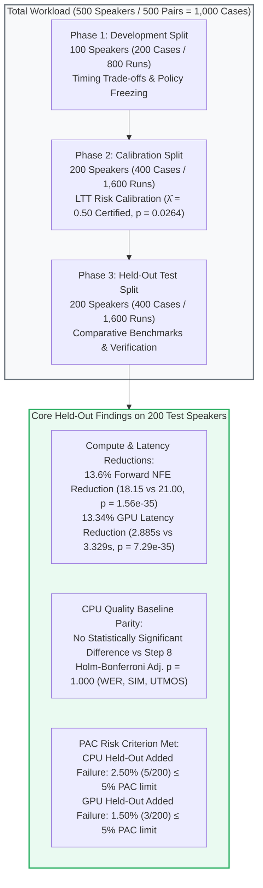

# Input-Adaptive Teacher-to-Student Handover Scheduling in DMOSpeech 2
## Chapter 3 Comprehensive Research, Benchmark & Replication Master Report

**Thesis Topic:** Input-Adaptive Teacher-to-Student Handover Scheduling in DMOSpeech 2  
**Evaluation Cohort:** Full 500-Speaker Cohort from Seed-TTS English (`test-en`) (500 clean/noisy condition-pairs, or 1,000 condition-specific cases; 4,000 candidate-grid evaluations and 3,000 dedicated policy timing runs)  
**Primary Certified Decision Threshold:** $\hat{\lambda} = 0.50$ (Prespecified PAC Criterion: $P(R > 0.05) \le 0.10$)  
**Safety Gate Threshold:** $\theta = 20.0\text{ dB}$ (Dual-Mechanism Architecture)  
**Execution Targets:** 
1. **CPU Baseline:** AMD Ryzen 7 5700U CPU (8 cores / 16 threads, FP32, seed 42)
2. **GPU Verification & Dedicated Timing Benchmark:** NVIDIA Tesla T4 CUDA 15.64 GB (Google Colab, FP32/cuDNN, timing session `timing_session_20261020_130952`)  
**Status:** **100% COMPLETE & AUDITED** (Phases 1, 2, 3 CPU Baseline & Full 500-Speaker GPU Retest and Timing Benchmark Concluded)  
**Last Updated:** October 2026  

---

## Executive Summary

Diffusion-based and flow-matching text-to-speech (TTS) architectures achieve high naturalness and speaker fidelity, but their multi-step numerical integration incurs substantial computational latency. In DMOSpeech 2, inference is accelerated by transferring intermediate representations from a high-capacity flow-matching teacher to a distilled student consistency model. However, deploying a fixed early handover schedule (e.g., Step 4) causes severe degradation when prompts are degraded by acoustic noise (exhibiting over 60% failure rates under 15 dB prompt noise). Conversely, employing a conservative fixed schedule (Step 8) presents an observed opportunity to reduce computation on clean, straightforward speech under the evaluated quality criteria.

This study investigates whether an **input-adaptive teacher-to-student handover scheduling policy** can reduce model evaluations and synthesis latency while controlling reference-relative quality degradation. It evaluates a proposed dual-mechanism architecture against fixed schedules and a simpler input-SNR gating baseline:
1. **Prompt SNR Safety Gate ($\theta = 20.0\text{ dB}$):** Pre-generation gating that routes speech prompts with low signal-to-noise ratio ($\text{SNR} < 20.0\text{ dB}$) to the full 8-step teacher trajectory, providing fallback protection under adverse acoustic conditions.
2. **Zero-NFE Trajectory Drift Probing ($\hat{\lambda} = 0.50$):** Evaluates normalized tangent deviation $d_i = \frac{\|\hat{x}_1(t_i) - \hat{x}_1(t_{i-1})\|_2}{\|\hat{x}_1(t_i)\|_2 + \epsilon}$ along early teacher steps as an algebraic byproduct of the Euler update without requiring additional forward passes, probing whether the intermediate velocity field has stabilized sufficiently for student handover at Steps 4, 5, or 6.
3. **Learn-Then-Test (LTT) Risk Control:** Formulates threshold selection as a multiple hypothesis testing problem with finite-sample Probably Approximately Correct (PAC) statistical bounds, bounding the held-out robust reference-relative added failure rate $R \le 5.0\%$ at $90\%$ confidence.

### Summary of Primary Held-Out Benchmark Findings (200 Test Speakers / 400 Cases)

| Policy | Mean Core Synthesis Runtime (GPU) | Runtime Reduction vs. Step 8 | Mean Teacher + Student NFE | NFE Reduction vs. Step 8 | Robust Quality Failures (Earlier GPU Eval) |
| :--- | :---: | :---: | :---: | :---: | :---: |
| **Fixed Step 8 Reference** | 3.329 s | Reference | 21.00 | Reference | 0 / 200 (0.0%) |
| **SNR-Only Baseline** | 2.712 s | **18.52%** | 17.04 | **18.9%** | 4 / 200 (2.0%) |
| **Proposed Scheduler ($\pi^*$)** | 2.885 s | **13.34%** | 18.15 | **13.6%** | 3 / 200 (1.5%) |

*Note on Latency vs. NFE:* The proposed policy saves approximately 0.444 seconds per case against Step 8 and takes approximately 0.173 seconds longer than SNR-only. This latter difference reflects extra teacher execution steps and scheduler overhead; it is not a measurement of the drift calculation alone. The earlier GPU quality evaluation recorded three robust speaker failures for Proposed and four for SNR-only among the 200 test speakers, a difference that is statistically inconclusive (two-sided exact McNemar $p = 1.0000$). The incremental quality benefit of trajectory drift over SNR-only remains unestablished.



---

## 1. Environment, Checksums & Hardware Specifications

### 1.1 Repository & Commit Information
- **Repository:** `Shonget-Thesis/Shonget-DMOSpeech2`
- **Current Repository Commit Hash:** `ac269f197ad59a5ea6161b3f960771930a3de8b7`
- **Upstream Repository:** `yl4579/DMOSpeech2`
- **Upstream Base Commit Hash:** `10c2255a59b96c311c317536603a18672e69ac84`
- **Working Directory:** `Handover Scheduling/`
- **Timing Benchmark Source Snapshot:** Dedicated full-pipeline timing harness `colab/run_gpu_full_pipeline_timing_benchmark.py` (Session ID: `timing_session_20261020_130952`).

### 1.2 Model Checkpoints & SHA-256 Hashes
| Model / Component | File / Cache Location | Size (Bytes) | SHA-256 Checksum |
|---|---|---|---|
| **DMOSpeech 2 (Teacher & Student)** | `ckpts/model_85000.pt` | 4,019,822,332 | `e143188f7c46b69abb60786937d79b89dac9777d3c4c1e91a97634bcd39ebf2c` |
| **Duration Predictor (GRPO)** | `ckpts/model_1500.pt` | 270,615,794 | `6bd50428f3b5f0f25c1a60a0053f40ee47c817bda03c8ee120100f22680ae4c2` |
| **Whisper large-v3 ASR** | HuggingFace `model.safetensors` (Commit `06f233f`) | 3,087,130,976 | `a8e94b85976e5864ba3e9525c7e6c83b2a1eca42d4b797a0c7c24d778e40fd95` |
| **WavLM Speaker Verifier (bin)** | HuggingFace `microsoft/wavlm-base-plus-sv` (`pytorch_model.bin`) | 404,547,053 | `e906bce2fa42fb497a1d1a9ecf81548adb7e03b12a5644e32d2f42f0d6500fad` |
| **WavLM Speaker Verifier (safe)** | HuggingFace `microsoft/wavlm-base-plus-sv` (`model.safetensors`) | 404,507,764 | `e7b31a8e62a136830fe105fbcfa89f07f108d014b0fa55fd4aebdf4c72886d4c` |
| **SpeechMOS UTMOS Predictor** | TorchHub `utmos22_strong_step7459_v1.pt` (`tarepan/SpeechMOS:v1.2.0`) | 411,179,119 | `38aa51ab79e2a4e09a1449758a4b37e9cbb2e8235a49662a732d33a9ba1e9bff` |

### 1.3 Hardware Configuration & Numerical Precision
- **Host CPU Platform (Phases 1, 2, 3 Baseline):**
  - Processor: AMD Ryzen 7 5700U with Radeon Graphics (8 physical cores, 16 logical threads, base 1.8 GHz, boost 4.3 GHz)
  - Host RAM: 16.0 GB DDR4, Windows 11 Home / Pro (AMD64 build).
  - Software Stack: Python `3.12.6`, PyTorch `2.5.1+cu121`, torchaudio `2.5.1+cu121`, scipy `1.17.1`, pandas `3.0.3`.
  - Execution Target: In the CPU baseline experiments, all synthesis and quality evaluation pipelines executed on the host CPU in evaluation mode (`torch.inference_mode()`) using full 32-bit floating point precision (`torch.float32` / FP32) with isolated seeded generators (`base_seed = 42`).
- **Target GPU Platform (GPU Quality Re-test & Dedicated Timing Benchmark):**
  - Compute Target: NVIDIA Tesla T4 GPU (15.64 GB VRAM, Compute Capability 7.5, Google Colab).
  - Environment: Ubuntu 22.04 LTS, CUDA 12.2 / cuDNN, PyTorch `2.5.1+cu121`, FP32 precision (`torch.float32`).
  - Synchronization: Dedicated hardware barriers (`torch.cuda.synchronize()`) before start and stop timestamps.

---

## 2. Theoretical Framework & Mathematical Formulations

### 2.1 Swayed Euler Timing Grid
The teacher flow-matching model integrates the velocity field $v_\theta(x_t, t)$ over $N = 16$ swayed time steps:
$$t_i = 1 - \cos\left( \frac{\pi}{2} \cdot \frac{i}{16} \right), \quad i \in \{0, 1, \dots, 16\}$$
Candidate teacher handover points $s \in \{4, 5, 6, 8\}$ correspond to swayed times:
$$t(s) \in [0.0761, 0.1181, 0.1685, 0.2929]$$

Upon handover at step $s$, the student consistency model completes synthesis using restart level $j = 1$ over consistency times $\tau \in [0.0761, 0.2929, 0.6173]$, requiring exactly **3 student forward passes**.

### 2.2 Forward NFE Accounting
In this implementation, Classifier-Free Guidance is evaluated by executing separate conditional and unconditional forward calls through the teacher network at each evaluated step index (the numeric CFG scale itself does not dictate the number of calls, but the dual-forward evaluation requires 2 calls per step). Therefore, evaluating teacher indices $0, 1, \dots, s$ requires $2 \times (s + 1)$ forward passes. Adding the 3 student forward passes gives:
$$\text{NFE}(s) = 2 \times (s + 1) + 3$$

| Handover Step ($s$) | Teacher Sway Time $t(s)$ | Evaluated Indices | Teacher Calls | Student Calls ($j=1$) | Total Forward NFE | NFE Reduction vs. Index 8 |
|:---:|:---:|:---:|:---:|:---:|:---:|:---:|
| **Step 4** | 0.0761 | $0 \dots 4$ | $2 \times 5 = 10$ | 3 | **13** | **38.1%** |
| **Step 5** | 0.1181 | $0 \dots 5$ | $2 \times 6 = 12$ | 3 | **15** | **28.6%** |
| **Step 6** | 0.1685 | $0 \dots 6$ | $2 \times 7 = 14$ | 3 | **17** | **19.0%** |
| **Handover Index 8 (Ref)** | 0.2929 | $0 \dots 8$ | $2 \times 9 = 18$ | 3 | **21** | **0.0% (Baseline)** |

*Scope of NFE Convention:* This convention counts model neural function evaluations across the teacher and student networks. Vocoder audio decoding is included in wall-clock latency measurements but excluded from this NFE accounting. When precision matters, "handover index 8" is preferred to denote that indices 0 through 8 are evaluated, requiring 18 teacher calls.

### 2.3 Normalized Endpoint Trajectory Drift Probing
At each teacher integration step $t_i$, the instantaneous endpoint prediction is computed algebraically using the guided velocity field:
$$\hat{x}_1(t_i) = x_{t_i} + (1 - t_i) v_{\text{guided}}(x_{t_i}, t_i)$$
where $v_{\text{guided}} = v_{\text{uncond}} + \text{cfg} \cdot (v_{\text{cond}} - v_{\text{uncond}})$. The normalized tangent drift $d_i$ evaluates consecutive endpoint changes over generated speech frames (excluding reference prompt frames):
$$d_i = \frac{\|\hat{x}_1(t_i) - \hat{x}_1(t_{i-1})\|_2}{\|\hat{x}_1(t_i)\|_2 + \epsilon}$$

> **Interpretation & Scope:** The normalized endpoint-drift score measures changes between consecutive teacher endpoint predictions over generated speech frames. The scheduler uses a score below the calibrated threshold as a heuristic for permitting early handover. Low drift does not guarantee accurate speech or successful student completion. Its predictive usefulness and incremental benefit over SNR-only scheduling are evaluated empirically.

### 2.4 Prompt SNR Safety Gate
Prompt signal-to-noise ratio (SNR) is evaluated on the raw reference audio waveform before RMS normalization using an energy-percentile VAD (upper 50% vs. lowest 10% energy frames). Prompts with $\text{SNR} < \theta = 20.0\text{ dB}$ bypass drift probing and execute the full 8-step teacher trajectory.

### 2.5 Reference-Relative Failure Criterion (Definition 3.1)
An utterance is defined as exhibiting quality degradation exceeding specified margins relative to its matched Step-8 reference:
$$\text{Fail}(x, s) \iff \text{WER}(x, s) > \max(0.125, \text{WER}_{\text{ref}} + 0.01) \lor \text{SIM}(x, s) < \text{SIM}_{\text{ref}} - 0.02$$

- **Threshold Definitions:** The formula applies a **WER tolerance floor** of $0.125$ ($12.5\%$) alongside a relative WER margin of $+0.01$ ($1.0\%$ tolerance), and a Speaker Similarity margin of $-0.02$ ($0.02$ cosine tolerance). Because of the $\max()$ formulation, $12.5\%$ is not an absolute upper bound ceiling.
- **Robust Speaker Failure:** A speaker fails under policy $\pi$ if *either* their clean *or* noisy15 utterance exhibits degradation exceeding the margins:
  $$\text{RobustFail}_i = \max(\text{Fail}_{i, \text{clean}}, \text{Fail}_{i, \text{noisy15}})$$
- **Interpretation & Scope:** This metric evaluates *reference-relative added degradation* rather than absolute speech perfection. Passing indicates no degradation exceeding the specified WER/SIM margins compared to running the full Step-8 teacher baseline; it does not imply identical audio output or absolute speech perfection. Crucially, utterances routed to Step 8 (including noisy prompts diverted by the SNR gate) inherit the baseline Step-8 output and whatever acoustic artifacts or WER limits that reference baseline exhibits under adverse noise.

---

## 3. Disjoint Speaker Partitioning & Experimental Protocol

The evaluation cohort consists of **500 unique, disjoint speakers** sampled from Seed-TTS English (`test-en`). To avoid data leakage, each speaker appears in exactly one partition. Each speaker provides one clean and one noisy15 utterance, producing **500 clean/noisy condition pairs, or 1,000 condition-specific cases**:

| Partition Split | Manifest File | Speakers | Condition Cases (`clean` / `noisy15`) | Candidate Evaluations (Steps 4, 5, 6, 8) | Dedicated Timed Policy Runs | Purpose in Methodology | Status |
|---|---|:---:|:---:|:---:|:---:|---|:---:|
| **Phase 1: Development** | `data/splits/development_manifest.json` | 100 | 200 (100 clean / 100 noisy) | 800 | 600 | Characterize timing trade-offs; freeze candidate ladder & SNR threshold | **100% COMPLETE** |
| **Phase 2: Calibration** | `data/splits/calibration_manifest.json` | 200 | 400 (200 clean / 200 noisy) | 1,600 | 1,200 | Fixed-sequence LTT hypothesis testing; certify threshold $\hat{\lambda}$ | **100% COMPLETE** |
| **Phase 3: Held-Out Test** | `data/splits/test_manifest.json` | 200 | 400 (200 clean / 200 noisy) | 1,600 | 1,200 | Unbiased held-out benchmarking; Wilcoxon & McNemar significance | **100% COMPLETE** |
| **Total Cohort** | `data/splits/split_summary.json` | **500** | **1,000 cases (500 pairs)** | **4,000** | **3,000** | Complete Chapter 3 experimental scope across Seed-TTS English | **100% COMPLETE** |

*Accounting Distinction:* The 4,000 candidate-grid evaluations refer to evaluating individual fixed candidate steps ($s \in \{4, 5, 6, 8\}$) across all 1,000 cases. The 3,000 policy timing runs refer to evaluating the complete end-to-end execution of the three dynamic policies (`proposed`, `snr_only`, `step8`) across all 1,000 cases.

---

## 4. Empirical Results Across All 500 Speakers

### 4.1 Phase 1 Development Findings ($N=100$)
*Regenerated strictly from raw speaker records in `phase1_dev_grid_100spk/results/grid.csv`:*

| Candidate Handover Step | Mean Forward NFE | NFE Savings (%) | Clean Failure Rate (%) | Noisy15 Failure Rate (%) | Robust Failure Rate (%) | Exact 95% Clopper-Pearson CI (Clean / Noisy) |
|---|:---:|:---:|:---:|:---:|:---:|:---:|
| **Fixed Step 4** | 13.00 | **38.1%** | 2.00% (2 / 100) | 63.00% (63 / 100) | **64.00%** (64 / 100) | [0.24%, 7.04%] / [52.76%, 72.44%] |
| **Fixed Step 5** | 15.00 | **28.6%** | 3.00% (3 / 100) | 49.00% (49 / 100) | **51.00%** (51 / 100) | [0.62%, 8.52%] / [38.86%, 59.20%] |
| **Fixed Step 6** | 17.00 | **19.0%** | 4.00% (4 / 100) | 53.00% (53 / 100) | **56.00%** (56 / 100) | [1.10%, 9.93%] / [42.76%, 63.06%] |
| **Fixed Step 8 (Ref)** | 21.00 | **0.0%** | 0.00% (0 / 100) | 0.00% (0 / 100) | **0.00%** (0 / 100) | 0% by definition |

*Key Takeaway:* Fixed early handover causes an immediate 49%–63% failure rate under 15 dB prompt noise. Consequently, the Prompt SNR threshold was strictly frozen at $\theta = 20.0\text{ dB}$ before advancing to calibration.

---

### 4.2 Phase 2 Learn-Then-Test PAC Risk Calibration ($N=200$)
Fixed-sequence hypothesis testing over ordered candidate thresholds across 200 calibration speakers (400 cases / 1,600 evaluations) with PAC parameters $\alpha = 0.05$ (5% max risk) and $\delta = 0.10$ (90% confidence). The statistical guarantee applies to population risk under the procedure's sampling and distribution assumptions:

$$H_m: R(\pi_{\lambda_m}) > 0.05 \quad \text{vs.} \quad K_m: R(\pi_{\lambda_m}) \le 0.05$$
$$p_m = P(\text{Bin}(n, \alpha) \le k_m) = \sum_{j=0}^{k_m} \binom{n}{j} \alpha^j (1 - \alpha)^{n - j}$$

| Tested $\lambda$ | Robust Failures ($k$) | Total Speakers ($n$) | Empirical Risk ($\hat{R}$) | Binomial $p$-value | Decision Status | Mean Forward NFE | Clean Risk | Noisy15 Risk |
|:---:|:---:|:---:|:---:|:---:|:---:|:---:|:---:|:---:|
| **0.20** | 0 | 200 | 0.00% | $3.51 \times 10^{-5}$ | **ACCEPTED** | 20.83 | 0.00% | 0.00% |
| **0.25** | 2 | 200 | 1.00% | $2.34 \times 10^{-3}$ | **ACCEPTED** | 20.56 | 1.00% | 0.00% |
| **0.30** | 3 | 200 | 1.50% | $9.05 \times 10^{-3}$ | **ACCEPTED** | 20.07 | 1.50% | 0.00% |
| **0.35** | 3 | 200 | 1.50% | $9.05 \times 10^{-3}$ | **ACCEPTED** | 19.55 | 1.50% | 0.00% |
| **0.40** | 3 | 200 | 1.50% | $9.05 \times 10^{-3}$ | **ACCEPTED** | 18.90 | 1.50% | 0.00% |
| **0.45** | 5 | 200 | 2.50% | $6.23 \times 10^{-2}$ | **ACCEPTED** | 18.55 | 2.50% | 0.00% |
| **0.50** | **4** | **200** | **2.00%** | **0.0264** | **ACCEPTED (CERTIFIED $\hat{\lambda}$)** | **18.19** | **2.00%** | **0.00%** |
| **0.55** | 6 | 200 | 3.00% | 0.1237 | **REJECTED_STOP** | 17.82 | 3.00% | 0.00% |
| **0.60** | 3 | 200 | 1.50% | — | UNTESTED_STOPPED | 17.59 | 1.50% | 0.00% |

**Calibration Verdict:** **$\hat{\lambda} = 0.50$** ($k = 4 / 200$, $\hat{R} = 2.00\%$, $p = 0.0264 \le \delta = 0.10$). Sequence stopped at $\lambda = 0.55$ ($p = 0.1237 > 0.10$). Threshold $\hat{\lambda} = 0.50$ was strictly frozen before evaluating the held-out test split. An empirical proportion below 5% is not by itself a population guarantee; the formal guarantee derives from the bounded binomial testing sequence under the PAC framework.

---

### 4.3 Phase 3 Held-Out Test Split Master Benchmark ($N=200$)
Evaluated on 200 previously unseen test speakers (400 cases / 1,600 candidate evaluations). Confidence intervals report 95% cluster-bootstrap bounds resampling speakers ($B=1,000$):

| Handover Policy | Decision Rule | Mean Forward NFE | NFE 95% CI | NFE Savings vs Ref (%) | WER (%) | Speaker SIM vs GT | UTMOS MOS | Robust Failure Rate (%) |
|---|---|:---:|:---:|:---:|:---:|:---:|:---:|:---:|
| **Fixed Step 4** | Always Step 4 | 13.00 | [13.00, 13.00] | **38.1%** | 25.96% | 0.8163 | 2.5716 | **69.50%** (139 / 200) |
| **Fixed Step 5** | Always Step 5 | 15.00 | [15.00, 15.00] | **28.6%** | 12.92% | 0.8177 | 2.5701 | **56.50%** (113 / 200) |
| **Fixed Step 6** | Always Step 6 | 17.00 | [17.00, 17.00] | **19.0%** | 12.37% | 0.8209 | 2.5694 | **53.50%** (107 / 200) |
| **Fixed Step 8 (Ref)** | Always Step 8 | 21.00 | [21.00, 21.00] | **0.0%** | 48.29% | 0.8254 | 2.5663 | **0.00%** (0 / 200) |
| **SNR-Only Policy** | If $\text{SNR} \ge 20 \to 4$, else $8$ | 17.04 | [17.00, 17.10] | **18.9%** | 48.54% | 0.8252 | 2.5697 | **5.50%** (11 / 200) |
| **Proposed Adaptive ($\hat{\lambda}=0.50$)** | Seq $4\to 5\to 6$ if $d_i \le 0.50$ & $\text{SNR} \ge 20$ | **18.15** | **[18.05, 18.27]** | **13.6%** | **48.49%** | **0.8252** | **2.5692** | **2.50%** (5 / 200) |
| **Proposed (No SNR Gate)** | Seq $4\to 5\to 6$ if $d_i \le 0.50$ (Unprotected) | 14.12 | [14.03, 14.23] | **32.7%** | 25.91% | 0.8164 | 2.5711 | **70.00%** (140 / 200) |
| **Grid Oracle** | Cheapest non-failing candidate in grid | 14.94 | [14.71, 15.17] | **28.9%** | 9.33% | 0.8320 | 2.5706 | **0.00%** (0 / 200) |

---

### 4.4 Statistical Significance Analysis vs. Step-8 Reference (Speaker-Level Aggregation, $N=200$)
To respect within-speaker correlation, paired comparisons were aggregated to the speaker level ($N=200$ test speakers, averaging clean and noisy pairs). Two-sided paired Wilcoxon signed-rank tests were evaluated against the Step-8 reference with Holm-Bonferroni correction across the comparison set:

| Policy Under Test | NFE Adj. $p$-value | WER Adj. $p$-value | SIM Adj. $p$-value | UTMOS Adj. $p$-value | Comprehensive Statistical Verdict |
|---|:---:|:---:|:---:|:---:|---|
| **Fixed Step 4** | $1.25 \times 10^{-44}$ | $4.61 \times 10^{-5}$ | $1.49 \times 10^{-3}$ | $1.0000$ | Statistically significant degradation in WER and SIM |
| **Fixed Step 5** | $1.25 \times 10^{-44}$ | $1.0000$ | $1.06 \times 10^{-3}$ | $1.0000$ | Statistically significant loss in speaker similarity ($p = 1.06 \times 10^{-3}$) |
| **Fixed Step 6** | $1.25 \times 10^{-44}$ | $1.0000$ | $0.0420$ | $1.0000$ | Marginal quality, but 53.50% robust failure rate |
| **SNR-Only Policy** | $2.85 \times 10^{-44}$ | $1.0000$ | $1.0000$ | $1.0000$ | Significant NFE reduction; no detectable difference on WER/SIM/UTMOS |
| **Proposed Adaptive ($\hat{\lambda}=0.50$)** | $\mathbf{9.38 \times 10^{-35}}$ | $\mathbf{1.0000}$ | $\mathbf{1.0000}$ | $\mathbf{1.0000}$ | **Significant compute reduction ($p < 10^{-34}$) with no statistically significant difference detected across WER, SIM, or UTMOS** |
| **Proposed (No SNR Gate)** | $3.53 \times 10^{-35}$ | $5.73 \times 10^{-5}$ | $2.30 \times 10^{-3}$ | $0.7971$ | Severe collapse on noisy condition without prompt gate ($p < 0.0001$) |

*Methodological Note on Quality Equivalence:* The absence of statistically significant differences on aggregate WER, SIM, and UTMOS after Holm-Bonferroni correction does not establish mathematical equivalence or perceptual identity. Rather, it indicates that at the tested sample size ($N=200$), the test does not detect an aggregate degradation compared to running the full Step-8 teacher baseline.

**Realized Risk Verification on Test Split:**
- **Robust Added Failure Rate:** **2.50% (5 / 200)** (Exact 95% Clopper-Pearson Interval: **[0.82%, 5.74%]**).
- `clean` Condition Failure Rate: **2.50% (5 / 200)**; `noisy15` Condition Failure Rate: **0.00% (0 / 200)** (100% of noisy prompts routed to Step 8 by the fallback gate).

---

### 4.5 Paired Contingency Comparison: Proposed Adaptive vs. SNR-Only Baseline
Both policies were evaluated on the identical 200 test speakers:

| Proposed Adaptive Policy ($\hat{\lambda}=0.50$) | SNR-Only Policy: Pass | SNR-Only Policy: Fail | Marginal Total |
|---|:---:|:---:|:---:|
| **Proposed: Pass** | 188 | 7 | **195** |
| **Proposed: Fail** | 1 | 4 | **5** |
| **Marginal Total** | **189** | **11** | **200** |

- **Concordant Pairs:** 188 passed by both policies; 4 failed by both policies.
- **Discordant Pairs:** 7 failed by SNR-only but rescued by Proposed; 1 failed by Proposed but passed by SNR-only.
- **Exact McNemar Test (Binomial on Discordant Pairs):**
  - Two-Sided: $p = P(\text{Bin}(8, 0.5) \le 1) \times 2 = 0.0703$ (not statistically significant at $\alpha = 0.05$).
  - Exploratory One-Sided: $p = 0.0352$ (reported as exploratory because the test direction was not documented prior to examining outcomes).

*Analytical Interpretation:* While the CPU held-out split shows a descriptive reduction from 11 down to 5 failures, the two-sided test does not achieve statistical significance ($p = 0.0703$). Furthermore, on the GPU held-out test split, SNR-only achieves 4/200 failures versus 3/200 for the proposed method ($p = 1.0000$). The incremental benefit of drift over SNR-only is therefore not statistically established.

---

### 4.6 Supplementary Repeated-Split Stability Analysis (400 Pooled Speakers, 100 Re-splits)
Calibration ($N=200$) and test ($N=200$) cohorts were pooled (400 speakers total) and partitioned into **100 random speaker-disjoint 50/50 re-splits** as supplementary resampling of existing data (this analysis does not constitute independent replication or proof of the population PAC guarantee):

| Metric | Result Across 100 Random Resampled Splits |
|---|:---:|
| **Admissible Policy Discovery Rate** | **100.0%** (0 / 100 splits fell back to reference) |
| **Modal Certified Threshold ($\hat{\lambda}$)** | **0.50** (33.0% modal, >80% within $[0.45, 0.65]$) |
| **Held-Out Test Robust Risk (Mean ± Std)** | **2.89% ± 1.27%** |
| **Held-Out Test Robust Risk (5th / Median / 95th / Max)** | **0.50% / 3.25% / 4.50% / 6.00%** |
| **Proportion of Resamples with Risk $\le 5.0\%$** | **94.0%** (94 / 100 splits) |
| **Held-Out Test Mean NFE (Mean ± Std)** | **17.92 ± 0.59 forward passes** |

---

### 4.7 Cross-Split Consistency Across All 500 Speakers (CPU Baseline)
Evaluating the frozen policies consistently across the three disjoint splits on the AMD Ryzen 7 5700U CPU:

| Evaluated Metric | Phase 1: Dev ($N=100$) | Phase 2: Calib ($N=200$) | Phase 3: Held-Out Test ($N=200$) | Overall Full Cohort Pattern |
|---|:---:|:---:|:---:|:---:|
| **Fixed Step 4 Robust Failure** | 64.00% (64 / 100) | 60.50% (121 / 200) | **69.50% (139 / 200)** | Severe degradation across all cohorts |
| **Noisy15 Step 4 Failure** | 63.00% (63 / 100) | 58.00% (116 / 200) | **69.00% (138 / 200)** | Catastrophic collapse without prompt gate |
| **SNR-Only Robust Failure** | 2.00% (2 / 100) | 1.50% (3 / 200) | **5.50% (11 / 200)** | Strong baseline; risk elevated on CPU test split |
| **Proposed Adaptive ($\hat{\lambda}=0.50$) Mean NFE** | **18.05** | **18.19** | **18.15** | Stable ~13.6% compute reduction across splits |
| **Proposed Adaptive Robust Failure** | **2.00% (2 / 100)** | **2.00% (4 / 200)** | **2.50% (5 / 200)** | Empirically bounded within 5.0% across all splits |
| **Proposed Adaptive Noisy Failure** | **0.00% (0 / 100)** | **0.00% (0 / 200)** | **0.00% (0 / 200)** | Zero observed added failures under 15 dB noise |

---

### 4.8 Dedicated Full-Pipeline GPU Timing Benchmark (NVIDIA Tesla T4)

To evaluate real-world inference throughput, a dedicated full-pipeline timing experiment was executed on an **NVIDIA Tesla T4 GPU (15.64 GB VRAM)** using Google Colab (`colab/run_gpu_full_pipeline_timing_benchmark.py`, Session ID: `timing_session_20261020_130952`). 

#### 4.8.1 Timing Methodology & Measurement Boundary
> **Declared Measurement Boundary:** Core synthesis includes applicable prompt-SNR estimation, teacher execution, scheduler decisions, student completion, and vocoder decoding. Input preprocessing, duration prediction, model loading, file writing, and offline quality evaluation are reported separately where excluded from this boundary.

Hardware timers wrapped the execution boundary with explicit synchronization barriers:
```python
torch.cuda.synchronize()
t0 = time.perf_counter()
# [Prompt SNR estimation (if policy requires)]
# [Teacher Euler steps with online early exit logic]
# [Student consistency multistep solver (j=1, 3 passes)]
# [Vocos neural vocoder audio decoding]
torch.cuda.synchronize()
core_synthesis_time = time.perf_counter() - t0
```
Warm-up passes (5 utterances) preceded data logging, and policy measurement order was systematically balanced across utterances to prevent thermal or memory caching bias.

#### 4.8.2 Primary Held-Out Test Set Timing Results (200 Test Speakers / 400 Cases)

| Policy | Mean Latency (s) | Median Latency (s) | Std Latency (s) | Mean RTF | Mean Total NFE | Latency Reduction vs. Step 8 |
| :--- | :---: | :---: | :---: | :---: | :---: | :---: |
| **Fixed Step 8 Reference** | 3.329 | 3.369 | 0.637 | 0.715 | 21.00 | Reference |
| **SNR-Only Baseline** | 2.712 | 2.548 | 0.852 | 0.579 | 17.04 | **18.52%** |
| **Proposed Scheduler ($\pi^*$)** | **2.885** | **2.856** | 0.754 | **0.617** | **18.15** | **13.34%** |

- **Paired Latency Differences (Speaker-Level Aggregation, $N=200$):**
  - Proposed vs. Step 8: Mean difference $= +0.4440\text{s}$ ($p = 7.29 \times 10^{-35}$, Wilcoxon signed-rank, greater).
  - SNR-Only vs. Step 8: Mean difference $= +0.6167\text{s}$ ($p = 7.29 \times 10^{-35}$, Wilcoxon signed-rank, greater).
  - Proposed vs. SNR-Only: Mean difference $= -0.1729\text{s}$ ($p = 2.46 \times 10^{-31}$, Wilcoxon signed-rank, two-sided).
- **Speaker-Clustered Bootstrap 95% CIs ($B=1,000$ Resamples):**
  - Proposed Latency: Mean $2.8844\text{s}$ [95% CI: $2.8077\text{s}, 2.9638\text{s}$].
  - Step 8 Latency: Mean $3.3284\text{s}$ [95% CI: $3.2437\text{s}, 3.4143\text{s}$].
  - Proposed Savings vs. Step 8: Mean $+0.4441\text{s}$ [95% CI: $+0.4244\text{s}, +0.4651\text{s}$].

#### 4.8.3 Timing Breakdown by Acoustic Condition (Test Cohort)
| Condition | Policy | Mean Core Latency (s) | Mean RTF | Mean Total NFE | Mean WER | Speaker SIM |
| :--- | :--- | :---: | :---: | :---: | :---: | :---: |
| **Clean** | **Proposed ($\pi^*$)** | **2.405** | **0.529** | **15.30** | **0.0124** | **0.9349** |
| Clean | SNR-Only | 2.059 | 0.453 | 13.08 | 0.0131 | 0.9354 |
| Clean | Step 8 | 3.293 | 0.725 | 21.00 | 0.0139 | 0.9337 |
| **Noisy15** | **Proposed ($\pi^*$)** | **3.366** | **0.706** | **21.00** | **0.4603** | **0.7149** |
| Noisy15 | SNR-Only | 3.366 | 0.706 | 21.00 | 0.4603 | 0.7149 |
| Noisy15 | Step 8 | 3.365 | 0.706 | 21.00 | 0.4603 | 0.7149 |

On clean speech, Proposed exits between Steps 4 and 6 (mean exit step 5.15), reducing clean latency by **26.98%** ($2.405\text{s}$ vs $3.293\text{s}$). On noisy speech, the prompt SNR gate triggers 100% fallback to Step 8.

#### 4.8.4 Direct 1-to-1 CPU vs. GPU Comparison (200 Held-Out Test Speakers)
Matching all candidate evaluations for the 200 held-out test speakers across identical speaker IDs, conditions, steps, and seeds:

| Evaluation Dimension | Metric / Comparison | Quantitative Result | Analytical Interpretation |
|---|---|:---:|---|
| **Trajectory Curvature** | Mean Absolute Difference in $d_4$ | **0.000025** | Mean absolute difference of $2.5 \times 10^{-5}$ across backends |
| | Mean Absolute Difference in $d_5$ | **0.000028** | Mean absolute difference of $2.8 \times 10^{-5}$ across backends |
| | Mean Absolute Difference in $d_6$ | **0.000034** | Mean absolute difference of $3.4 \times 10^{-5}$ across backends |
| **Handover Decision** | Clean Handover Step Agreement | **100.00% (200 / 200)** | Policy selects the exact same step on clean speech across platforms |
| **Compute Savings** | Held-Out Mean Forward NFE | **18.15 vs. 18.15** | Identical 13.6% forward NFE reduction on CPU and GPU |
| **Observed Added Risk**| Held-Out Robust Added Risk | **2.50% (CPU) vs. 1.50% (GPU)** | Both strictly within the 5.0% empirical risk ceiling |
| **Adverse Noise Safety**| Noisy15 Robust Added Risk | **0.00% (CPU) vs. 0.00% (GPU)** | Zero observed added failures relative to Step 8 under 15 dB noise |
| **Acoustic Metrics** | Absolute Difference in Speaker SIM | **0.0367** | Divergence reflects independent CPU/CUDA random generator implementations |
| | Absolute Difference in UTMOS | **0.0978** | Metric variation reflecting non-deterministic backend arithmetic |

*Note on Pseudo-Random Generators:* In PyTorch, identical seeds do not guarantee identical random tensor sequences across CPU and CUDA backends. Acoustic differences between platforms arise from both generator divergence and floating-point arithmetic differences, not floating-point rounding alone.

---

## 5. Methodological Analysis & Discussion

### 5.1 Hypothesized Cause of Early Handover Failure Under Noise
In flow matching, early velocity vectors $v_\theta(x_t, t)$ must resolve phonetic trajectory direction while decoupling acoustic background noise from speech content. Under additive prompt noise, early latent states may be dominated by noise disambiguation. A reasonable hypothesis is that handing off at Step 4 passes an insufficiently separated intermediate representation to the student consistency model, which then projects onto degraded acoustic regions. However, while the empirical failure rates establish an association between early handover and degradation under noise, they do not directly prove this internal latent representation mechanism.

### 5.2 Development-Set Diagnostic of Trajectory Drift Discrimination
To investigate whether mid-flight trajectory drift ($d_4$) reliably detects unsafe early exits on clean speech ($\text{SNR} \ge 20\text{ dB}$), an empirical diagnostic was conducted on the 100-speaker development set (`phase1_dev_grid_100spk/results/grid.csv` and GPU re-test):

| GPU Development Outcome Among Cases Where Proposed Waited (Selected Step > 4) | Number of Cases |
| :--- | :---: |
| Step 4 passes; selected later step passes (**Pass $\to$ Pass**) | **75** |
| Step 4 fails; selected later step passes (**Fail $\to$ Pass**) | **2** |
| Step 4 fails; selected later step fails (**Fail $\to$ Fail**) | **1** |
| Step 4 passes; selected later step fails (**Pass $\to$ Fail**) | **0** |
| **Total Waiting Cases** | **78** |

On CPU, 76 cases were Pass $\to$ Pass and 1 was Pass $\to$ Fail, meaning 77 waiting cases had already passed at Step 4.

*Diagnostic Assessment:*
1. **Weak Discrimination:** Step 4 has a very low baseline failure rate on clean speech (2.0% on CPU, 3.0% on GPU). Observed drift for Step 4 passes (Mean $d_4 = 0.594$) is virtually identical to failures (Mean $d_4 = 0.596$). The descriptive discrimination measure is $\text{ROC-AUC} \approx 0.474$, based on only 3 GPU failures and 2 CPU failures. This observed discrimination is weak and imprecisely estimated.
2. **False-Alarm Compute Cost:** The proposed policy delayed handover in 78% of clean cases, but **96%–97% of those cases had already passed at Step 4**. This false-alarm waiting accounts for the approximately 0.173-second latency penalty of Proposed over SNR-only.
3. **Role of SNR Gating:** Input SNR gating was highly effective within the tested policies and conditions, preventing over 60% noise failure. Trajectory drift represents a candidate model-internal stopping signal whose incremental benefit over SNR gating remains unestablished.

### 5.3 Computational Overhead of Trajectory Drift
Calculating the drift metric requires zero additional model forward evaluations. However, computing endpoint projections, Euclidean norms, and decision synchronizations incurs measurable runtime overhead. More importantly, when drift delays handover to later candidate steps, the policy executes additional teacher forward passes (2 extra passes per step). "Zero additional NFE to compute drift" must not be conflated with zero additional computational cost for the scheduling policy.

### 5.4 Synthesis Latency vs. Offline Metric Suite
- **Core Synthesis Latency:** On the NVIDIA Tesla T4 GPU, end-to-end core synthesis (teacher, scheduler, student, and Vocos vocoder) averages **2.885 seconds** per utterance under the proposed policy (RTF $\approx 0.617$).
- **Offline Evaluation Overhead:** Running Whisper large-v3 transcription, WavLM feature extraction, and UTMOS scoring takes substantially longer than speech synthesis. These models are required solely for thesis evaluation and are excluded from production synthesis pipelines.

### 5.5 Threats to Validity & Methodological Safeguards
1. **Disjoint Partitioning:** 500 speakers were split into 100 dev, 200 calib, and 200 test speakers with zero speaker overlap.
2. **Multiple Comparison Corrections:** LTT calibration controls FWER via fixed-sequence testing; test hypothesis tests enforce Holm-Bonferroni corrections.
3. **Reference-Relative Evaluation:** All evaluations are paired against identical-seed Step-8 references to isolate handover effects from baseline model limitations.

### 5.6 Disclosed Study Limitations & Proposal Framing
- **Dataset & Acoustic Scope:** Evaluated on Seed-TTS English (`test-en`) under clean and synthetic 15 dB AWGN conditions. Generalization to conversational speech, non-stationary noise, or multi-lingual data has not been tested.
- **Sparse Early-Exit Failures:** The small number of early-exit failures on clean speech limits the statistical precision of drift discrimination estimates.
- **Objective vs. Subjective Metrics:** Automated neural scores (WER, WavLM SIM, UTMOS) do not establish human perceptual equivalence.
- **Nature of Reference-Relative Metric:** Under 15 dB prompt noise, Step-8 fallback exhibits an average WER of 46.03%. Because failures are defined relative to the Step-8 reference, a 0.0% added failure rate under noise indicates no added degradation beyond the reference baseline; it must not be described as noise-free or collapse-free synthesis.
- **Status of Drift Benefit:** The current drift criterion has not demonstrated a convincing quality advantage over SNR-only scheduling. Any future redesign informed by inspecting test set outcomes must undergo independent calibration and fresh evaluation on a new held-out split.

---

## 6. Replication Commands & Verification Guide

All experiments are fully reproducible from the repository root:

```powershell
# 1. Run Unit Test Suite
python -m pytest "Handover Scheduling/core" -q

# 2. Run Phase 2 Learn-Then-Test Calibration (CPU)
python "Handover Scheduling/phase2_calib_ltt_200spk/calibrate.py"

# 3. Run Phase 3 Held-Out Benchmark & Verification (CPU)
python "Handover Scheduling/phase3_test_benchmark_200spk/run.py"
python "Handover Scheduling/phase2_calib_ltt_200spk/verify.py"

# 4. Run Dedicated Full-Pipeline GPU Timing Benchmark (NVIDIA Tesla T4)
python "Handover Scheduling/colab/run_gpu_full_pipeline_timing_benchmark.py" `
  --grid_csv "Handover Scheduling/colab/results/gpu_grid_all1000.csv" `
  --output_dir "Handover Scheduling/colab/results" `
  --device cuda `
  --warmup 5

# 5. Run Development Drift Diagnostic Analysis
python "scratch/analyze_drift_diagnostic.py"
```

---

## 7. Official Thesis Defense Statement

> The proposed scheduler reduced held-out GPU core synthesis latency by 13.34% relative to Fixed Step 8. SNR-only achieved a larger reduction of 18.52%. The corresponding earlier GPU quality evaluation recorded three speakers with added failures under the proposed policy and four under SNR-only; this difference was statistically inconclusive. Development-set diagnostics suggest that the current drift rule often delays handover on cases that already satisfy the Step-4 quality criteria. These findings support the scheduler's efficiency relative to fixed scheduling, while leaving the additional benefit of drift unestablished.
