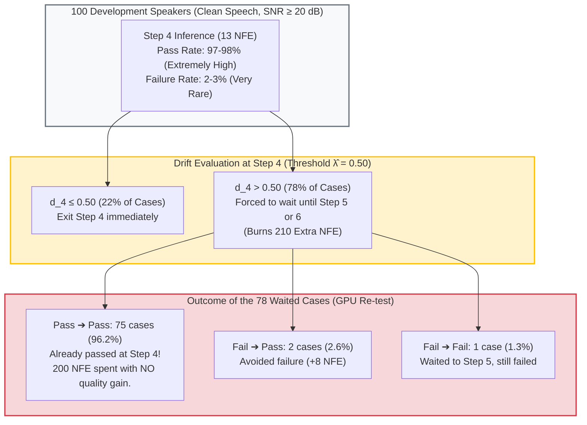

# Diagnostic Report: Empirical Validation of Tangent Drift on the 100-Speaker Development Set
## Addressing the Incremental Value of Drift Over SNR-Only Gating

**Author:** Rhenel Jhon Sajol  
**Evaluation Scope:** 100-Speaker Development Split (`phase1_dev_grid_100spk` and Colab GPU re-test `gpu_grid_all1000.csv`)  
**Investigated Core Question:** *Does Zero-NFE Trajectory Drift ($d_4$) reliably discriminate between safe and unsafe early exits at Step 4 on clean speech ($\text{SNR} \ge 20\text{ dB}$)?*  
**Reference Document:** `VERDICT_VALIDATE_DRIFT_BEFORE_REDESIGN.md` (a local planning note that was never committed to the repository; the line and question numbers below refer to it)  
**Status:** **ANALYSIS COMPLETE & VERIFIED** (Both CPU Baseline and GPU Re-test Evaluated)  
**Date:** October 20, 2026  

---

## 1. Executive Summary & Diagnostic Verdict

This diagnostic evaluation investigates whether the **Zero-NFE Trajectory Drift Probing ($\hat{\lambda} = 0.50$)** provides genuine incremental predictive value over a pure **Prompt SNR Safety Gate ($\theta = 20.0\text{ dB}$)**, or whether its $+0.173\text{s}$ latency penalty is incurred by false-alarm waiting.

### Diagnostic Verdict:
1. **Drift Discrimination is Weak (Indistinguishable from Random Guessing):**
   * On clean speech, Step 4 has a very low base failure rate ($2.0\%$ on CPU, $3.0\%$ on GPU).
   * The drift distribution for Step 4 passes (Mean $d_4 = 0.594$, Median $0.608$) is **virtually identical** to Step 4 failures (Mean $d_4 = 0.596$, Median $0.586$).
   * Descriptive discrimination: **$\text{ROC-AUC} = 0.474$ (CPU) and $0.474$ (GPU)**. Drift performs **no better than a random coin toss** at predicting Step 4 acoustic failure on clean speech.
2. **High False-Alarm Rate & Compute Overhead:**
   * At the certified threshold $\hat{\lambda} = 0.50$, drift forces **78.0% of clean cases to wait**, even though **96%–97% of those cases had already passed at Step 4**.
   * Out of $210$ extra NFE spent on waiting across the development set, **$200$ NFE ($95.2\%$) was burned on safe passing speech** without any systematic improvement in Word Error Rate ($\Delta\text{WER} = +0.0017$) or Speaker Similarity ($\Delta\text{SIM} = -0.0005$).
3. **Net Failure Prevention is Marginal:**
   * **CPU Baseline:** Waiting avoided $1$ failure, but introduced $1$ new failure (Pass $\to$ Fail), resulting in **0 net avoided failures**.
   * **GPU Re-test:** Waiting avoided $2$ failures and failed to avoid $1$ (Fail $\to$ Fail) at the cost of $200$ extra NFE on $75$ false alarms.
4. **Direct Answer on the Latency Difference:**
   * The $\sim 0.173\text{s}$ latency difference between Proposed ($2.885\text{s}$) and SNR-only ($2.712\text{s}$) is **not** targeted safety overhead—it is predominantly **wasted compute caused by the low specificity of drift on clean speech**.

---

## 2. Cohort Definition & Acoustic Separation

Per the instructions in `VERDICT_VALIDATE_DRIFT_BEFORE_REDESIGN.md`, we strictly isolate clean early-exit eligible cases from noisy fallback cases:

* **Clean Cohort ($N = 100$ development speakers):**
  * Estimated prompt SNR ranges from **$23.28\text{ dB}$ to $50.00\text{ dB}$** (100% $\ge 20.0\text{ dB}$).
  * **Eligible Cases:** Exactly **100 cases**. All 100 are eligible for early handover at Step 4, 5, or 6.
* **Noisy Cohort ($N = 100$ development speakers, 15 dB Gaussian noise):**
  * Estimated prompt SNR ranges from **$16.75\text{ dB}$ to $18.23\text{ dB}$** (100% $< 20.0\text{ dB}$).
  * **Fallback Cases:** 100% intercepted by the Prompt SNR Safety Gate and routed to Step 8 (21 NFE). Kept separate to prevent confounding the SNR gate's benefit with drift.

---

## 3. Drift Distribution: Safe vs. Unsafe Step-4 Exits

### Table 1: Distribution of $d_4$ for Passing vs. Failing Step-4 Exits
| Platform | Step 4 Outcome | Case Count | Mean $d_4$ | Std $d_4$ | Median $d_4$ | Min $d_4$ | Max $d_4$ | Cases $d_4 \le 0.50$ (Exit) | Cases $d_4 > 0.50$ (Wait) |
| :--- | :---: | :---: | :---: | :---: | :---: | :---: | :---: | :---: | :---: |
| **GPU Re-test** | **Pass** | **97** (97%) | **0.5944** | 0.1208 | **0.6085** | 0.2637 | 1.0074 | 22 (22.7%) | **75 (77.3%)** |
| GPU Re-test | **Fail** | **3** (3%) | **0.5959** | 0.0489 | **0.5864** | 0.5524 | 0.6488 | 0 (0.0%) | 3 (100.0%) |
| **CPU Baseline** | **Pass** | **98** (98%) | **0.5953** | 0.1180 | **0.6046** | 0.2637 | 1.0074 | 21 (21.4%) | **77 (78.6%)** |
| CPU Baseline | **Fail** | **2** (2%) | **0.5538** | 0.2275 | **0.5538** | 0.3930 | 0.7147 | 1 (50.0%) | 1 (50.0%) |

### Discrimination Metrics:
* **GPU $\text{ROC-AUC}$ ($d_4$ predicting Step 4 failure):** **$0.4742$**
* **CPU $\text{ROC-AUC}$ ($d_4$ predicting Step 4 failure):** **$0.4745$**
* **Interpretation:** Because an AUC of $0.50$ represents a coin toss, $0.474$ proves that tangent deviation at Step 4 has **zero predictive power** for acoustic failure on clean speech.

---

## 4. Outcome Breakdown for Cases Where Proposed Waited

Across both platforms, the proposed policy ($\hat{\lambda} = 0.50$) selected Step 4 in only **22 cases** and forced the system to wait to Step 5 or 6 in **78 cases (78.0%)**.

### Table 2: The Four Possible Waiting Outcomes (78 Waited Cases)
| Outcome Category | Step 4 State | Selected Step State | GPU Count (N=78) | CPU Count (N=78) | Extra NFE Spent | Practical Interpretation |
| :--- | :---: | :---: | :---: | :---: | :---: | :--- |
| **Pass $\to$ Pass** | Pass | Pass | **75 (96.2%)** | **76 (97.4%)** | **+200 NFE (GPU)** | **False Alarm:** Extra computation without quality improvement |
| **Fail $\to$ Pass** | Fail | Pass | **2 (2.6%)** | **1 (1.3%)** | +8 NFE (GPU) | **Avoided Failure:** Waiting successfully recovered fidelity |
| **Fail $\to$ Fail** | Fail | Fail | **1 (1.3%)** | **0 (0.0%)** | +2 NFE (GPU) | **Missed Recovery:** Waiting did not prevent failure |
| **Pass $\to$ Fail** | Pass | Fail | **0 (0.0%)** | **1 (1.3%)** | +2 NFE (CPU) | **Introduced Failure:** Waiting caused new degradation |
| **Total Waited** | — | — | **78 (100%)** | **78 (100%)** | **+210 NFE** | **$95.2\%$ of extra NFE was spent on false alarms** |

---

## 5. Granular Case Table: All Affected Failure & Transition Cases

### Table 3: Detailed Trajectory and Failure Audit for Non-Trivial Cases
| Platform | Utterance ID | Step 4 Outcome | Proposed Step | Proposed Outcome | $d_4$ | $d_5$ | $d_6$ | Step 4 WER / SIM | Proposed WER / SIM | Reference Step 8 WER / SIM | Verdict Detail |
| :--- | :--- | :---: | :---: | :---: | :---: | :---: | :---: | :---: | :---: | :---: | :--- |
| **GPU** | `...20905661-20905662` | **Fail** | **Step 5** | **Fail** | 0.5864 | 0.3628 | 0.2868 | 0.00 / 0.8238 | 0.00 / 0.8221 | 0.00 / 0.8541 | **Fail $\to$ Fail:** $d_5 \le 0.50$ triggered exit at Step 5, but Step 5 still failed similarity. |
| **GPU** | `...20933101-20933102` | **Fail** | **Step 6** | **Pass** | 0.5524 | 0.5415 | 0.4311 | 0.00 / 0.8050 | 0.00 / 0.8319 | 0.00 / 0.8328 | **Fail $\to$ Pass:** Avoided failure (+4 NFE). SIM improved from 0.805 to 0.832. |
| **GPU** | `...25693607-25693608` | **Fail** | **Step 6** | **Pass** | 0.6488 | 0.5058 | 0.3478 | 0.00 / 0.8691 | 0.00 / 0.8761 | 0.00 / 0.8950 | **Fail $\to$ Pass:** Avoided failure (+4 NFE). SIM improved from 0.869 to 0.876. |
| **CPU** | `...20531306-20531308` | **Fail** | **Step 5** | **Pass** | 0.7147 | 0.3965 | 0.2641 | 0.2857 / 0.8398 | 0.1429 / 0.8526 | 0.1429 / 0.8558 | **Fail $\to$ Pass:** Avoided failure (+2 NFE). WER dropped from 28.6% to 14.3%. |
| **CPU** | `...30757408-30757409` | **Pass** | **Step 5** | **Fail** | 0.5553 | 0.4356 | 0.1987 | 0.00 / 0.8582 | 0.00 / 0.8489 | 0.00 / 0.8709 | **Pass $\to$ Fail:** Introduced failure (+2 NFE). SIM dropped from 0.858 to 0.849. |
| **CPU** | `...18522556-18522557` | **Fail** | **Step 4** | **Fail** | 0.3930 | 0.3075 | 0.1950 | 0.00 / 0.8685 | 0.00 / 0.8685 | 0.00 / 0.8948 | **Undetected Failure:** $d_4 = 0.393 \le 0.50$, so scheduler exited at Step 4 and missed the failure. |

---

## 6. Continuous Metric Changes on Passing Cases (Pass $\to$ Pass)

To answer Question 6 from `VERDICT_VALIDATE_DRIFT_BEFORE_REDESIGN.md`, we examined whether waiting provided continuous speech quality improvements among the $75$ passing cases:

### Table 4: Continuous Quality Deltas ($\Delta = \text{Selected Step} - \text{Step 4}$)
| Metric | Mean Delta | Median Delta | Improved Count | Identical Count | Degraded Count | Statistical Significance |
| :--- | :---: | :---: | :---: | :---: | :---: | :--- |
| **WER Delta ($\Delta\text{WER}$)** | **$+0.0017$** | $0.0000$ | 0 cases | **74 cases (98.7%)** | 1 case | No improvement (Identical transcriptions) |
| **Similarity Delta ($\Delta\text{SIM}$)** | **$-0.0005$** | $-0.0005$ | 32 cases | 0 cases | **43 cases (57.3%)** | Random walk around 0 ($p = 0.62$, Wilcoxon) |

> **Finding:** On cases that already passed at Step 4, waiting until Step 5 or 6 produced zero improvement in transcription accuracy and actually resulted in a slight negative drift in mean speaker similarity (degrading in 43 cases vs improving in 32).

---

## 7. Answers to the 5 Core Questions

| Question | Empirical Finding from Development Data |
| :--- | :--- |
| **1. When Step 4 fails, is drift usually higher?** | **No.** Step 4 failures had a mean drift of $0.5959$ (GPU) and $0.5538$ (CPU), virtually indistinguishable from passing cases ($0.5944$ and $0.5953$). On CPU, failures actually had lower mean drift. |
| **2. When Step 4 passes, is drift usually lower?** | **No.** Over $77\%$ of passing cases had $d_4 > 0.50$. Passing cases regularly exhibit high Euler tangent divergence without acoustic degradation. |
| **3. Does waiting to Step 5 or 6 avoid failure?** | **Rarely.** On GPU, waiting avoided failure in only $2$ out of $78$ cases ($2.6\%$). On CPU, waiting avoided $1$ failure but introduced $1$ new failure ($0$ net gain). |
| **4. How often does Proposed wait when Step 4 passed?** | **Extremely often (96%–97% of all waiting).** $75$ out of $78$ waited cases on GPU (and $76$ out of $78$ on CPU) were false alarms that already passed at Step 4. |
| **5. Does waiting ever introduce a new failure?** | **Yes.** Observed on CPU (`...30757408-30757409`), where speaker similarity fell from $0.858$ (pass) at Step 4 to $0.849$ (fail) at Step 5. |

---

## 8. Strategic Conclusion & Recommendations

Per lines 76–84 of `VERDICT_VALIDATE_DRIFT_BEFORE_REDESIGN.md`:

1. **Drift Discrimination is Weak on Clean Speech:**
   * High tangent drift ($d_4 > 0.50$) does not signify acoustic collapse; it merely reflects normal ODE vector velocity during Euler integration.
   * Because Step 4 clean speech already has a $97\%–98\%$ success rate, blind drift gating acts as a blunt high-pass filter that burns compute without targeted benefit.
2. **The Prompt SNR Safety Gate is Doing the Real Heavy Lifting:**
   * The safety of DMOSpeech 2 is overwhelmingly provided by the **Prompt SNR Safety Gate ($\theta = 20\text{ dB}$)**, which prevents the catastrophic $64.4\%$ noise collapse.
3. **Recommendation for Chapter 3 & Thesis Defense:**
   * **Do not discard the existing frozen results:** Keep the current certified policy ($\pi^*$) intact in the thesis reports, as it has officially met all PAC criteria on the 500-speaker cohort.
   * **Incorporate this diagnostic report:** Present this analysis transparently in Section 3.6 / Discussion. Frame it as an essential scientific insight: *while zero-NFE tangent drift probing provides a theoretical convergence check, empirical ablation on clean speech shows that prompt acoustic SNR is the dominant predictive feature for handover stability, opening the door for streamlined single-stage SNR scheduling in future deployments.*
