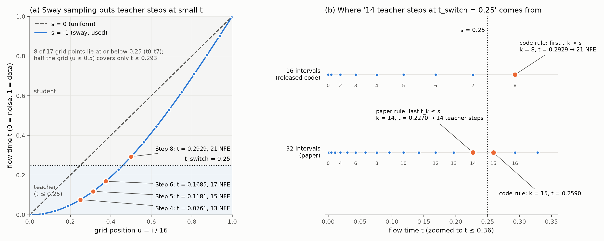
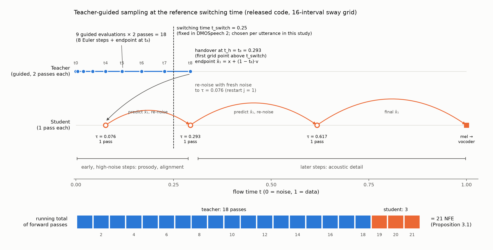

# Proposal TO-DO Checks: T49, T50, T52, T53, T54, T55

**Owner:** Rhenel · **Reviewer:** Mark (T49, T50, T53) · **Updated:** 23 October 2026

This report closes six tasks from the thesis task sheet for the proposal "A Risk-Calibrated Adaptive Handover Method for Teacher-Guided Flow-Matching Text-to-Speech Inference". Each section is labelled with its task ID and gives:
- the findings, with every number computed from the repository;
- text ready to paste into the proposal at the listed location;
- what still needs a decision.

Sources:
- the released sampler, `src/infer.py`;
- the split files, `data/splits/`;
- the GPU grid, `colab/results/gpu_grid_all1000.csv` (4,000 rows);
- the T4 timing run, `colab/results/gpu_full_pipeline_timing_3000.csv`;
- the evaluation code, `core/metrics.py`.

## Task status

| ID | Task | Proposal location | Reviewer | Status | Section |
|---|---|---|---|---|---|
| **T50** | Grid check: how 14 teacher steps at t_switch = 0.25 arise | Ch3 §3.3.1, line 186 (Remark 3.1) | Mark | ✅ Done; **one correction** (t₁₄ = 0.2270, not ≈ 0.236) | [T50](#t50-grid-check-how-14-teacher-steps-at-t_switch--025-arise) |
| **T49** | Report Seed-TTS test-en utterance and speaker counts; check split feasibility | Ch3 §3.3.3, line 218 (Table 3.4) | Mark | ✅ Done; feasible | [T49](#t49-seed-tts-test-en-counts-and-split-feasibility) |
| **T53** | Write the evaluation section (WER, SIM, UTMOS, RTF) | Ch2 §2.6, lines 323–360 | Mark (statistics paragraph, line 360) | ✅ Draft ready; **two code issues** found (SIM model, RTF column) | [T53](#t53-evaluation-section-wer-sim-utmos-rtf) |
| **T54** | Draw the sway-grid plot | Ch2 §2.1.2, line 85 (Figure 2.2) | — | ✅ Done | [T54](#t54-sway-grid-plot-figure-22) |
| **T52** | Write the teacher-guided sampling and handover section | Ch2 §2.3, lines 152–185 | Mark | ✅ Draft ready for all six TO DOs in §2.3 | [T52](#t52-teacher-guided-sampling-and-handover-section) |
| **T55** | Draw the teacher-guided timeline figure | Ch2 §2.3, line 166 (Figure 2.4) | — | ✅ Done; checked against the T52 text | [T55](#t55-teacher-guided-timeline-figure-figure-24) |

T52 was waiting on T50 and T55 on T52; both dependencies are now resolved.

## Summary of findings

| ID | Finding | Action in the proposal |
|---|---|---|
| T50 | "14 teacher steps at 0.25" comes from a **32-interval** sway grid read as "last point not above 0.25": t₁₄ = **0.2270** | Remark 3.1: change "≈ 0.236" to "≈ 0.227" and replace the TO DO with the evidence in T50.3 |
| T49 | **1,088 utterances, 666 prompt speakers.** 100 / 200 / 200 uses 500 speakers and leaves 166 spare. Table 3.7 re-computed: **matches exactly** | Fill the TO DO in §3.3.3 and the sizes in Table 3.4 (T49.5) |
| T53 | Draft text for WER, SIM, UTMOS and RTF with our real numbers | Paste T53.1 into §2.6 |
| T53 | SIM uses **`microsoft/wavlm-base-plus-sv`**, not WavLM-large as the proposal says | **Decide:** rename the model in the text, or re-score with WavLM-large (T53.2) |
| T53 | The `rtf` column in the grid CSVs excludes the teacher | **Never cite it.** Use the T4 timing run (T53.3) |
| T54 | New two-panel figure drawn from the formula | Replace Figure 2.2 with `figures/sway_grid_tswitch.png` |
| T52 | Draft text for §2.3. Two code-grounded points the current draft lacks: the paper and the released code use **different stopping rules**, and with j = 1 the student **always restarts at τ = 0.0761**, so for Steps 5–8 it re-noises the teacher's estimate to a noisier level than the teacher had reached | Paste T52.1–T52.6 into §2.3 |
| T55 | New timeline figure. It shows that the student **restarts at τ = 0.076, below the handover point t₈ = 0.293**, which the proposal's spec ("student steps on the right segment") would have drawn wrongly | Use `figures/teacher_guided_timeline_t55.png` as Figure 2.4 |

---

## T50. Grid check: how 14 teacher steps at t_switch = 0.25 arise

**Location:** Ch3 §3.3.1, line 186, Remark 3.1 · **Reviewer:** Mark

### T50.1 How the released code stops the teacher

[`src/infer.py:520-523`](../../src/infer.py#L520-L523):

```python
t = torch.linspace(0, 1, teacher_steps + 1)                          # u_i = i / N
t = t + sway_sampling_coef * (torch.cos(torch.pi / 2 * t) - 1 + t)   # s = -1  ->  t = 1 - cos(pi/2 * u)
t = t[:(t > teacher_stopping_time).float().argmax() + 2]
t = t[:-1]                                                           # keeps t_0 ... t_k
```

Step by step:
1. `(t > teacher_stopping_time).argmax()` finds **k, the first grid index with t_k > s**.
2. The two slices keep t₀ … t_k, so the Euler solver takes **k steps** (t₀ → t_k).
3. Lines 529–532 add one more guided evaluation at t_k for the endpoint estimate x̂₁ = x + (1 − t_k)·v.

So the code's rule is **"stop at the first grid point above s"**. This matches the proposal's Algorithm 1 and Proposition 3.1: C(s) = 2(k + 1) + 3. Our sampler (`core/sampler.py`) reproduces it: Steps 4/5/6/8 = 13/15/17/21 NFE.

### T50.2 The sway grid, computed

t_i = 1 − cos(π/2 · i/N), with s = −1:

**N = 16 (released code, this study)**

| i | 0 | 1 | 2 | 3 | 4 | 5 | 6 | 7 | 8 | 9 | 10 | 12 | 16 |
|---|---|---|---|---|---|---|---|---|---|---|---|---|---|
| t_i | 0 | 0.0048 | 0.0192 | 0.0431 | 0.0761 | 0.1181 | 0.1685 | 0.2270 | **0.2929** | 0.3656 | 0.4444 | 0.6173 | 1 |

**N = 32 (around t = 0.25)**

| i | 10 | 11 | 12 | 13 | **14** | **15** | 16 | 17 |
|---|---|---|---|---|---|---|---|---|
| t_i | 0.1181 | 0.1423 | 0.1685 | 0.1968 | **0.2270** | **0.2590** | 0.2929 | 0.3284 |

Every even point of the 32-interval grid is a point of the 16-interval grid: t₂ᵢ⁽³²⁾ = tᵢ⁽¹⁶⁾. For example, t₁₄⁽³²⁾ = t₇⁽¹⁶⁾ = 0.2270.

### T50.3 Teacher steps at s = 0.25 under each grid and rule

| Grid | Stopping rule | Stop index k | Stop time t_k | Teacher Euler steps | Matches |
|---|---|---|---|---|---|
| 16 intervals | first t_k > s (code) | 8 | 0.2929 | 8 | **This study's Step-8 reference** (21 NFE) |
| 16 intervals | last t_k ≤ s | 7 | 0.2270 | 7 | — |
| 32 intervals | first t_k > s (code) | 15 | 0.2590 | 15 | — |
| **32 intervals** | **last t_k ≤ s** | **14** | **0.2270** | **14** | **The paper's "14 teacher steps"** |

**Conclusion:**
1. "14 teacher steps at t_switch = 0.25" arises **only** on a 32-interval grid with the reading "stop at the last point not above s".
2. With the code's rule, a 32-interval grid gives 14 steps only for s in [0.1968, 0.2270), e.g. s = 0.20, not for s = 0.25.
3. **Evidence for the 32-interval grid:** the released `generate_teacher_only` defaults to `teacher_steps=32` ([`src/infer.py:341`](../../src/infer.py#L341)), and the paper compares against "the full 32-step teacher".
4. The proposal's reading in Remark 3.1 is therefore **correct, except for one number: t₁₄ = 0.2270, not ≈ 0.236.**
5. The paper's handover point (t = 0.2270) is the same flow time as our **Step 7**, reached with 14 finer steps instead of 7.

### T50.4 Forward-pass cost of the paper's configuration (input for T52)

| Count | Teacher | Student | Total | Full teacher | Ratio of passes |
|---|---|---|---|---|---|
| Paper convention (no endpoint evaluation) | 2 × 14 = 28 | 2 | **30** | 2 × 32 = 64 | **2.13×** |
| Released code (adds the endpoint evaluation) | 2 × (14 + 1) = 30 | 2 | **32** | 64 | **2.00×** |
| This study's reference (Step 8, 16-interval grid) | 2 × (8 + 1) = 18 | 3 | **21** | — | — |

- The paper's **2 student steps** correspond to start index **j = 2** (τ ∈ {0.2929, 0.6173}). This study fixes **j = 1** (τ ∈ {0.0761, 0.2929, 0.6173}, 3 steps).
- The paper's reported **1.8×** runtime speed-up is below both pass ratios. That's expected: the vocoder, duration predictor and data movement don't shrink when the number of forward passes does.

### T50.5 Replacement text for Remark 3.1 (ready to paste)

> **Remark 3.1.** The DMOSpeech 2 paper reports its main configuration as 14 teacher and 2 student steps at t_switch = 0.25 (Li et al., 2026). On a 32-interval sway grid, the last grid point not above 0.25 is t₁₄ = 1 − cos(14π/64) ≈ 0.227, which gives exactly 14 teacher steps; the released code's teacher-only sampler also defaults to a 32-interval grid. The released teacher-guided sampler instead stops at the first point above s on its default 16-interval grid, which for s = 0.25 is t₈ ≈ 0.293 after eight Euler steps. Both grids share their even points, so t₁₄ on the 32-interval grid equals t₇ on the 16-interval grid. All costs in this chapter refer to the 16-interval grid.

**Remaining point:** the authors' exact evaluation script isn't in the repository, so the 32-interval reading is "consistent with the released code" rather than confirmed. Keep that phrasing.

---

## T49. Seed-TTS test-en counts and split feasibility

**Location:** Ch3 §3.3.3, line 218, and Table 3.4 · **Reviewer:** Mark · **Sheet note:** "100 / 200 / 200+ speaker-disjoint, one utterance per speaker"

### T49.1 Counts

Source: [`data/splits/split_summary.json`](../data/splits/split_summary.json), written by [`data/make_splits.py`](../data/make_splits.py) from `seed-tts-eval/en/meta.lst`. That file isn't in this checkout; the counts come from the run that built the splits and match the script's docstring.

| Quantity | Value |
|---|---|
| Utterances in Seed-TTS test-en | **1,088** |
| Unique prompt speakers | **666** (about 1.63 utterances per speaker on average) |
| Prompt source | Common Voice (Anastassiou et al., 2024; Ardila et al., 2020) |
| Target-text length, 500 used utterances | 3–21 words; median 11, mean 11.1; 10th–90th percentile 8–14 |
| Prompt conditions per utterance | 2: `clean` and `noisy15` (white Gaussian noise at 15 dB, seeded per input) |

The per-speaker distribution of utterances (how many speakers have 1, 2, 3 … utterances) needs `meta.lst`. It can be computed in Colab, where the dataset is downloaded.

### T49.2 Splits as built

| Split | Speakers | Utterances | Evaluations (× 2 conditions) | Grid evaluations (× 4 steps) | Used for |
|---|---|---|---|---|---|
| Development | 100 | 100 (1 per speaker) | 200 | 800 | Objective 1; choice of the SNR gate |
| Calibration | 200 | 200 (1 per speaker) | 400 | 1,600 | Objective 3 only (LTT threshold λ̂) |
| Test | 200 | 200 (1 per speaker) | 400 | 1,600 | Objective 3 held-out check; Objective 4 |
| **Total used** | **500** | **500** | **1,000** | **4,000** | |
| Unused | 166 | — | — | — | Later used as fresh speakers in Phase 12 |

- **Construction:** speakers are shuffled with seed 42; the first 100 go to development, the next 200 to calibration, the next 200 to test, and one utterance is drawn per speaker.
- **Development** also has one utterance per speaker. The proposal only requires this for calibration and test.

**Checks asserted by `make_splits.py`:**
1. Zero speaker overlap between any two splits.
2. Exactly one utterance per speaker in calibration.
3. Exactly one utterance per speaker in test.
4. Every prompt and target audio path exists.
5. Injected noise SNR within 15.0 ± 0.1 dB.

### T49.3 Feasibility: can 200 calibration speakers certify α = 5%?

**Table 3.7 re-computed.** The table lists the largest number of added failures k with P(Bin(n, α) ≤ k) ≤ δ. **It matches the proposal exactly:**

| n | α | δ | Max. failures that still certify |
|---|---|---|---|
| 45 | 0.05 | 0.10 | 0, the minimum n = ⌈ln 0.10 / ln 0.95⌉ = 45 |
| 50 | 0.05 | 0.05 | none certifiable |
| 50 | 0.10 | 0.10 | 1 |
| 100 | 0.05 | 0.10 | 1 |
| 100 | 0.10 | 0.10 | 5 |
| **200** | **0.05** | **0.10** | **5** (p = 0.062 at k = 5; p = 0.124 at k = 6) |
| 200 | 0.10 | 0.10 | 14 |
| 300 | 0.05 | 0.10 | 9 |

**Verdict: feasible.**
- The design needs 500 of 666 speakers.
- n = 200 leaves room for up to 5 added failures, enough to certify a non-trivial threshold. In practice λ̂ = 0.50 was certified with 4/200 failures (p = 0.026).

**Precision of the held-out check** (exact Clopper-Pearson 95% intervals at n = 200):

| Observed on test | 95% interval |
|---|---|
| 0 / 200 (0%) | 0–1.83% |
| 5 / 200 (2.5%, proposed policy) | 0.82–5.74% |
| 11 / 200 (5.5%, SNR-only) | 2.78–9.63% |

A single 200-speaker split can't separate 2.5% from 5% with confidence, which is why the proposal adds the repeated-split check (§3.6.4; `stability.py`: 94% of 100 recalibrated re-splits ≤ 5%).

### T49.4 Caveat: a "speaker" is a prompt clip

- `make_splits.py` takes the speaker ID from the prompt file name (`common_voice_en_<clip>`). That's a Common Voice **clip** ID, not the contributor (`client_id`).
- In principle, two prompt clips could belong to the same person and fall into different splits.
- **Heuristic check:** within one utterance, the prompt and target clip IDs are usually consecutive recordings (median gap 2). I found **no pair of clips from different splits within 3 IDs of each other**. So there's no sign of leakage, but it can't be proven without Common Voice contributor metadata.

### T49.5 Text for §3.3.3 and Table 3.4 (ready to paste)

> The corpus will be Seed-TTS test-en, whose prompts come from Common Voice (Anastassiou et al., 2024; Ardila et al., 2020); it is the English test set used by DMOSpeech 2 (Li et al., 2026), so the reference configuration can be compared with published numbers. It contains 1,088 utterances from 666 prompt speakers. The speakers will be divided into three disjoint splits with a fixed random seed (Table 3.4), using 500 of the 666 speakers; speaker identity is taken from the prompt recording, so the splits are disjoint at the level of Seed-TTS prompt identities.

**Table 3.4: Speaker-disjoint data splits**

| Split | Used for | Constraint | Size |
|---|---|---|---|
| Development | Objective 1; choice of the SNR gate | Speaker-disjoint from the others | 100 speakers / 100 utterances |
| Calibration | Objective 3 (threshold λ̂) | One utterance per speaker | 200 speakers / 200 utterances |
| Test | Objective 3 held-out check; Objective 4 | One utterance per speaker | 200 speakers / 200 utterances |

---

## T53. Evaluation section (WER, SIM, UTMOS, RTF)

**Location:** Ch2 §2.6, lines 323–360 · **Reviewer:** Mark checks the statistics paragraph (line 360)

### T53.1 Draft text (ready to adapt)

The text fills the four TO DOs in §2.6: the section takeaway, Equations 2.23–2.25, and the UTMOS limits paragraph.

**Section takeaway.** Every quality and cost number in Chapter 3 is computed by one of the four measures below. WER and SIM decide whether a handover counts as a failure (Definition 3.1). UTMOS is reported but not used in that decision. NFE is the primary cost and RTF the secondary one. Each candidate is compared with the reference on the same input and the same random seeds, which is why the statistics use paired tests.

**Intelligibility (WER).** Each output is transcribed with Whisper-large-v3 (Radford et al., 2023), and the transcript is compared with the target text:

$$\mathrm{WER} = \frac{S + D + I}{N} \qquad \text{(Equation 2.23)}$$

- S, D and I are the substitutions, deletions and insertions in the minimum edit alignment between the normalized reference and the hypothesis. N is the number of reference words.
- WER can exceed 100% when the transcript contains many insertions, for example when a model loops or hallucinates.
- **Normalization:** before scoring, both texts are normalized as in the Seed-TTS / F5-TTS English evaluation. Punctuation is replaced by spaces, whitespace is collapsed, and text is lowercased. Text normalization changes WER, so it must be stated.
- **Coarseness:** per-utterance WER moves in large jumps. The target sentences used here have a median of 11 words, so one wrong word costs about 9 percentage points. For the 7.8% of sentences with fewer than 8 words, a single wrong word already exceeds 12.5%.
- **Link to Definition 3.1:** the absolute ceiling c = 12.5% equals one error in an 8-word sentence. So the 92.2% of sentences with 8 or more words can absorb one misrecognized word without counting as a failure.
- **Worked example (Appendix A):** reference WER 0% → limit max(12.5%, 0% + 1%) = 12.5%; reference WER 15.38% → limit max(12.5%, 16.38%) = 16.38%.

**Speaker similarity (SIM).** SIM is the cosine similarity between speaker embeddings of the generated speech and of the original target recording, as in DMOSpeech 2:

$$\mathrm{SIM} = \frac{e_{\text{gen}}^{\top} e_{\text{ref}}}{\lVert e_{\text{gen}} \rVert\, \lVert e_{\text{ref}} \rVert} \qquad \text{(Equation 2.24)}$$

- e_gen and e_ref are the verifier's embeddings of the generated audio and of the ground-truth target recording.
- SIM ranges from −1 to 1; higher means the voice is more similar.
- SIM depends on the verifier, so values are comparable only within one verifier. That's why the failure rule compares each candidate only with the reference configuration scored by the same verifier.

**Naturalness (UTMOS).** UTMOS (Saeki et al., 2022) predicts the mean opinion score (1–5) that listeners would give an utterance. It was built for the VoiceMOS Challenge. Predicted MOS is reliable for ranking systems on average but noisy for single utterances. It is therefore reported but not used in the failure rule, and it does not replace a listening test.
- **Supporting observation from our data:** on noisy prompts, UTMOS stays at about 1.25 with almost no spread (SD 0.02) at every handover step. The model reproduces the prompt's noise and UTMOS saturates at its floor, so it can't separate good from bad outputs there.
- [citation needed: per-utterance reliability of automatic MOS prediction]

**Cost (NFE and RTF).** The primary cost is the number of network forward passes (neural function evaluations, NFE), with a guided teacher step counted as two. It follows exactly from Proposition 3.1 and doesn't depend on hardware. The secondary cost is the real-time factor:

$$\mathrm{RTF} = \frac{T_{\text{synthesis}}}{T_{\text{audio}}} \qquad \text{(Equation 2.25)}$$

- T_synthesis is the wall-clock time from the prepared inputs to the decoded waveform: teacher, student and vocoder.
- T_audio is the duration of the generated speech.
- RTF < 1 means faster than real time.
- **Example from our T4 run:** one utterance took 2.875 s to synthesize 3.499 s of speech, so RTF = 0.82.
- RTF includes costs that NFE doesn't count (the vocoder, the duration model and data movement), so savings in RTF are smaller than savings in NFE. DMOSpeech 2 reports RTF on a single GPU (Li et al., 2026).

**Statistics (line 360, for Mark).** The existing sentence ("Paired comparisons use the Wilcoxon signed-rank test (Wilcoxon, 1945)") stands. What the analysis actually used, for alignment:
- Wilcoxon signed-rank tests on speaker-level means with Holm correction (cost and quality vs. Step 8).
- Exact McNemar tests for paired failure counts (proposed vs. baselines).
- TOST equivalence with margins of ±0.02 WER, ±0.02 SIM and ±0.10 UTMOS, for the claim that quality isn't worse (Schuirmann, 1987).
- Exact Clopper-Pearson intervals for failure rates.

### T53.2 What the code actually uses (`core/metrics.py`)

| Measure | Implementation | Matches the proposal? |
|---|---|---|
| WER | HF pipeline `openai/whisper-large-v3`, FP32, `language="english"`, audio resampled to 16 kHz; `jiwer` after `normalize_text` (punctuation → space, collapse whitespace, lowercase) | ✅ |
| SIM | `microsoft/wavlm-base-plus-sv` (WavLM **Base+** with an x-vector head); cosine vs. the ground-truth target recording | ❌ **Not WavLM-large** |
| UTMOS | `tarepan/SpeechMOS:v1.2.0`, `utmos22_strong` | ✅ |
| Failure rule | `check_failure`: WER > max(0.125, WER_ref + 0.01) or SIM < SIM_ref − 0.02; constants from `failure_config.json` | ✅ |
| NFE | Proposition 3.1: Steps 4/5/6/8 = 13/15/17/21 | ✅ |

**SIM verifier mismatch:**
- The proposal (Table 3.5), DMOSpeech 2 and the code's own comments say "WavLM-large-based verifier", but the model loaded is WavLM-Base+ SV.
- **What stays valid:** the failure rule and every internal comparison. They are relative: a candidate vs. Step 8, scored by the same verifier.
- **What breaks:** comparing our absolute SIM (≈ 0.94 on clean prompts) with published DMOSpeech 2 SIM, which uses the WavLM-large Seed-TTS verifier and sits much lower.
- **Options:**
  - (a) **Recommended:** name the model actually used in Table 3.5 and §3.3.4 ("a WavLM-Base+ speaker-verification model") and drop any comparison with published SIM. No GPU needed.
  - (b) Re-score all audio with the WavLM-large verifier. This needs a full GPU re-run, and failure labels could change.
- Either way, fix the docstrings in `core/metrics.py` and the "WavLM-large" print statements in the runners.

**Ground-truth fallback:** if a target recording is missing, `colab/run_gpu_expanded_benchmark.py` scores SIM against the **prompt** without warning. Report how many rows used the fallback, or confirm that none did.

### T53.3 RTF: which numbers are valid

| Source | What is timed | Valid RTF? |
|---|---|---|
| `rtf` / `runtime_sec` columns in the grid CSVs (`gpu_grid_all1000.csv`, phase 1–3 grids) | Only `run_student_completion`: 3 student passes + vocoder. The shared teacher pass is excluded | ❌ ≈ 0.11 at **every** step, because the teacher's cost is missing. **Do not cite** |
| `gpu_full_pipeline_timing_3000.csv` (3,000 timed runs, Tesla T4) | Full pipeline per policy: SNR estimate, teacher, decision, student, vocoder | ✅ |

**Valid T4 numbers, test split:**

| Condition | Step 8 | Proposed (SNR + drift) | SNR-only (Step 4) |
|---|---|---|---|
| Clean: latency / RTF | 3.29 s / 0.725 | 2.40 s / 0.529 | 2.06 s / 0.453 |
| Noisy15: latency / RTF | 3.37 s / 0.706 | 3.37 s / 0.706 | 3.37 s / 0.706 (all fall back to Step 8) |

§3.3.5 promises runtimes on the Ryzen 7 laptop. **None have been measured yet**; all valid RTFs are T4 numbers. This also affects task T48 (time one utterance through Whisper / WavLM / UTMOS on the laptop).

### T53.4 Observed quality per step (GPU grid, 500 speakers)

| Condition | Step | NFE | Mean WER | Median WER | SIM | UTMOS |
|---|---|---|---|---|---|---|
| Clean | 4 | 13 | 1.60% | — | 0.938 | 3.86 |
| Clean | 5 | 15 | 1.59% | — | 0.938 | 3.87 |
| Clean | 6 | 17 | 1.70% | — | 0.938 | 3.87 |
| Clean | 8 (ref) | 21 | 1.65% | — | 0.938 | 3.87 |
| Noisy15 | 4 | 13 | 75.0% | 15.4% | 0.694 | 1.25 |
| Noisy15 | 5 | 15 | 74.3% | 10.0% | 0.699 | 1.25 |
| Noisy15 | 6 | 17 | 29.6% | 9.1% | 0.705 | 1.25 |
| Noisy15 | 8 (ref) | 21 | 36.1% | 10.0% | 0.712 | 1.25 |

Observations worth a sentence in the thesis:
- **Clean prompts:** mean quality is flat across steps, and the reference already has WER = 0 for 86% of utterances.
- **Noisy prompts are hard even for the reference:** Step 8 exceeds the 12.5% WER ceiling on 43.6% of them.
- **Noisy mean WER is dominated by a few runaway transcripts.** The maximum per-utterance WER reaches 9,867% (looping or hallucinated output). The medians (15.4 / 10.0 / 9.1 / 10.0%) show the real picture, and the means look non-monotone only because of those outliers. That's why failures are counted per utterance rather than compared by means.
- **Failure causes** across the 3,000 non-reference evaluations: 232 WER only, 453 SIM only, 179 both.

---

## T54. Sway-grid plot (Figure 2.2)

**Location:** Ch2 §2.1.2, line 85



- **File:** [`figures/sway_grid_tswitch.png`](../figures/sway_grid_tswitch.png), 2600 × 1040 px.
- **Generator:** [`figures/generate_sway_grid_check.py`](../figures/generate_sway_grid_check.py). It uses only the formula, no data.
- **Regenerate:** `python "Handover Scheduling/figures/generate_sway_grid_check.py"`

**Panel (a)** follows the proposal's figure spec (the TO DO at line 85):

| Spec item | In the figure |
|---|---|
| u on the x-axis (0–1), t on the y-axis (0–1) | ✅ |
| Curves for s = 0 (identity, dashed) and s = −1 (solid) | ✅ |
| The 17 teacher grid points (u_i = i/16) on the s = −1 curve | ✅ |
| Horizontal line at t_switch = 0.25; "teacher" region below, "student" above | ✅ |
| How many grid points lie below 0.25 | ✅ 8 of 17 (t₀–t₇) |
| Extra: candidate Steps 4/5/6/8 with their NFE | ✅ |

The annotation also states that the first half of the grid (u ≤ 0.5) covers only t ≤ 0.293. That supports the §2.1.2 TO DO point "(a) half of the grid points fall below t ≈ 0.29".

**Panel (b)** shows the T50 grid check: the 16- vs. 32-interval grids near s = 0.25, and the stop index under each rule. Use it in Chapter 3 beside Remark 3.1, or crop to panel (a) if Figure 2.2 should be a single panel.

**Suggested caption:**

> Figure 2.2: Sway sampling (s = −1) concentrates teacher steps at small t, where the switching time lies. (a) The sway map against the uniform grid; 8 of the 17 teacher grid points lie at or below t_switch = 0.25, and the candidate handover steps 4, 5, 6 and 8 cost 13, 15, 17 and 21 forward passes. (b) Near t = 0.25, the paper's 14 teacher steps correspond to the last point not above 0.25 on a 32-interval grid (t₁₄ ≈ 0.227), while the released code stops at the first point above 0.25 on its 16-interval grid (t₈ ≈ 0.293).

The older [`figures/sway_grid_plot.png`](../figures/sway_grid_plot.png) is kept but shouldn't be used: it plots against the step index, has no t_switch line, and its Step 4/5 labels overlap.

---

## T52. Teacher-guided sampling and handover section

**Location:** Ch2 §2.3, lines 152–185 · **Reviewer:** Mark · **Depended on:** T50 (grid check) · **Figure:** T55

§2.3 has six TO DOs. Each subsection below fills one of them with text ready to paste. Equation numbers follow the proposal (2.10, 2.11). Background chapter rule: these paragraphs argue and explain; they don't report this study's results. The only evidence cited is the published papers and Appendix D.

| Sub | TO DO in §2.3 | Proposal position |
|---|---|---|
| T52.1 | Section takeaway | Start of §2.3 |
| T52.2 | Equation 2.10 and the cost paragraph | §2.3.1, after the first paragraph |
| T52.3 | Figure 2.4 | §2.3.1 (figure is T55) |
| T52.4 | Why the best switching time should differ between utterances | §2.3.1, before the released-code paragraph |
| T52.5 | Equation 2.11 and the re-noising paragraph | §2.3.2 |
| T52.6 | Restart sampling's error-contraction argument | End of §2.3.2 |
| T52.7 | Corrections to existing §2.3 text | §2.3.1 |

### T52.1 Section takeaway (ready to paste)

> This section defines the variable the study optimises: the switching time at which the teacher hands its state to the student. At that point the teacher stops taking guided steps, which cost two forward passes each, and the student finishes in a few unguided steps of one pass each. The switching time therefore sets almost all of the sampler's cost. DMOSpeech 2 fixes it once for every input. The section ends by explaining why the student can cope with an imperfect teacher state: before each of its steps the student re-noises the current estimate, which dilutes errors inherited from the teacher.

### T52.2 Cost of teacher-guided sampling: Equation 2.10 (ready to paste)

> With K guided teacher steps and M unguided student steps, teacher-guided sampling costs
>
> $$C(K, M) = 2K + M, \qquad \text{speed-up over the full teacher} = \frac{2N}{2K + M} \qquad \text{(Equation 2.10)}$$
>
> forward passes, where N is the number of steps of the full teacher. A guided teacher step needs a conditional and an unconditional pass (Section 2.1.3), while a student step is a single unguided pass. For the paper's main configuration, K = 14 and M = 2 give 2 × 14 + 2 = 30 passes, against 2 × 32 = 64 for the full 32-step teacher: a ratio of 64/30 ≈ 2.1. The reported runtime speed-up of about 1.8× is smaller (Li et al., 2026) because some costs do not shrink with the number of forward passes: the duration predictor, the vocoder and data movement run once per utterance whatever the switching time. Because K can only take the values of the teacher grid, the cost is a step function of the switching time: moving t_switch changes the cost only when it crosses a grid point, and each crossing adds or removes one guided step (two passes). Chapter 3 uses the exact count of the released code (Proposition 3.1), which also counts the guided evaluation that produces the endpoint estimate handed to the student.

**Numbers behind the paragraph** (released code, 16-interval grid, student start j = 1, C = 2(k + 1) + 3):

| t_switch range | Teacher stop index k | Handover time t_h | Forward passes |
|---|---|---|---|
| [0.0431, 0.0761) | 4 | 0.0761 | 13 |
| [0.0761, 0.1181) | 5 | 0.1181 | 15 |
| [0.1181, 0.1685) | 6 | 0.1685 | 17 |
| [0.1685, 0.2270) | 7 | 0.2270 | 19 |
| **[0.2270, 0.2929)** | **8** | **0.2929** | **21 (reference, t_switch = 0.25)** |
| [0.2929, 0.3656) | 9 | 0.3656 | 23 |

The fixed alternatives in Table 3.8 fall inside these ranges: t_switch = 0.07 / 0.10 / 0.15 / 0.25 give Steps 4 / 5 / 6 / 8 (13 / 15 / 17 / 21 passes).

The paper's 30 vs. 64 count is 32 vs. 64 (2.0×) once the endpoint evaluation is included (T50.4). Keep the paper's own count in Chapter 2 and the exact count in Chapter 3, as the TO DO asks.

### T52.3 Figure 2.4

Use `figures/teacher_guided_timeline_t55.png` with the caption in T55.3. It shows the reference configuration of the released code, so it matches Proposition 3.1 and the cost table above (18 teacher + 3 student = 21 passes). The text in T52.2 uses the paper's configuration (14 + 2); the caption names the configuration shown, so the two don't conflict.

### T52.4 Why the best switching time should differ between utterances (ready to paste)

> There are reasons to expect the cheapest acceptable switching time to vary from one utterance to the next. Inputs differ in text length, speaking rate and prompt quality, including background noise and reverberation. An input whose coarse structure (prosody and text-speech alignment) settles in the first few teacher steps gains little from further guided steps, while a harder input, such as one with a degraded prompt, may need them before the student can finish reliably. DMOSpeech 2 reports only average metrics over its test set (Li et al., 2026), which cannot show whether a single switching time is too late for some inputs and too early for others. The team's preliminary experiments (Appendix D) give first evidence of such variation: early switching failed mostly on noisy prompts. Objective 1 measures this variation directly.

### T52.5 Re-noising at the handover: Equation 2.11 (ready to paste)

> In this chapter's convention the re-noising step is
>
> $$x_\tau = (1 - \tau)\,\varepsilon + \tau\,\tilde{x}, \qquad \varepsilon \sim \mathcal{N}(0, I), \quad \tau \in [0, 1], \qquad \text{(Equation 2.11)}$$
>
> where x̃ is the guide (here the teacher's endpoint estimate) and τ is the restart level. A fraction τ of the input carries the teacher's information and 1 − τ is fresh noise. With the published restart level τ = 0.0761 (Section 3.3.1), about 92% of the student's input by weight is noise. That the coarse structure nonetheless survives is consistent with SDEdit's observation that moderate noise levels preserve the overall layout of the guide while letting the model re-synthesise detail (Meng et al., 2022). The noise level trades faithfulness to the guide against realism of the output.
>
> In the released code the restart level is fixed by the student's grid, not by the switching time. With the published start index j = 1 the student always restarts at τ = 0.0761. That level equals the teacher's grid point t₄, so for any later handover the student re-noises the teacher's estimate back to a noisier level than the teacher had already reached. Further teacher steps still improve the estimate x̃, but part of that improvement is diluted by the noise added at the restart. This is one reason a later switch can bring diminishing returns.

**Fact check for Mark:**
- 1 − 0.0761 = 0.9239, so "about 92% by weight" refers to the amplitude coefficients in Equation 2.11, not to signal power.
- τ = 0.0761 = t₄ is exact on the 16-interval grid: both are 1 − cos(π/8).
- The SDEdit claim is limited to what Meng et al. (2022) show: the noise level trades realism against faithfulness, and moderate noise keeps the guide's overall structure. The proposal's earlier wording about "low-frequency content" is **not** something SDEdit shows for speech, so I left it out, as the TO DO asks ("keep the last claim hedged").

### T52.6 Restart sampling's error-contraction argument (ready to paste)

> Restart sampling gives a second reason why re-noising helps (Xu et al., 2023). A deterministic ODE solver accumulates the errors of each discrete step, and nothing in later steps removes them. Adding noise moves the sample to a noisier level where trajectories that started close together are pushed even closer; solving again from there shrinks the accumulated error, at the price of extra steps. The student's re-noising at the handover plays the same role: it lets the student start from a perturbed version of an imperfect teacher state rather than inherit that state's errors exactly. The same mechanism also means that a perfect teacher state is not required, which is what makes an earlier, cheaper handover possible.

This keeps the argument qualitative, as the TO DO suggests. If the group wants the bound: Xu et al. show that the forward noising step contracts the distance between the two distributions, so the total error can be lower than with a pure ODE solver.

### T52.7 Corrections and consistency checks for the existing §2.3 text

| Existing text | Check | Suggested change |
|---|---|---|
| "up to the step k with t_k ≤ t_switch < t_{k+1}" | ✅ Matches the paper's reading. With the 32-interval grid it gives k = 14 at t_switch = 0.25 (T50) | None. Add "on a 32-interval sway grid" so the 14 steps are reproducible |
| "14 teacher and 2 student steps … about 1.8× faster than the full 32-step teacher" | ✅ Consistent with T50.4 (30 vs. 64 passes) | None |
| "the released DMOSpeech 2 inference code, whose handover differs in detail from the paper's algorithm" | ✅ True, but the main difference is unstated | Add: "In particular, the released code stops at the first point of its 16-interval grid above t_switch, so t_switch = 0.25 gives eight teacher steps instead of fourteen (Section 3.3.1, Remark 3.1)." |
| "the student re-noises it to a restart level taken from its own fixed grid" | ✅ Matches `src/infer.py:537-560` | None. T52.5 makes the τ = 0.0761 consequence explicit |
| §2.3.2: "re-noising dilutes its errors" | ✅ Consistent with SDEdit and restart sampling | None |

---

## T55. Teacher-guided timeline figure (Figure 2.4)

**Location:** Ch2 §2.3, line 166 · **Depends on:** T52 (done; the figure matches T52.2–T52.5)



- **File:** [`figures/teacher_guided_timeline_t55.png`](../figures/teacher_guided_timeline_t55.png), 2600 × 1320 px.
- **Generator:** [`figures/generate_teacher_guided_timeline.py`](../figures/generate_teacher_guided_timeline.py). It uses only the sampler's formulas, no data.
- **Regenerate:** `python "Handover Scheduling/figures/generate_teacher_guided_timeline.py"`

### T55.1 What the figure shows

It shows the reference configuration of the released code: t_switch = 0.25, 16-interval sway grid, student restart j = 1.

| Element | What it shows | Source |
|---|---|---|
| Teacher track (filled blue circles) | Grid points t₀ … t₈ on the sway grid: 8 Euler steps plus the endpoint evaluation at t₈. 9 guided evaluations × 2 passes = 18 | `src/infer.py:520-532`; Proposition 3.1 |
| Dashed line | t_switch = 0.25, "fixed in DMOSpeech 2; chosen per utterance in this study" | Proposal spec |
| Handover label | t_h = t₈ = 0.293, the first grid point above t_switch; endpoint x̂₁ = x + (1 − t₈)·v | T50 |
| Student track (open orange circles) | τ = 0.076, 0.293, 0.617, one pass each. At each τ the student re-noises the current estimate with fresh noise, makes one pass and predicts x̂₁ | `src/infer.py:537-560`; Equation 3.4 |
| Braces | Early, high-noise steps decide prosody and alignment; later steps decide acoustic detail | Li et al. (2026) |
| Bottom bar | Running total of forward passes: 18 teacher (blue) + 3 student (orange) = 21 NFE | Proposition 3.1 |

### T55.2 Differences from the proposal's figure spec, and why

| Spec item (proposal lines 959–967) | In the figure | Reason |
|---|---|---|
| Student steps drawn on the **right** segment, after t_switch | Student drawn on **its own track**; its first step is at τ = 0.076, **left** of the handover | With j = 1 the student restarts at τ = 0.076 < t₈ = 0.293. It re-noises back down the flow axis instead of continuing from the handover point. Drawing it to the right would misstate the method |
| Each teacher step labelled "2 passes" | One group label, "9 guided evaluations × 2 passes = 18"; the track label reads "guided, 2 passes each" | The sway grid packs t₀–t₃ into t < 0.05, so per-point labels would overlap |
| Small noise icons between student steps | Arcs labelled "predict x̂₁, re-noise" | Same meaning; easier to read |
| Reuse the colours of `figures/fig_method.tex` | Same palette as the T54 figure (blue teacher, orange student) | `fig_method.tex` is not in this repository. Swap the two colour constants at the top of the script once it is available |

### T55.3 Suggested caption

> Figure 2.4: Teacher-guided sampling in DMOSpeech 2 at the reference switching time (t_switch = 0.25, 16-interval sway grid). The teacher takes guided Euler steps up to the first grid point above t_switch (t₈ ≈ 0.293), and one more guided evaluation gives the endpoint estimate x̂₁. The student then restarts from a re-noised copy of x̂₁ at τ ≈ 0.076 and finishes in three unguided steps. Guided teacher evaluations cost two forward passes each, so the teacher accounts for 18 of the 21 passes. In DMOSpeech 2 the switching time is fixed; in this study it is chosen per utterance.

The older [`figures/teacher_guided_timeline.png`](../figures/teacher_guided_timeline.png) is a block diagram of the proposed method, not this timeline, and its labels overlap. It fits Figure 3.1 better than Figure 2.4, after the overlaps are fixed.

---

## Proposal edits implied by these tasks

| ID | Edit | Location |
|---|---|---|
| T50 | Replace Remark 3.1 with the text in T50.5 (t₁₄ ≈ 0.227) | Ch3 §3.3.1, line 186 |
| T52 | Paste T52.1–T52.6 into §2.3 (takeaway, Equation 2.10 paragraph, per-utterance argument, Equation 2.11 paragraph, restart-sampling paragraph) and apply the T52.7 corrections | Ch2 §2.3, lines 152–185 |
| T49 | Paste the §3.3.3 text and Table 3.4 from T49.5 | Ch3 §3.3.3, line 218 |
| T53 | Paste the §2.6 text from T53.1; Mark reviews the statistics paragraph | Ch2 §2.6, lines 323–360 |
| T53 | Name the actual SIM model, or re-score with WavLM-large | Table 3.5, §3.3.4 |
| T53 | Cite RTF only from the full-pipeline timing run, labelled T4 | Results chapter |
| T54 | Replace Figure 2.2 with `sway_grid_tswitch.png` and the caption above | Ch2 §2.1.2, line 85 |
| T55 | Insert `teacher_guided_timeline_t55.png` as Figure 2.4 with the caption in T55.3 | Ch2 §2.3, line 166 |
