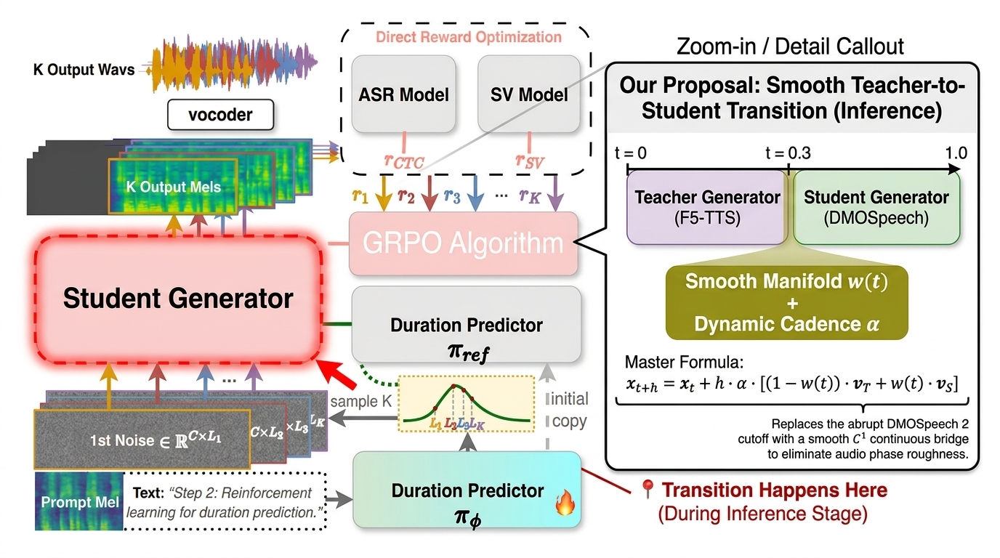

# 📚 Research Evolution: From F5-TTS to DMOSpeech 2 and the Transition Problem

## 1. The Lineage: From F5-TTS to DMOSpeech 2

To understand why the transition problem exists, we must trace the chronological evolution across the three foundational systems:

```
┌──────────────────────────────────────────────────────────────────────────────────┐
│                             THE RESEARCH EVOLUTION                               │
├────────────────────────────┬─────────────────────────────┬───────────────────────┤
│ 1. F5-TTS (Oct 2024)       │ 2. DMOSpeech 1 (Early 2025) │ 3. DMOSpeech 2 (2025) │
├────────────────────────────┼─────────────────────────────┼───────────────────────┤
│ • Full Flow-Matching (DiT) │ • Distilled Student (DMD2)  │ • GRPO Duration Policy│
│ • High quality, natural    │ • Fast 4-step generation    │ • Teacher-Guided      │
│ • Slow: 32–64 steps on ODE │ • Flat/robotic voices       │   Sampling (t = 0.3)  │
│ • ACTS AS THE TEACHER      │ • Disconnected duration     │ • HARD CUTOFF FLAW!   │
└────────────────────────────┴─────────────────────────────┴───────────────────────┘
```

---

### Step 1: F5-TTS (Chen et al., October 2024) — *The Foundation / Teacher*
* **The Architecture:** A non-autoregressive Flow Matching model built on a 22-layer Diffusion Transformer (DiT-Base, ~310M parameters).
* **The Strength:** Outstanding zero-shot voice cloning quality, natural pitch variation, and human-like prosodic expressiveness.
* **The Bottleneck:** Requires **32 to 64 numerical ODE steps** to generate speech. On a standard laptop CPU, generating 3 seconds of audio takes over **60 to 90 seconds**, making real-time use impossible.

---

### Step 2: DMOSpeech 1 (Li et al., Early 2025) — *The Fast Student*
* **The Innovation:** The authors used **Distribution Matching Distillation (DMD2)** and Direct Metric Optimization to distill F5-TTS into a compressed **4-Step Student Generator**.
* **The New Problem:**
  1. **Mode Collapse / Acoustic Degradation:** Compressing 32 steps down to 4 steps collapsed the output distribution. Speech became flat, muffled, and lost the fine vocal timbre of the original speaker.
  2. **Unoptimized Duration:** The duration predictor was still a separate model trained with standard MSE/L1 loss. It had no feedback on whether its predicted length caused high Word Error Rate (WER) or poor Speaker Similarity.

---

### Step 3: DMOSpeech 2 (Li et al., July 2025) — *The RL Duration & Hybrid Sampling*
DMOSpeech 2 introduced **two distinct contributions**:

1. **Contribution A (Main Focus): RL-Trained Duration Policy ($\pi_\phi$):**
   * Formulated duration prediction as a reinforcement learning policy.
   * Fine-tuned with **Group Relative Policy Optimization (GRPO)** using ASR (Whisper) Word Error Rate and Speaker Verification (SV) similarity as direct reward signals.
2. **Contribution B (Inference Heuristic): Teacher-Guided Sampling:**
   * To fix the flat/robotic sound of the student, they reintroduced the **Teacher (F5-TTS)** during generation.
   * **The Heuristic Rule:** Run the Teacher for the first 30% of steps ($t \in [0, 0.30]$) to establish vocal timbre and pitch, then let the Student finish the remaining 70% ($t \in [0.30, 1.00]$).

---

## 2. The Problem in the DMOSpeech 2 Architecture

The image below illustrates the exact architecture of DMOSpeech 2 and pinpoints the structural flaw:



### 🔍 Where the Flaw Lives (The Red Box):

In the paper's diagram, the authors drew a single box labeled **`Student Generator` (❄️ frozen)** because that diagram shows **Training Mode (Step 2)**. 

However, during **Inference (Actual Audio Generation)**, that single box executes **Teacher-Guided Sampling**:

```
Time (t): 0.0                      0.30                                1.00
Trajectory: ├────── Teacher (F5-TTS) ──────┼────── Student (DMOSpeech) ──────┤
                                           ▲
                                           │
                           💥 THE ABRUPT HARD CUTOFF!
                           (Acoustic Phase Discontinuity)
```

---

### 💥 The Mathematical Failure Modes of the DMOSpeech 2 Handover:

#### 1. The Vector Field Boundary Collision ($\mathcal{C}^0$ Discontinuity)
* In the actual code of `src/infer.py`, DMOSpeech 2 simply stops the `_teacher_sampling` loop at $t = 0.30$ and passes the raw tensor into `_student_sampling`.
* The Teacher vector field $\mathbf{v}_{\text{teacher}}$ and Student vector field $\mathbf{v}_{\text{student}}$ do not share identical vector derivatives at that boundary:
  $$\lim_{t \to 0.30^-} \mathbf{v}(x_t, t) \neq \lim_{t \to 0.30^+} \mathbf{v}(x_t, t)$$
* **Physical Acoustic Symptom:** This sudden mathematical jump creates an **acceleration spike** ($\frac{\partial^2 x}{\partial t^2} \to \infty$). Human ears perceive this as **phase roughness, metallic clicking, and sudden texture changes mid-syllable**.

#### 2. Compounding Duration Pre-Allocation Error
* When taking few discrete steps ($N = 4$), step size $h = 0.25$ is large.
* Any minor misestimation in predicted duration $\hat{T}$ forces the discrete solver to compress or stretch spectral energy:
  $$\tilde{\mathbf{v}}_t = \alpha \cdot \mathbf{v}_t, \quad \text{where } \alpha = \frac{T^*}{\hat{T}}$$
* Without dynamic velocity rescaling, this causes **severe word slurring, rushing, or trailing dead silence**.

---

## 3. The Thesis Opportunity: What Our Proposal Solves

DMOSpeech 2 focused 90% of its research on training the Duration Predictor with GRPO. They treated Teacher-Guided Sampling as an afterthought—a quick heuristic hack with a hard cutoff.

### 💡 Our Contribution: The Missing Mathematical Continuum

We hold the DMOSpeech 2 models strictly constant and **upgrade the handover mechanism inside that Red Box**:

```
DMOSpeech 2 (Baseline):
Teacher ───► [ Hard Cutoff at t = 0.3 ] ───► Student  (Clicks & Roughness)

Our Proposed Shonget-Matching:
Teacher ───► [ Smooth Transition Manifold w(t) ] ───► Student  (Seamless, Crisp Audio)
             [ + Dynamic Velocity Scaler α     ]
```

### 🌟 The Unified Master Formula:
$$\mathbf{x}_{t+h} = \mathbf{x}_t + h \cdot \underbrace{\alpha}_{\text{Dynamic Cadence Scaling}} \cdot \left[ \underbrace{(1 - w(t)) \cdot \mathbf{v}_{\text{teacher}} + w(t) \cdot \mathbf{v}_{\text{student}}}_{\text{Smooth } \mathcal{C}^1\text{-Continuous Manifold}} \right]$$

1. **Continuous Cosine Manifold ($w(t)$):**
   $$w(t) = \frac{1}{2} \left[ 1 - \cos\left( \pi \frac{t - t_1}{t_2 - t_1} \right) \right]$$
   Because $\left. \frac{dw}{dt} \right|_{t_1} = \left. \frac{dw}{dt} \right|_{t_2} = 0$, the transition is **strictly $\mathcal{C}^1$-continuous**, completely eliminating vector collisions and boundary clicks.

2. **Dynamic Velocity Rescaling ($\alpha$):**
   $$\alpha = \text{clamp}\left( \frac{\text{Reference Syllable Pace}}{\text{Predicted Syllable Pace}}, 0.80, 1.20 \right)$$
   Dynamically scales integration velocity to match natural human cadence, preventing few-step word slurring.

---

## 4. Summary for Defense & Reviewers

* **F5-TTS** proved that Flow-Matching produces stunning zero-shot voice quality (but was too slow).
* **DMOSpeech 1** proved distillation can produce a 4-step student (but lost acoustic naturalness).
* **DMOSpeech 2** introduced RL duration prediction and hybrid sampling (but left an abrupt, rough cutoff at $t=0.3$).
* **Our Thesis** provides the **mathematical solution to that cutoff**: turning an ad-hoc heuristic into a rigorous, $\mathcal{C}^1$-continuous inference engine that delivers fast, high-quality synthesis on consumer CPUs.
