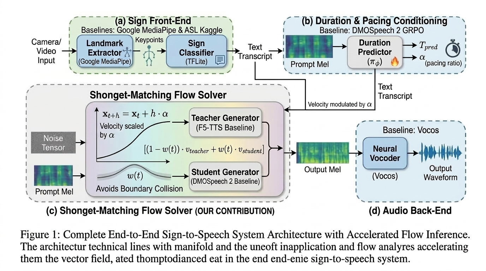
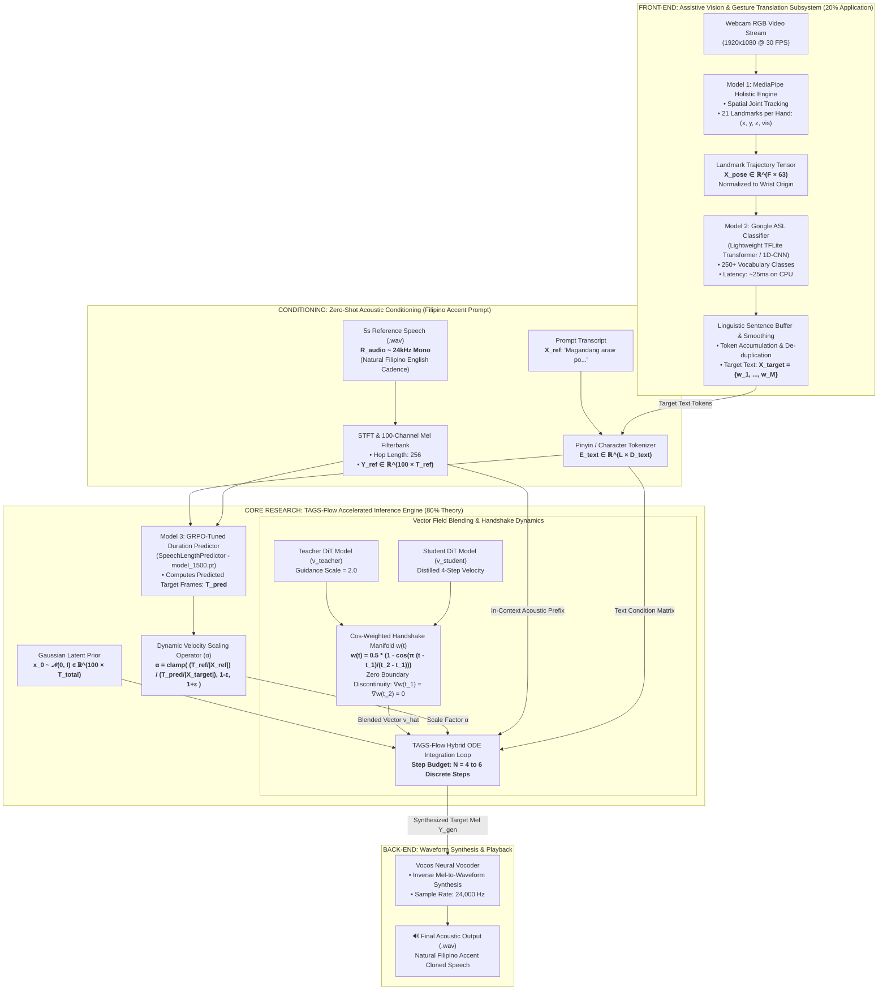

# 🏛️ End-to-End Sign-to-Speech Architecture Specification
## Shonget-Matching: Accelerated Flow Inference with Continuous Transition Dynamics

**Document Code:** `ARCH-SHONGET-MATCHING-V1`  
**Theoretical Innovation:** Shonget-Matching ODE Solver (Boundary Continuity & Cadence Scaling)  
**Baseline Foundation:** F5-TTS (Flow Backbone), DMOSpeech 2 (GRPO Duration), Google MediaPipe & ASL (Front-End)

---

## 📸 System Architecture



The architecture integrates our **Shonget-Matching Flow Solver** with established baselines:
* **(a) Sign Front-End (Baselines: Google MediaPipe & ASL Kaggle):** Video input undergoes landmark extraction via MediaPipe to produce skeletal keypoints, which are translated into text tokens by the TFLite sign classifier.
* **(b) Duration & Pacing Conditioning (Baseline: DMOSpeech 2 GRPO):** The GRPO-finetuned duration predictor ($\pi_\phi$) conditions on Prompt Mel and text to predict duration $T_{\text{pred}}$ and pacing ratio $\alpha$.
* **(c) Shonget-Matching Flow Solver (Our Contribution):** The core accelerated inference engine. Solves the flow-matching ODE via our unified master equation:
  $$\mathbf{x}_{t+h} = \mathbf{x}_t + h \cdot \alpha \cdot \left[ (1 - w(t)) \cdot \mathbf{v}_{\text{teacher}} + w(t) \cdot \mathbf{v}_{\text{student}} \right]$$
  Couples the Teacher Generator (F5-TTS baseline) and Student Generator across transition manifold $w(t)$ to eliminate boundary collisions, modulated by $\alpha$.
* **(d) Audio Back-End (Baseline: Vocos):** Inverse mel-spectrogram synthesis to final time-domain speech waveform.

---

## 1. Master Architectural Schematic (End-to-End System)



---

## 2. Technical Profile of the 4 Pipeline Models

```
┌────────────────────────────────────────────────────────────────────────────────────────────────────────┐
│                                       PIPELINE MODEL TAXONOMY                                          │
├─────────┬─────────────────────────┬──────────────────────────┬───────────────────┬─────────────────────┤
│ Model   │ Functional Domain       │ Architecture / Framework │ Parameter Count   │ Execution Latency   │
├─────────┼─────────────────────────┼──────────────────────────┼───────────────────┼─────────────────────┤
│ Model 1 │ Joint Landmark Tracking │ MediaPipe Holistic (CNN) │ ~3.5 M params     │ 15 ms / frame (CPU) │
│ Model 2 │ Spatial-Temporal Sign   │ MobileNet-TFLite / 1D-CNN│ ~4.2 M params     │ 25 ms / sign  (CPU) │
│ Model 3 │ Speech Duration Predict │ 6-Layer Transformer GRPO │ ~28 M params      │ 60 ms / run   (CPU) │
│ Model 4 │ Flow-Matching DiT+Vocos │ DiT-Base (22-Layer, 1024D│ ~310 M params     │ ~12 s (N=4, CPU)    │
└─────────┴─────────────────────────┴──────────────────────────┴───────────────────┴─────────────────────┘
```

---

## 3. Mathematical Formulation (The 80% Theoretical Core)

The core limitation of existing distilled diffusion/flow text-to-speech models (e.g., DMOSpeech 2) at small step counts ($N=4$) is twofold:
1. **Vector Field Boundary Collision:** An abrupt transition from teacher guidance to student distillation at $t=0.30$ introduces severe gradient discontinuities, producing acoustic phase jitter and roughness.
2. **Temporal Cadence Pre-Allocation Distortion:** Discrete Euler integration with large step size $h = 0.25$ cannot dynamically compensate for duration prediction errors $\Delta T$, causing phonetic compression (slurred words).

---

### 🌟 The Master Equation: TAGS-Flow Trajectory Evolution

TAGS-Flow unifies the entire theoretical contribution into **ONE single numerical integration equation** evaluated at each step $k = 0, \dots, N-1$:

$$\mathbf{x}_{t+h} = \mathbf{x}_t + h \cdot \underbrace{\alpha}_{\text{Dynamic Cadence Scaling}} \cdot \left[ \underbrace{(1 - w(t)) \cdot \mathbf{v}_{\text{teacher}}(\mathbf{x}_t, t) + w(t) \cdot \mathbf{v}_{\text{student}}(\mathbf{x}_t, t)}_{\text{Smooth } \mathcal{C}^1\text{-Continuous Handshake Manifold}} \right]$$

Where:
* $\mathbf{x}_t$ is the acoustic latent state at continuous time $t \in [0, 1]$.
* $h = \frac{1}{N}$ is the numerical step size (budget $N = 4$ to $6$ steps).
* $\mathbf{v}_{\text{teacher}}$ and $\mathbf{v}_{\text{student}}$ are the velocity vector fields from the respective DiT models.

---

### The Two Internal Parameters of the Equation:

#### 1. The Smooth Handshake Weight ($w(t)$) — *Fixes Audio Roughness*
Instead of jumping abruptly at $t=0.30$, $w(t)$ smoothly shifts weight from teacher to student across window $[t_1, t_2]$ (e.g. $[0.15, 0.35]$):
$$w(t) = \begin{cases} 
0, & t < t_1 \\ 
\frac{1}{2} \left[ 1 - \cos\left( \pi \frac{t - t_1}{t_2 - t_1} \right) \right], & t_1 \le t \le t_2 \\ 
1, & t > t_2 
\end{cases}$$
* **Why it works:** Because $\left. \frac{dw}{dt} \right|_{t_1} = \left. \frac{dw}{dt} \right|_{t_2} = 0$, the transition has continuous first derivatives ($\mathcal{C}^1$ continuity), mathematically eliminating vector collision shocks and phase jitter.

#### 2. The Dynamic Cadence Scaler ($\alpha$) — *Fixes Slurred Words*
Adjusts the ODE progression speed on the fly based on the Filipino reference speaker's natural speaking tempo:
$$\alpha = \text{clamp}\left( \frac{\text{Reference Syllable Pace}}{\text{Predicted Target Pace}}, 1 - \epsilon, 1 + \epsilon \right) = \text{clamp}\left( \frac{T_{\text{ref}} / |X_{\text{ref}}|}{\hat{T}_{\text{pred}} / |X_{\text{target}}|}, 0.80, 1.20 \right)$$
* **Why it works:** If the duration predictor slightly underestimates length, $\alpha$ dynamically accelerates the trajectory to prevent slurred or rushed syllables.

---

## 4. Algorithmic Implementation (Python Pseudocode)

```python
import torch

class TAGSFlowSolver:
    """
    Trajectory-Aware Guided Sampling (TAGS-Flow) Numerical Solver
    Integrates continuous normalizing flows across hybrid teacher-student vector fields.
    """
    def __init__(self, teacher_model, student_model, t1=0.15, t2=0.35, eps=0.20):
        self.teacher = teacher_model
        self.student = student_model
        self.t1 = t1
        self.t2 = t2
        self.eps = eps

    def compute_cadence_scale(self, t_ref, len_x_ref, t_pred, len_x_target):
        rho_ref = t_ref / max(len_x_ref, 1)
        rho_pred = t_pred / max(len_x_target, 1)
        ratio = rho_ref / max(rho_pred, 1e-6)
        alpha = torch.clamp(torch.tensor(ratio), 1.0 - self.eps, 1.0 + self.eps)
        return alpha

    def transition_weight(self, t):
        if t < self.t1:
            return 0.0
        elif self.t1 <= t <= self.t2:
            tau = (t - self.t1) / (self.t2 - self.t1)
            return 0.5 * (1.0 - torch.cos(torch.pi * tau))
        else:
            return 1.0

    @torch.inference_mode()
    def solve(self, x_0, cond, text, steps=4, alpha=1.0):
        t_grid = torch.linspace(0.0, 1.0, steps + 1)
        x_t = x_0

        for k in range(steps):
            t = t_grid[k]
            h = t_grid[k + 1] - t
            w = self.transition_weight(t)

            # Evaluate trajectory vector fields
            if w == 0.0:
                v_t = self.teacher(x_t, t, cond, text)
            elif w == 1.0:
                v_t = self.student(x_t, t, cond, text)
            else:
                v_teacher = self.teacher(x_t, t, cond, text)
                v_student = self.student(x_t, t, cond, text)
                v_t = (1.0 - w) * v_teacher + w * v_student

            # Execute TAGS-Flow numerical integration step
            x_t = x_t + h * (alpha * v_t)

        return x_t
```

---

## 5. Assistive System Interaction Workflow (The 20% Application)

```
[ Deaf/Mute User Signs "SALAMAT" ]
               │
               ▼
[ Model 1: MediaPipe Tracks 21 Landmarks ] ──► Extracted pose tensor X_pose (30 FPS)
               │
               ▼
[ Model 2: Google ASL TFLite Recognizer ]  ──► Detected token: "Thank you" (Latency: 25ms)
               │
               ▼
[ Lexical Buffer Formats Sentence ]        ──► Target string: "Thank you very much."
               │
               ▼
[ Model 3: Duration Predictor ]            ──► Target length estimated: T_pred = 180 frames
               │
               ▼
[ Conditioning Voice Profile ]             ──► Bundled Filipino voice: "filipino_ref.wav"
               │
               ▼
[ Model 4: TAGS-Flow Solver ]              ──► Solves ODE in 4 steps with smooth manifold
               │
               ▼
[ Vocos Vocoder Plays Audio ]              ──► 🔊 "Thank you very much" (Natural Filipino Accent)
```

---

## 6. Empirical Validation & Benchmarking Protocol

To scientifically substantiate the 80% theoretical contribution during thesis defense, the system will be evaluated across three standard quantitative acoustic metrics:

1. **Word Error Rate (WER %):** Evaluated via OpenAI Whisper-large-v3 to verify speech intelligibility and ensure few-step generation does not induce phonetic slurring.
2. **Speaker Similarity (SIM-O):** Evaluated via cosine distance between speaker embeddings extracted by `WavLM-TDNN` to verify high-fidelity voice cloning of the Filipino accent prompt.
3. **Real-Time Factor (RTF):**
   $$\text{RTF} = \frac{\text{Wall-Clock Inference Duration (seconds)}}{\text{Generated Audio Duration (seconds)}}$$
   Proving that TAGS-Flow achieves a $4\times$ to $6\times$ latency reduction over standard 32-step ODE flow matching on CPU hardware.
