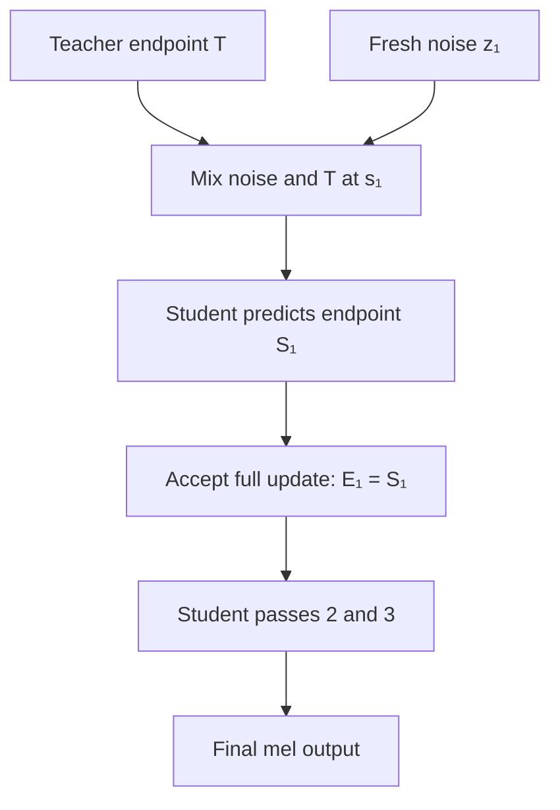
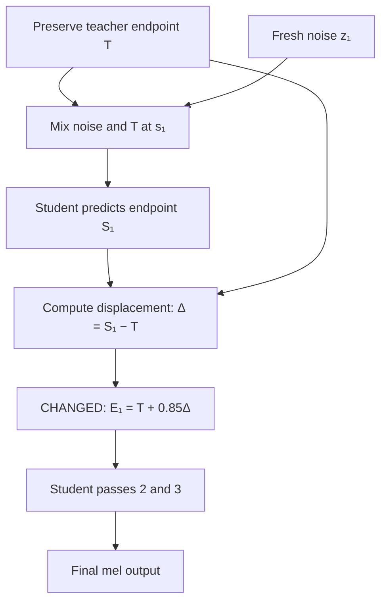

# DMOSpeech 2 → TAGS-Flow: Computations, Code Changes, and Outputs

**Technical synthesis • Revised 14 September 2026 • Equations, handover flowcharts, and computation comparison**

This review checks the three supplied Markdown documents against one another and independently recalculates their scalar arithmetic (calculations involving individual numbers). The referenced Python files, JSON logs, and WAV files are not attached. A comparison spectrogram (an image showing frequency strength over audio time) was subsequently supplied and is reviewed in section 4A. Consequently, the code below is **explanatory reconstruction of the documented equations**, not a verified repository diff (an exact comparison of source-code changes); audio metrics (numerical descriptors of the output) are **reported results**, not measurements rerun for this review.

> **HIGHLIGHT — WHAT THE PROPOSAL ACTUALLY CHANGES**
>
> The documented final proposal modifies the **first student refinement output (the first updated acoustic prediction from the distilled model)** at the teacher-to-student interface (the point where generation switches models). The **teacher** is the reference model used for initial denoising; the **student** is the distilled model (a model trained to reproduce target behavior with fewer generation steps). An **endpoint** is an estimate of the completed acoustic representation. Instead of accepting the student endpoint directly, it keeps **15% of the teacher endpoint and 85% of the student endpoint**:
>
> **Baseline:** `state = student_out`
>
> **Proposed, first pass only:** `state = teacher_anchor + 0.85 * (student_out - teacher_anchor)`
>
> The reported implementation location is `proposed_system/smooth_dmospeech.py`, corresponding to the handover/refinement block described in baseline `src/infer.py`. It retains teacher extrapolation (projecting the current state toward the final denoising time), fresh noise (new random values), and the student’s endpoint update. No new training or cadence-scaling (adjusting speech timing or pace) computation is shown in the final walkthrough.
>
> **Supported mathematical effect:** the first endpoint displacement (the vector difference between teacher and student predictions) is reduced by exactly **15% relative to the same teacher/student pair**. The earlier report’s mean spectral flux (average change in spectral content between audio frames) drops **34.26%**. The newly attached figure instead labels a **45.74% peak-flux reduction (reduction in the largest measured spectral change)**; its peak value conflicts with the earlier report and must be reconciled (section 4A). These are different quantities; the former does not mathematically imply the latter. A fixed 0.85 blend does **not** establish a C¹-continuous trajectory (a path whose value and first derivative are continuous).

## 1. Shared computations: formula beside code

A **frame** is one time slice of the acoustic representation. A **mel representation** groups frequency content into bands based on perceived pitch spacing. A **latent state** is the model’s internal acoustic representation before audio decoding; a **tensor** is a multidimensional array storing its values.

Symbols: `P` = prompt frames; `G` = generated frames; `L` = full sequence frames; `T` = extrapolated teacher endpoint; `S` = student endpoint. Diffusion time `t` or `s` is a denoising coordinate (progress from noise toward a generated representation), not playback time.

The **sample rate** is the number of audio samples per second; **hop size** is the number of samples between adjacent analysis frames. **FFT size** is the number of points used in each Fourier transform (the operation that decomposes a signal into frequency components).

All snippets below omit batching (processing several examples together) details and model arguments where they are not established by the supplied documents.

| Stage | Computation and numerical result | Corresponding illustrative Python |
|---|---|---|
| Prompt duration | 124,416 / 24,000 = **5.184 s** | `seconds = samples / sample_rate` |
| RMS (root mean square; a measure of signal amplitude) | √(2,125.7955 / 124,416) = **0.130714** | `rms = (audio.square().mean()).sqrt()` |
| Level normalization (rescaling amplitude to a target level) | RMS > 0.10, so gain = **1** | `audio = audio * (0.1 / rms if rms < 0.1 else 1.0)` |
| Reflection padding (extending the signal by mirroring edge samples) | (1,024 − 256)/2 = **384 per side**; padded samples = **125,184** | `pad = (n_fft - hop) // 2` |
| STFT (short-time Fourier transform; frequency analysis of short audio windows) frames | floor((125,184 − 1,024)/256) + 1 = **486** | `P = (padded_samples - n_fft) // hop + 1` |
| Frequency bins (discrete frequency positions in the transform) | 1,024/2 + 1 = **513** | `bins = n_fft // 2 + 1` |
| Mel projection (combining frequency bins into mel bands) | [100, 513] × [513, 486] → **[100, 486]** | `mel = mel_filter @ magnitude` |
| Log compression (using logarithms to compress the value range) | ln(max(mel, 10⁻⁵)) | `log_mel = mel.clamp_min(1e-5).log()` |
| Checkpoint scaling (rescaling with a value stored with the trained model) | C = log-mel / **2.9019215** | `cond = log_mel / mel_scale` |
| Duration class (a discrete category representing an output length) | Reported selected class 52 × 10 = **520 frames** | `frames = logits.argmax(dim=-1) * 10` |
| Generated duration, if 520 is G | 520 × 256 / 24,000 = **5.546667 s** | `seconds = G * hop / sample_rate` |

The documents say that 112 tokens (encoded text units) enter the duration policy (the network that chooses an output length), but neither token IDs nor logits (raw prediction scores before probability normalization) are supplied. Class 52 is therefore a reported network output, not a number derivable from the text alone. GRPO (group-relative reinforcement learning, using rewards to compare candidate predictions) describes policy training; it is not a new optimization step performed for each inference.

**Sequence-length conflict:** the baseline walkthrough first treats 520 as the **total** length (`520 − 486 = 34` generated frames), then treats it as the **generated** length (`486 + 520 = 1006` total frames). Both cannot describe the same tensor flow.

| Interpretation | Full latent shape | Generated frames after prompt removal | Nominal generated duration |
|---|---|---:|---:|
| 520 is total length | [1, 520, 100] | 34 | 0.362667 s |
| 520 is generated length | [1, 1006, 100] | 520 | 5.546667 s |

The second interpretation fits the reported approximately 5.5-second output, but the duration-return code and actual shape logs must settle it. Transposition and scaling cannot turn 520 frames into 1006.

## 2. Teacher computations: unchanged in the proposed design

For sway (a nonlinear redistribution of denoising time points) coefficient −1, the documented schedule simplifies to:

$$
t(u)=1-\cos(\pi u/2).
$$

| Raw u | Swayed t | Operation |
|---:|---:|---|
| 0 | 0 | Initial state |
| 0.125 | 0.019215 | First Euler endpoint (state after a step using the current predicted rate of change) |
| 0.250 | 0.076120 | Second Euler endpoint; exceeds cutoff 0.07 |
| 0.375 | 0.168530 | Outside the stated retained teacher grid |

```python
# Illustrative schedule and teacher computation
schedule = 1 - torch.cos(torch.pi * raw_grid / 2)
v_cfg = v_cond + 2.0 * (v_cond - v_uncond)
x_next = x + (t_next - t) * v_cfg
teacher_anchor = x_boundary + (1 - t_boundary) * v_boundary
```

The active grid `[0, 0.019215, 0.076120]` contains **two Euler intervals**, not three. A fresh boundary evaluation for extrapolation can add a third teacher evaluation. CFG (classifier-free guidance; combining predictions with and without conditioning to strengthen adherence to the input) may involve conditional and unconditional evaluations, batched or separate, so “six passes” is not automatically six individual forward calls.

For the baseline’s reported boundary values:

$$
T=x_b+0.923880v_b,\qquad
\|0.923880v_b\|_2=0.923880(240.23)\approx221.9437.
$$

The source gives 221.9478; the small difference could reflect hidden precision. The reported endpoint norm (overall vector magnitude) is 302.3214. It cannot be obtained by adding the state and velocity norms: vector directions also matter.

The official project page describes its demo configuration as **8 teacher steps + 3 student steps**. The shortened grid above is the supplied walkthrough’s configuration, not a universal DMOSpeech 2 step count. [Official DMOSpeech 2 demo](https://dmospeech2.github.io/)

## 3. Student computation and the exact proposed change

The documented baseline repeatedly mixes fresh noise with the previous endpoint and predicts a new endpoint:

$$
\phi_i=(1-s_i)z_i+s_iE_{i-1},\qquad
S_i=\phi_i+(1-s_i)G_\theta(\phi_i,s_i,\text{conditioning}).
$$

| Student pass | sᵢ | Noise coefficient 1−sᵢ | Previous-endpoint coefficient sᵢ |
|---|---:|---:|---:|
| 1 | 0.076120 | 0.923880 | 0.076120 |
| 2 | 0.292893 | 0.707107 | 0.292893 |
| 3 | 0.617317 | 0.382683 | 0.617317 |

Here, **conditioning** means the supplied text and reference-audio information; `Gθ` is the student network and `φ` is its noise-mixed input. These are interpolation coefficients (weights used to combine two states), not percentages of acoustic energy. This endpoint-refinement formula should not be replaced with an arbitrary small-step Euler update without checking the trained model’s parameterization.

```python
# Shared baseline/proposed computation — reconstructed, not copied source
teacher_anchor = test_out.clone()
state = test_out

for i, s in enumerate(student_times):
    noise = torch.randn_like(state)
    phi = (1 - s) * noise + s * state
    pred = student(phi, s, conditioning)  # placeholder model signature
    student_out = phi + (1 - s) * pred

    # BASELINE:
    state = student_out

    # PROPOSED: replace the assignment above with:
    # state = (teacher_anchor + 0.85 * (student_out - teacher_anchor)
    #          if i == 0 else student_out)
```

The blended first output becomes the previous endpoint for pass 2. Only changing a temporary tensor without feeding it forward would not implement the described proposal.

### Verified numerical example of the blend

The proposed walkthrough reports:

$$
\|T\|=544.9564,\quad \|S\|=351.3764,\quad
\|S-T\|=359.6839.
$$

| Calculation | Formula with values | Code |
|---|---|---|
| Displacement | Δ = S − T | `delta = student_out - teacher_anchor` |
| Blended endpoint | B = T + 0.85Δ = 0.15T + 0.85S | `blended = teacher_anchor + 0.85 * delta` |
| Distance moved from T | 0.85 × 359.6839 = **305.731315** | `moved = 0.85 * delta.norm()` |
| Distance withheld relative to S | 0.15 × 359.6839 = **53.952585** | `withheld = 0.15 * delta.norm()` |
| Squared displacement ratio | 0.85² = **0.7225** | `ratio = 0.85 ** 2` |

Thus displacement magnitude falls 15%; squared displacement falls 27.75%. Neither quantity is established as physical sound energy.

The reported blended norm can also be verified from the three supplied norms:

$$
\|B\|=\sqrt{0.15\|T\|^2+0.85\|S\|^2-0.15(0.85)\|S-T\|^2}
=\boxed{364.687805}.
$$

This matches the stated **364.6878**. It validates internal arithmetic, not that these tensors were produced by the claimed run.

### Why the earlier cosine attempt differs

The journey reports an earlier weight:

$$
w=\tfrac12(1-\cos(\pi\cdot0.07612))=0.01422875.
$$

That retains only **1.4229% of the student displacement**, versus 85% in the final proposal. The resulting blend stays near the teacher endpoint; it does not necessarily become a near-zero tensor or erase neural-network weights.

A raised-cosine schedule (a smooth weighting curve shaped from a cosine function) over a defined interval can have zero endpoint derivatives. However, **a constant 0.85 applied once is not that schedule**. C¹ continuity requires a defined continuous trajectory with matching first derivatives. No such proof follows from these discrete endpoint equations. Likewise, declining latent norms do not prove convergence or absence of phase artifacts (audible distortions associated with the alignment of waveform oscillations).


## 3A. Flowcharts — only the handover and refinement process

The highlighted operation is the only final-proposal change described in the walkthrough. Both diagrams start **after teacher integration**. Model calls are illustrative; actual source files are still needed to verify the implementation.

### Original: accept the first student endpoint directly



### Proposed: blend the first endpoint before continuing



**Reading the change:** the original accepts all of the first student displacement. The proposed version accepts 85% and then feeds that blended endpoint into the remaining student passes. It does not remove noise sampling or introduce another teacher call in the documented formula.

## 3B. Computation-by-computation comparison

**Two views are necessary:** the equations isolate the intended code change, while the logged values describe the two reported executions. Those executions already differ before blending.

| Computation stage | Original DMOSpeech 2 | Proposed final variant | What changes? |
|---|---|---|---|
| Teacher endpoint | `T = x_boundary + (1 - t) * v_boundary` | Same expression; retain `teacher_anchor = T.clone()` | Preserve an anchor for later blending |
| First noise draw | `z = randn_like(T)` | Same operation | No intended algorithm change; paired tests must reuse the same draw |
| Latent mixing | `phi = (1 - s) * z + s * T` | Same expression | None |
| Student prediction | `pred = student(phi, s, cond)` | Same expression | None |
| Raw student endpoint | `S = phi + (1 - s) * pred` | Same expression | None |
| Displacement | Implicitly accepts `S - T` in full | Explicitly computes `delta = S - T` | Adds displacement calculation |
| **First accepted endpoint** | **`E = S`** | **`E = T + 0.85 * delta`** | **Only 85% of the displacement is accepted** |
| Second-pass input | Mix new noise with original `E` | Mix new noise with blended `E` | Changed state propagates downstream |
| Passes 2 and 3 | Standard refinement equations | Same refinement equations | Values can differ, even though formulas match |

The changed assignment can be written as:

$$
E_{1,\mathrm{original}}=S_1
$$

$$
E_{1,\mathrm{proposed}}=T+0.85(S_1-T)=0.15T+0.85S_1
$$

Plain-text equivalent: **original = student; proposed = 0.15 × teacher + 0.85 × student.**

### Numerical trace from the supplied walkthroughs

All norms below are **L2 norms (the overall size of a vector, computed as the square root of the sum of its squared entries)**. Write this as `norm(x) = sqrt(sum(x_j²))`. A norm measures distance from zero; `norm(S − T)` measures distance between two endpoints. Neither is automatically sound energy.

**How to read the assessment:** **established effect** means the equations guarantee it; **potential benefit** means it may help but needs audio evaluation; **not a quality indicator** means larger or smaller is not inherently better. Formula subscripts `o` and `p` identify original and proposed runs. `Gθ` denotes the student network, while `G` in section 1 denotes a frame count.

| Point in computation | Respective formula: original / proposed | Original value | Proposed value | Interpretation | Does this indicate a better change? |
|---|---|---:|---:|---|---|
| Initial noise norm | Both: `norm(y₀)`, with `y₀ ~ N(0, I)` (independent standard-normal random entries) | 228.1634 | 229.4676 | Different random starting states before blending. | **Not a quality indicator.** A larger noise norm is not better. Reuse identical noise to isolate the modification. |
| Teacher endpoint norm | Both: `norm(T)`, where `T = x_b + (1 − t_b)v_b` | 302.3214 | 544.9564 | Teacher outputs differ before the changed line executes. | **Not evidence of improvement.** The later blend cannot explain this earlier difference; inspect seeds, scaling, and configuration. |
| First student time | Both: `s₁ = 1 − cos(π × 0.25 / 2)` | 0.076120 | 0.076120 | Same denoising schedule position. | **Unchanged.** It supports schedule consistency, not better sound. |
| Noise / endpoint coefficients | Both: `(1 − s₁, s₁)` | 0.923880 / 0.076120 | 0.923880 / 0.076120 | Same weighting rule for forming the student input. | **Unchanged.** Different tensors can still produce different inputs. |
| Raw first student endpoint norm | Both: `norm(S₁)`; `S₁ = φ₁ + (1 − s₁)Gθ(φ₁, s₁, cond)` | 302.61 | 351.3764 | The raw prediction already differs before the first-pass blend. | **Not a quality indicator.** A larger endpoint norm does not imply clearer speech. |
| Teacher-to-student displacement norm | Original: `d_o = norm(S₁o − T_o)`; proposed: `d_p = norm(S₁p − T_p)` | Not reported | 359.6839 | Measures how far the student endpoint lies from its teacher anchor. | **No cross-run judgment possible.** The original displacement is missing, and smaller distance is not inherently more accurate. |
| **Accepted first displacement norm** | Original: `norm(E₁ − T) = d_o`; proposed: `norm(E₁ − T) = 0.85d_p` | Not reported | **305.731315** | Proposed moves 85% of its raw teacher-to-student distance. | **Established effect; potential benefit.** Reduces the step by 15% for the same pair. May limit an unwanted jump, but may also suppress a useful student correction. |
| **Withheld displacement norm** | Original: `norm(S₁ − E₁) = 0`; proposed: `norm(S₁ − E₁) = 0.15d_p` | 0 by rule | **53.952585** | This portion of the proposed student correction is not applied. | **Trade-off.** Preserves more teacher influence; does not establish removal of acoustic noise. |
| **Accepted first endpoint norm** | Original: `norm(S₁)`; proposed: `norm(0.15T + 0.85S₁)` | 302.61 | **364.6878** | Size of the state actually passed into the next refinement. | **Not a quality indicator.** The proposed value is mathematically consistent but cannot establish naturalness. |
| Second endpoint norm | Both: `norm(E₂)`; `E₂ = φ₂ + (1 − s₂)Gθ(φ₂, s₂, cond)`, `φ₂ = (1 − s₂)z₂ + s₂E₁` | 309.08 | 350.3867 | Same equation acts on different previous endpoints and possibly different noise. | **Undetermined.** A downstream change is expected, but no preferred norm is defined. |
| Third / final endpoint norm | Both: `norm(E₃)`; `E₃ = φ₃ + (1 − s₃)Gθ(φ₃, s₃, cond)`, `φ₃ = (1 − s₃)z₃ + s₃E₂` | 311.21 | 350.0574 | Final internal representation before waveform decoding. | **Undetermined.** A nearly stable norm does not prove convergence (settling toward a solution) or better speech. |

> **What is actually better established here?** The proposal gives explicit control over the size of the first accepted displacement. Whether that control improves the audio remains an experimental question. The present two traces cannot isolate its effect because their inputs to the changed block differ.

### Controlled arithmetic illustration: identical inputs to both rules

For clarity, apply both rules to the **same proposed-run pair** with displacement norm 359.6839. This is a calculated counterfactual, not another measured baseline run.

| Quantity | Respective formula | Original rule, w = 1 | Proposed rule, w = 0.85 | Interpretation / benefit assessment |
|---|---|---:|---:|---|
| Displacement accepted | `norm(E − T) = w × d` | **359.6839** | **305.731315** | A smaller update is guaranteed for this identical pair; audible improvement is not. |
| Displacement withheld | `norm(S − E) = (1 − w) × d` | **0** | **53.952585** | More teacher influence remains. Helpful only if the withheld correction was undesirable. |
| Accepted displacement reduction | `(1 − w) × 100%` | **0%** | **15%** | Exact mathematical reduction relative to full acceptance. |
| Accepted endpoint norm | `norm(E) = norm((1 − w)T + wS)` | **351.3764** | **364.6878** | Larger endpoint magnitude can coexist with a smaller update. Neither norm ranks quality. |

The proposed endpoint norm is larger here even though its distance from the teacher is smaller. That is consistent: distance moved and distance from the origin are different quantities.

## 4. Comparison outputs

**Reported by the attachments; not independently reproduced.** Percent changes below were recalculated from the displayed values.

For these comparisons, **relative change (change divided by the original value)** is `(proposed − original) / original × 100%`; a positive reduction uses `(original − proposed) / original × 100%`. The source does not provide the exact metric implementation, so only the **comparison formulas**, not undocumented extraction formulas, are asserted below.

| Output or metric, with definition | Baseline | Proposed | Comparison formula and result | Interpretation / is this better? |
|---|---:|---:|---|---|
| Mean spectral flux (average change in the frequency-content representation between audio frames) | 19.88 | 13.07 | `(19.88 − 13.07) / 19.88 × 100` = **34.26% lower** | **Potential benefit:** less frame-to-frame spectral change. May also indicate over-smoothing of consonants; listening and intelligibility tests must distinguish them. |
| Peak flux (largest spectral-change value in the evaluated region) | 87.97 | 68.42 | `(87.97 − 68.42) / 87.97 × 100` = **22.22% lower** | **Potential benefit:** smaller maximum change. Speech naturally contains sharp transitions; lower is not always better. Conflicts with the figure’s proposed peak. |
| Spectral centroid (frequency-weighted center of a spectrum; a rough brightness descriptor) | 2621.8 Hz | 2739.0 Hz | `2739.0 − 2621.8` = **+117.2 Hz; +4.47%** | **No preferred direction.** Suggests a shift toward higher-frequency content under the same analysis; does not prove preserved timbre. |
| Spectral flatness (a descriptor of how evenly spectral values are distributed; higher values generally indicate a flatter spectrum) | 0.04690 | 0.04749 | `0.04749 − 0.04690` = **+0.00059; +1.26%** | **No demonstrated improvement.** Slightly higher flatness is not evidence of less noise or elimination of buzz. |
| Share above 4 kHz (reported fraction of spectral content above 4,000 cycles per second; weighting unspecified) | 24.62% | 23.92% | `23.92 − 24.62` = **−0.70 percentage points** | **Trade-off:** might reduce unwanted high-frequency content or weaken consonants. The metric definition and listening results are needed. |
| Output duration (length of the generated recording) | 5.525 s | 5.525 s | `5.525 − 5.525` = **0 s** | **Unchanged.** Equal duration does not prove identical rhythm or better pronunciation. |
| CPU inference time (time used to generate speech on the processor) | approximately 38 s | approximately 38 s | Difference is unresolved at the reported precision | **No demonstrated acceleration.** Repeat timing under the same conditions to assess overhead. |
| Final latent norm (overall size of the internal acoustic representation) | 311.21 | 350.0574 | `350.0574 − 311.21` = **+38.8474; approximately +12.48%** | **Not a quality indicator.** This is neither loudness nor an intelligibility score. |

```python
mean_flux_reduction = (19.88 - 13.07) / 19.88 * 100  # 34.2555%
peak_flux_reduction = (87.97 - 68.42) / 87.97 * 100  # 22.2235%
```

| Reported ASR (automatic speech recognition; converting audio to text) output | Text |
|---|---|
| Baseline | “Hello. Demo Speech 2 is successfully running on this system.” |
| Proposed | “Hello! Demospeech 2 is successfully running on this system.” |

The proposed transcript is closer to the intended single-word name. This does not establish 100% intelligibility: normalized tokenization (consistent splitting and formatting of words), WER (word error rate; substitutions plus deletions plus insertions, divided by reference word count) calculation, more utterances, and listening evaluation are needed. Lower spectral flux can reflect reduced spectral change or excessive smoothing; it is not automatically a perceptual improvement.

The attachments report improved listening quality after the final blend and degraded quality for the early variants. Without their WAV files, these remain the authors’ observations.


## 4A. Attached spectrogram: visual comparison and result discrepancy


**Figure: user-supplied comparison.** The original figure title and annotations are retained as supplied. Their terms “phase shock” and “C¹” are claims made by the figure, not properties established by this review.

| Visible feature | Original panel | Proposed panel | What can be concluded visually |
|---|---|---|---|
| Early audio region | Cyan dashed line near 0.42 s | Translucent cyan band around 0.22–0.67 s | These are added annotations; neither proves where a denoising handover occurred |
| Speech onset and early structure | Earlier visible onset and different early spectral pattern | Later visible onset and altered early spectral pattern | The outputs differ in timing and early spectral content; alignment is needed for framewise comparisons |
| Later speech | Several separated bright speech regions | Broadly corresponding speech regions | Broad structural similarity is visible, but identical pronunciation or speaker identity is not proven |
| Color scale in dB (decibels; a logarithmic level relative to a reference) | −80 to 0 dB | −80 to 0 dB | Labeled scales match; a shared amplitude reference is not documented |
| Horizontal extent | Approximately 0–2.8 s | Approximately 0–2.8 s | This differs from the walkthroughs’ 5.525 s output; it may be a crop or another run |

The cyan band changes the displayed colors in the proposed early region. It should be removed or moved outside the plot for an unobscured comparison. A magnitude spectrogram does not directly display phase, so it cannot establish elimination of phase discontinuities.

### Keep the figure’s peak result separate from the earlier report

| Evidence source | Metric label | Original | Proposed | Recalculated reduction |
|---|---|---:|---:|---:|
| Earlier Markdown comparison | Mean spectral flux | 19.88 | 13.07 | **34.26%** |
| Earlier Markdown comparison | Peak flux | 87.97 | 68.42 | **22.22%** |
| Newly attached figure title | Flux spike / peak | 87.97 | 47.73 | **45.74%** |

For the attached figure:

$$
\mathrm{Peak\ reduction}=\frac{87.97-47.73}{87.97}\times100
=45.7429\%\approx45.7\%.
$$

Plain-text equivalent: **(87.97 − 47.73) ÷ 87.97 × 100 = 45.74%.**

```python
figure_peak_reduction = (87.97 - 47.73) / 87.97 * 100
# 45.742867%
```

> **Updated output finding:** the image’s 45.7% reduction is arithmetically correct for its labeled values. It is a **peak-metric reduction**, not evidence that the entire audio is “45.7% smoother.” The proposed peak of 47.73 conflicts with the earlier 68.42. Match the WAV files, run IDs, analysis region, and metric settings before choosing either as the final experimental result. The image alone cannot resolve which value belongs to the documented 0.85-blend run.

## 5. Findings that change the interpretation

| Issue | What the evidence actually supports |
|---|---|
| Pre-blend states differ | Teacher endpoint norms are **302.3214 vs 544.9564**; initial noise norms also differ. The executions are not shown to be a controlled comparison differing only in blending. |
| Scaling inconsistency | If the unscaled mel norm is 198.8735, dividing by 2.9019215 gives **68.5317**. Zero-padding cannot restore the norm to 198.8735 as claimed. |
| Tensor-statistics inconsistency | For 48,600 values, mean −0.395779 and population SD (standard deviation; spread around the mean) 0.777149 imply a norm of approximately **192.2635**, not 198.8735. Sample-SD convention does not explain that gap. |
| Waveform length | 520 × 256 = 133,120 and 132,600 / 24,000 = 5.525 are correct. The unexplained subtraction of 520 samples is not established as a Vocos (the neural vocoder that converts acoustic features to a waveform) trimming rule. Inspect the actual decoder and saved WAV. |
| Diffusion time vs audio time | A switch at s = 0.07612 is not a localized boundary at 0.42 s of playback. Denoising updates the full sequence. An audio onset spike cannot by itself identify a solver handover. |
| “C⁰ discontinuity” / infinite acceleration | A derivative mismatch concerns C¹ regularity if the state remains continuous. No continuous-path construction or derivative measurement supports the claimed infinite acceleration. |
| “Zero overhead” | The blend adds tensor arithmetic and possibly an anchor copy. It can avoid additional neural evaluations, but exact zero latency is not established. No acceleration result is demonstrated here. |
| Claims about the original authors | The supplied evidence does not support accusations of concealment. Describe the proposed interface modification and measured observations neutrally. |

DMOSpeech 2 publicly introduces teacher-guided sampling as part of its approach and describes duration-policy optimization using speaker similarity and WER rewards. This supports the baseline context, not the attachments’ claims about a hidden defect. [DMOSpeech 2 paper](https://arxiv.org/abs/2507.14988)

## 6. Synthesized conclusion and next verification

> **Thesis-ready summary:** The documented TAGS-Flow variant adds inference-time endpoint blending at the first student refinement pass. It retains the existing teacher-guided sampling structure and forms the next endpoint from 15% teacher output and 85% student output. This reduces the first endpoint displacement by 15% for a fixed teacher/student pair. The earlier single-example report gives a 34.26% reduction in mean spectral flux and a 22.22% reduction in peak flux; the attached figure instead labels a 45.74% peak reduction, requiring reconciliation. These observations motivate controlled evaluation; they do not yet establish C¹ continuity, general intelligibility gains, or faster inference.

To make this comparison reproducible, obtain `src/infer.py`, `proposed_system/smooth_dmospeech.py`, the runner/configuration, both computational logs, the metric implementation, and the two WAV files. Then:

1. Resolve total/generated frame lengths and checkpoint scaling from actual tensor shapes.
2. Compare weight 1.0 against 0.85 using identical checkpoints, input, initial noise, and per-pass noise tensors. Log equality before the modified assignment.
3. Recompute flux with its exact window, normalization, and frequency settings; report full-audio or explicitly defined audio-region metrics without equating playback time to diffusion time.
4. Evaluate multiple sentences, speakers, and paired seeds using WER, speaker similarity, listening judgments, and repeated runtime measurements.

### Source map

- **[B]** `DMOSPEECH2_COMPLETE_NUMERICAL_CALCULATION_WALKTHROUGH.md`: baseline arithmetic, schedule, refinement equations, and claimed tensor dimensions.
- **[P]** `PROPOSED_COMPLETE_NUMERICAL_CALCULATION_WALKTHROUGH.md`: proposed anchor/displacement values, 0.85 blend, and later endpoint norms.
- **[F]** `comparison_baseline_vs_proposed_spectrogram.png`: newly supplied image; visual observations and title values in section 4A.
- **[J]** `BEFORE_AND_AFTER_THE_DMOSPEECH_JOURNEY.md`: implementation history, code locations, transcripts, and comparative metrics.
- Sections 1–2 synthesize [B, P]; section 3 uses [B, P, J]; section 4 uses [J] with final norms from [B, P]; section 5 records this review’s consistency checks. Linked public sources provide only the explicitly attributed baseline context.